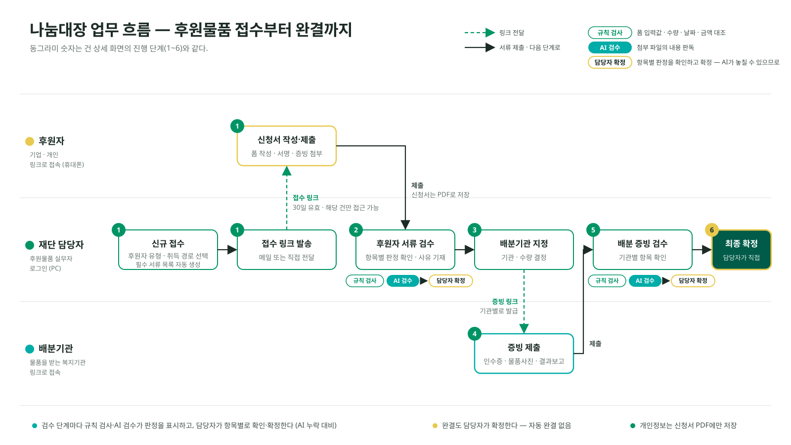
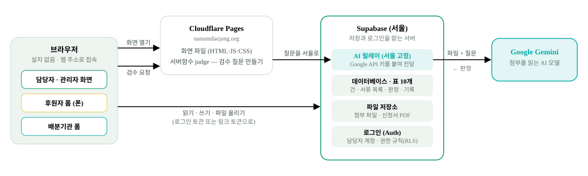

# **나눔대장**

사회복지법인 어린이재단 · AI 챌린지 해 본선

**후원물품 신청 서류를 받고, 검수하고, 기록합니다.** 후원자와 배분기관에게 링크 하나로 서류를 받아 한곳에 모으고, AI가 내용을 먼저 검수하며, 누가 어떤 서류를 언제 제출했는지 기록이 남는 **후원물품 서류 관리 플랫폼**입니다.

## **1. 팀 기본 정보**

### **1.1 기관 정보**

사회복지법인 어린이재단(이하 초록우산)은 1948년부터 어린이들의 행복한 성장을 위해 "언제나 어린이 곁에서" 함께하는 아동복지전문기관입니다. 전국 17개 지역본부와 7개 복지관, 6개 가정위탁지원센터, 4개 아동보호전문기관 등 촘촘한 네트워크로 국내 아동복지를 선도하며, 국내외에서 어린이의 행복한 성장을 위해 아동의 권리가 보호, 존중, 실현되는 세상을 만들어가기 위한 노력을 하고 있습니다. 또한 투명한 후원금 관리와 효율적인 사업 운영을 인정받아 한국가이드스타 공익법인 종합평가에서 2016년부터 2025년까지 10년 연속 별점 만점을 받았으며, 늘 새로운 문제를 선도적으로 발견하고 해결해 나가는 도전정신으로 아동복지 현장의 실질적 변화를 만들어 가고자 합니다.

### **1.2 팀 구성원 정보**

| 구분 | 이름 | 소속·직책 | AI 챌린지 해에서의 담당 역할 |
|---|---|---|---|
| 팀장 | 김선미 | 전략기획실 대리 | **전체 개발과정 PM** — AI 검수 기준 설계와 실제 서류로 검증 · 담당자·후원자 화면(프론트) · 개인정보 보관·전송 범위 결정 · 동료 사용 테스트 결과 취합·반영 · README 초안 작성 |
| 팀원 | 최유진 | 전략기획실 과장 | **AI 검수 실제 연결** — 금액 대조 AI 판정 실동작 확인 · AI 판정을 서버에서 수행하도록 이전(API 키 노출 차단) · 화면–서버 연동 규격 정의 · 판정 결과 저장 및 복원 설계 · 데이터 추출 방식 설계 · 서류 저장 및 다운로드 기능 구현 · 정확도 측정 |
| 팀원 | 김연수 | 전략기획실 과장 | **화면과 운영** — 파일 단위가 아닌 접수 건 단위 AI 검수 설계 · 다기관 배분 설계 보완 · 관리자 화면(계정·권한·통계·검수 기준자료) · 모바일 대응 테스트 · 관리자용 가이드 제작 |
| 팀원 | 홍승희 | 전략기획실 대리 | **데이터와 권한** — 데이터베이스 스키마 설계 · 담당자 로그인 설계 및 구현 · 계정 생성 · 접근 권한 적용(후원자·배분기관 본인 건 외 조회 차단) · 데모 영상 제작 · 이용자용 가이드 작성 · 라이선스 정리 |

## **2. AI 솔루션**

### **2.1 문제 정의**

#### **어떤 문제인가**

후원물품을 접수할 때 후원자에게 받아야 할 서류는 다양합니다. 후원자가 개인인지 법인인지, 물품을 구매해서 준 것인지 직접 제조한 것인지 등에 따라 필요한 서류가 달라지기도 하며, 배분이 이루어지면 배분기관으로부터도 인수증 및 결과보고서를 받아야 합니다.

문제는 매번 달라지는 서류 목록과 검수 기준을 담당자가 복잡한 지침을 통해 확인해야 하며, 다양한 경로로 안내하고 수취하여 검수해야 한다는 것입니다. 기존에 사용하는 시스템은 배분이 완전히 이루어지기 전까지 담당자가 서류를 관리하고 보관해야 하기 때문에, 이러한 과정에서 필요한 서류들이 누락되거나 오류가 발생하는 사례가 많습니다. 실제로 2026년 5월 기준 재단에 접수된 물품후원 **1,400건 중 40%가** 최종 검수 과정에서 신청서류 미비, 가액산정 오류, 서류와 수량 불일치 등이 발생하였고, 이를 수정하는 데에도 많은 시간이 소요되며 때에 따라 후원자가 서류를 다시 제출해야 하는 번거로움도 발생하고 있습니다.

#### **누가 겪는 문제인가**

현장에서 후원물품이 접수될 때마다 매번 어려운 지침을 보며 판단하고 서류를 누락 없이 챙겨야 하는 **후원물품 담당 실무자**, 오류 검수와 수정을 위해 많은 에너지를 쏟아야 하는 **후원물품 총 책임자**가 이 문제를 주로 겪는 이용자입니다. 대회를 준비하는 과정에서 재단 내 직원 익명 게시판에 후원물품 서류 취합만이라도 효율화해 달라는 안건이 올라올 정도로, 이 부분에 대한 현장의 욕구는 확실합니다.

#### **기존에는 어떻게 해결해 왔고, 무엇이 부족했나**

업무 매뉴얼이 있고 실무자가 헷갈려하는 부분에 대한 FAQ도 정리되어 안내되었지만, 복잡한 매뉴얼을 모두 숙지하지 못하는 경우가 많습니다. 업무 자동화 프로그램(RPA)을 통해 서류를 일정한 기준별로 검수하는 것도 검토했으나, 수기로 작성된 신청서류나 서명이 포함된 스캔본은 글자 인식 정확도가 낮고 오류 유형이 다양해 표준화하기 어려웠습니다.

#### **왜 중요한가**

우리가 해결하려는 사회문제는 결국 현장에 맞닿아 있고, 행정처리를 최대한 효율화하여 더 많은 대상자를 만나고 사례를 발굴하는 것이 중요합니다. **나눔대장이 해결하려는 문제는, 단순히 후원물품 관련 서류를 효율적으로 취합·검수·관리하는 것만이 아닙니다. 궁극적으로 이렇게 아낀 시간들을 현장에서 아이들을 더 만나고 사례를 발굴하여 적시에 지원하는 데 쓰이도록 하는 것이 목적입니다.**

### **2.2 AI 솔루션 소개**

#### **솔루션 개요**

나눔대장은 후원물품 접수 및 배분 과정에서 **서류를 받고 → 검수하고 → 기록하는** 일을 하나의 플랫폼에서 하도록 합니다.

- **받는다** — 담당자가 후원 유형(법인 / 법인 외 × 구매 / 제조·유통)을 지정하면 업무지침에 따른 필수서류 목록이 생성되고 접수 링크가 발급됩니다. 후원자와 배분기관은 각자의 링크로 서류를 제출하며, 서류는 **한곳에** 모입니다.

  → 담당자가 지침을 일일이 확인해 서류 목록과 양식을 정리하고, **여러 경로로 나눠 받지 않아도 됩니다.**

- **검수한다** — 담당자가 **AI 검수를 실행**하면 항목별 수취 여부와 오류가 근거와 함께 표시됩니다. **최종 확정은 AI가 아닌 사람이 합니다.**

  → 총괄 담당자가 최종 검수에서야 발견하던 서류 미비·가액 오류를, **각 담당자가 접수 단계에서 발견하고 고칠 수 있습니다.**

- **기록한다** — 누가 무엇을 언제 냈는지, 지금 어느 단계인지, AI가 무엇을 판정했는지가 모두 남습니다.

  → 담당자가 바뀌어도 **서류가 사라지거나 이력을 확인할 수 없는 일이 없고**, 투명한 회계처리와 감사 대응이 가능합니다.

#### **솔루션 사용 링크**

| 구분 | 링크 또는 안내 |
|---|---|
| 솔루션 실행 링크 | https://nanumdaejang.org |
| 소스코드 또는 결과물 원본 | https://github.com/aihae2026/aihae_final14 (이 저장소) 솔루션 코드는 [`app/`](app/), 서버 함수는 [`supabase/`](supabase/), 문서는 [`docs/`](docs/) 폴더에 있습니다. |
| 데모 영상(선택) | [나눔대장 시연영상 (mp4 · 22MB)](docs/나눔대장_시연영상.mp4) ※ 용량이 커서 GitHub 화면에서 바로 재생되지 않습니다. 파일을 연 뒤 **View raw** 또는 내려받기 버튼(⤓)으로 보실 수 있습니다. |
| 테스트 계정(선택) | 심사 기간에만 운영한 계정으로, 심사 종료 후 로그인 계정 자체를 삭제해 더는 로그인할 수 없습니다(관리자 권한도 회수). 화면 구성과 흐름은 [시연 영상](docs/나눔대장_시연영상.mp4)과 [이용자 가이드](docs/나눔대장_이용자가이드.md)에서 보실 수 있습니다. |

#### **설치 및 실행 방법**

별도 설치 없이 브라우저(권장: 크롬)에서 동작합니다. 대회 심사용 계정은 심사 종료 후 로그인 계정 자체를 삭제해 더는 로그인할 수 없습니다(관리자 권한도 회수). 직접 운영해 보려면 본인 Supabase 프로젝트를 만든 뒤 [`app/README.md`](app/README.md)의 「새 환경에 세울 때」 절차를 따르세요.

> ⚠️ **운영 전 주의 — AI 검수는 로그인 없이 호출할 수 있는 구조입니다.** AI 검수 주소(`/judge`)는 로그인을 확인하지 않고, 서울 릴레이(`gemini-relay`)도 공개 키만 확인합니다. 이 공개 키는 `/config.js`로 모든 방문자에게 내려가므로, 외부인이 기관의 Gemini 키로 요금을 늘리거나 호출 한도를 바닥내 검수를 멈추게 할 수 있습니다(개인정보가 바로 새는 경로는 아닙니다). 그래서 **Google 쪽 예산 알림·사용량 상한과 Cloudflare의 `/judge` 요청 횟수 제한을 반드시 걸어 두어야 합니다.** 점검용 함수 `where-am-i`는 운영에 배포하지 마세요. 자세한 내용은 [관리자 가이드 6.1](docs/나눔대장_관리자가이드.md#61-운영-비용)을 참고하세요.

#### **주요 기능**

| # | 기능 | 현재 문제 | 그래서 구현한 핵심 기능 |
|---|---|---|---|
| 1 | **유형별 체크리스트 자동 전개** | 복잡한 지침을 통해 담당자가 매번 필요한 서류 목록을 확인하고 양식을 준비해야 합니다 | 기부자 유형 × 취득경로에 따라 필요한 서류 목록이 자동으로 안내됩니다 |
| 2 | **접수 링크 발송** | 서면·유선·메일 등 다양한 경로로 접수되고 담당자 개인이 보관하여 서류가 흩어지고 누락이 발생합니다 | 담당자가 유형을 지정해 링크를 발급하고, 후원자는 해당 링크를 통해 서류를 접수합니다(화면에서 본인확인 4자리 · 제출 후 화면 닫힘 · 30일 만료 — 링크 주소 관리 주의는 [그 밖의 보안](#보안-주의-링크) 참고) |
| 3 | **물품기부신청서 전자 작성·서명** | 수기 서명을 포함한 신청서 스캔본은 인식률이 낮고 데이터화하기 어렵습니다 | 기존 양식을 전자화하여, 브라우저에서 전자서명이 포함된 신청서 PDF가 생성됩니다 |
| 4 | **AI 서류 검수** | 접수 건마다 다양한 기준에 따라 서류를 대조하고 검수하는 데 오랜 시간이 걸립니다 | 정해진 8가지 규칙에 따라 서류를 검수합니다(아래 검수 기준 표) |
| 5 | **완결 처리** | 서류 취합 및 검수 과정에서 누락 및 오류가 발생하는 건들이 있습니다 | 미수취 서류나 검수가 이뤄지지 않은 항목이 있으면 완결을 막고, 무엇이 남았는지 안내합니다 |
| 6 | **배분기관 증빙 수취** | 배분 이후 배분기관에서 받아야 할 서류들을 여러 경로로 받고 담당자가 보관하기 때문에 서류가 흩어지고 누락이 발생합니다 | 배분기관에 별도 링크를 발급해 인수증·배분 물품 사진을 받습니다(다기관 배분 포함) |
| 7 | **이력·감사** | 서류를 접수하는 경로가 다양하고 담당자별로 처리하기 때문에 감사 대응이 어렵습니다 | 누가 무엇을 언제 받았는지 기록이 남으며, 개인정보가 포함된 PDF 열람도 기록을 남깁니다 |
| 8 | **ZIP 일괄 내려받기** | 기존에 사용하던 시스템과 연계하기 전까지 서류 이관이 필요합니다 | 완결 건의 서류를 한 번에 내려받아 재단 시스템으로 이관할 수 있습니다 |
| 9 | **관리자 화면** | 인수인계 및 업데이트되는 검수 기준을 관리하는 데 어려움이 있습니다 | 사용자별 관리자 계정 권한을 부여하고, 검수 기준 및 통계를 확인할 수 있습니다 |

**AI 검수 기준 8가지**

| 규칙 번호 | 검수 기준 | 세부 내용 | 누가 하나 |
|---|---|---|---|
| E1 | 금액 대조 | 영수증·세금계산서 금액과 신청서 등록 금액이 같은가 | AI 판독 + 규칙 대조 |
| E2 | 일자 순서 | 서류 일자가 기부일보다 앞서는가 · 기부일이 배분일보다 앞서는가 | 규칙 대조 (구매일만 AI 판독) |
| E3 | 가액 산정 방식 | 영리법인이 장부가액 대신 시가로 산정했는가 | 규칙만 |
| E4 | 수량 대조 | 서류 수량과 등록 수량 · 인수증 수량과 그 기관 배분 수량 | AI 판독 + 규칙 대조 |
| E5 | 취득경로 | 낸 서류가 시사하는 취득경로가 신청 경로와 맞는가 | AI 판독 + 규칙 대조 |
| E6 | 증빙서류 적격 | 낼 수 없는 서류를 냈는가(간이영수증·견적서·거래명세표 등) | AI 판별 |
| E7 | 배분 수량 합계 | 기관별 배분 수량의 합이 접수 수량과 맞는가 | 규칙만 |
| E8 | 물품 사진 | 물품사진 자리에 사진이 아닌 것이 왔는가 | AI 판별 |

※ **서류를 읽는 일은 AI가, 숫자를 맞춰보는 일은 정해진 규칙이 합니다.** 규칙이 더 빠르고 정확한 부분까지 AI에 맡기지는 않았습니다. 판정 결과는 이 규칙 번호와 함께 저장되어, 나중에 무엇을 근거로 판정했는지 확인할 수 있습니다.

#### **AI 활용 내용**

| 구분 | 내용 |
|---|---|
| 사용한 AI 도구·모델 | **Google Gemini (gemini-3.5-flash)**: 후원자가 올린 증빙서류(영수증, 세금계산서, 물품사진 등)를 읽고 **정해진 데이터(금액, 날짜, 수량, 서류 종류)를 추출**하여 저장하도록 하고, 화면에서 후원자가 작성한 내용과 대조할 수 있도록 하였습니다. **Claude Code**: 전체 구현 과정에서 바이브 코딩을 통해 코드를 작성하고, 데모 데이터를 생성하며 검사 스크립트를 작성하였습니다. |
| AI가 담당하는 기능 | 첨부된 서류 이미지를 읽어 ① **값 추출**(금액·일자·수량) ② **서류 종류 판별**(적격/비적격) ③ **물품사진 여부 판별**을 수행합니다. 판정 결과는 '이상 없음 / 확인 권장 / 판단 보류' 세 가지 중 하나로, 판정 사유와 근거를 함께 표시합니다. |
| AI를 활용한 이유 | 이 업무의 핵심은 **비정형 서류의 내용 판단**입니다. 파일이 왔는지(수취 여부)는 규칙으로 되지만, "이 영수증이 증빙으로 인정되는가", "적힌 금액·일자·수량이 신청 내용과 맞는가"는 서류마다 양식이 달라 규칙으로 표준화되지 않습니다. 재단이 RPA를 검토했다가 한계에 부딪혔던 것도 이 지점입니다. |
| AI가 없었다면 어려웠던 부분 | **오류 유형의 다양성**입니다. 재단 물품후원 접수건 총괄 검수에서 오류 형태가 29개 항목으로 매우 다양해 규칙 기반으로 커버하는 데 한계가 있었고, 서류가 **손글씨·사진·PDF·캡처로 섞여** 들어와 글자 인식(OCR) 정확도가 낮았습니다. 이 부분은 AI가 필요한 영역으로 두고, 모든 부분에 AI를 활용하기보다 정해진 규칙으로 처리하는 것이 더 신속하고 정확한 부분은 검수 방법을 다르게 하였습니다. |

#### **(선택) AI 성능 개선 시도**

테스트 과정에서 결과물에 많은 영향을 주어 개선했던 사례 두 가지입니다.

**① 프롬프트가 아니라 검수 기준을 고쳤습니다**

1차 검증(AI가 만들어낸 가상 서류 기반) 시에는 미리 설계한 검수기준과 AI 검수 내용에 다른 부분이 없었으나, 2차 검증 시(실제 담당자가 만들어낸 서류 기반)에는 잘못된 부분이 발견되었습니다. 프롬프트의 문제라기 보다, 대표 케이스로 만든 검수기준에 부합하지 않는 다양한 케이스가 발견되고 보다 세부적인 규칙을 지정하는 것이 필요했기 때문에 그 부분을 다시 보완하였습니다.

**② 증빙서류를 파일 하나씩 보는 것이 아니라 접수 건별로 함께 보도록 했습니다**

처음에는 AI가 영수증, 세금계산서 등을 하나씩 읽고 판정하다보니 여러 서류를 종합해서 봐야 하는 수량, 단가 등을 놓치는 일이 발생했습니다. 그래서 접수 건별로 첨부된 모든 서류를 한꺼번에 모아놓고 판정하도록 개선하였고, 검수기준에 맞춘 판정 정확도가 개선되었습니다.

가상 서류와 실제 후원 서류로 **300회 이상** 검수를 돌리며 기준을 다듬었고, AI가 서류에 없는 값을 지어내는 일은 없었습니다. 틀린 경우도 서류 안의 **다른 항목을 잘못 가져온 것**이어서, 어떤 값을 어디에서 읽을지 기준에 명시해 바로잡았습니다.

### **2.3 이용자용 가이드**

이 솔루션에는 이용자가 셋입니다.

① 플랫폼을 업무에 활용하는 **실무자**(후원물품 담당자)

② 실무자가 발송한 링크에 접속해 정보를 입력하고 서류를 업로드하는 **후원자**

③ 배분 물품의 인수증·사진을 제출하는 **배분기관**

세 이용자가 한 건을 어떻게 주고받는지는 **2.2의 업무 흐름도**를 참고해 주세요.

세부 내용은 **[이용자용 가이드](docs/나눔대장_이용자가이드.md)** 를 참고해 주세요. ([인쇄용 PDF로 보기](docs/나눔대장_이용자가이드.pdf))

#### **가. 담당자 (재단 실무자)**

**준비물** — 관리자가 발급한 계정(이메일·비밀번호)이 사전에 필요합니다.

- **로그인** — 관리자로부터 부여받은 계정으로 로그인을 진행합니다.

- **접수 링크 발송** — 후원자 유형(법인/법인 외)과 취득경로(구매/제조·유통)를 고르면 **필요 서류 목록이 펼쳐집니다.** 연락처를 넣으면 본인확인 4자리가 자동으로 채워집니다. 링크를 복사해 전달합니다(메일 보조).

- **제출 확인** — 제출이 들어오면 건 상세에서 서류를 열어봅니다. 진행바 6칸(후원자 서류 수취 → 후원자 서류 검수 → 배분기관 지정 → 배분기관 서류 수취 → 배분기관 서류 검수 → 완결)이 그대로 탭이어서, 칸을 누르면 그 단계 화면으로 바로 갑니다.

- **AI 검수 실행** — 항목별로 '이상 없음/확인 권장/판단 보류'가 근거와 함께 표시됩니다. **AI가 보지 않는 범위가 화면에 함께 표시됩니다.**

- **확정** — 담당자가 **[원본 보고 처리]** 로 원본을 열어 최종 확인한 뒤 수취 처리합니다. 잘못 눌렀으면 완결 전까지 **[수취 취소]** 로 되돌릴 수 있습니다.

- **배분기관 지정** — 배분기관과 수량을 입력한 후, 기관별 증빙 링크를 발송하고 수취를 확인합니다.

- **완결** — 수취나 검증되지 않은 항목이 있으면 완결되지 않습니다. 모두 완료되었다면 완결 처리를 합니다.

- **ZIP 일괄 받기** — 완결된 건의 서류를 일괄 다운로드할 수 있습니다. 기존에 사용하던 재단 시스템으로 이관 시(또는 내부 보관 시) 사용합니다.

> **⚠️ 주의할 점**
>
> - 한 건은 **한 품목**입니다. 여러 품목은 건을 나눠 접수합니다.
> - AI 검수는 서류가 접수되는 즉시 자동으로 진행되지 않습니다. **담당자가 검수를 실행해야** 진행됩니다.

#### **나. 후원자 (물품을 기부하는 개인·법인)**

**준비물** — 담당자에게 받은 링크, 연락처 뒷 4자리, 증빙 서류 파일

- **링크 열기** — 본인확인으로 **연락처 뒷 4자리**를 넣습니다.

- **신청서 작성** — **물품기부신청서**를 화면에서 작성합니다. 기부자 정보 → 물품 정보(품목·수량·단가) 순이며, 기부가액은 **수량 × 단가로 자동 계산**됩니다.

- **동의 확인** — 개인정보 수집·이용 동의, 국외 이전 동의(별도), 처리 위탁 안내를 확인합니다.

- **서명** — **서명란에 직접 사인**합니다. 법인은 서명 대신 **법인 인감이 날인된 신청서 스캔본**을 올립니다.

- **증빙 업로드** — 항목별 칸에 증빙을 올립니다.

- **제출** — 제출하면 **해당 링크로는 신청서 화면이 다시 열리지 않으며, 별도 서면을 제출할 필요는 없습니다.**

> **⚠️ 주의할 점**
>
> - 링크는 **한 번만** 쓸 수 있고 **30일**이 지나면 만료됩니다. 다시 필요하면 담당자에게 재발급을 요청하세요.
> - 링크 주소는 **열쇠와 같습니다.** 단체 대화방 등 여러 사람이 보는 곳에 올리지 마세요.
> - 필수 서류를 올리지 않으면 제출되지 않습니다.
> - 권장 브라우저는 **크롬**입니다. 스마트폰에서도 동작합니다.

#### **다. 배분기관 (물품을 받은 기관)**

- **링크 열기** — 담당자에게 받은 링크를 열고 본인확인 4자리를 넣습니다.

- **인수증 작성** — 화면에 **그 기관 몫의 배분 수량**이 이미 적혀 있습니다. 내용을 작성한 뒤 **배분 물품 사진**을 올립니다.

- **결과보고서** — **선택 항목**입니다.

- **증빙이 없는 건** — 제출할 증빙이 없으면 화면이 "제출할 증빙 없음"이라고 안내합니다.

### **2.4 관리자용 가이드**

저희 플랫폼의 구조와 기술, 개발 과정을 포함한 운영 방법, 인수인계까지 다룬 **[관리자용 가이드](docs/나눔대장_관리자가이드.md)** 를 꼼꼼히 준비했습니다. ([인쇄용 PDF로 보기](docs/나눔대장_관리자가이드.pdf))

#### **가. 어떤 구조로 작동하나**

개인정보가 어느 층에 남는지를 갈라 두는 것이 이 설계의 원칙이며, 보관·전송 범위는 개인정보 보호를 고려해 설계했습니다(세부 내용은 4.5).

#### **나. 사용한 기술과 외부 서비스**

| 층 | 무엇 | 그래서 무엇이 좋은가 |
|---|---|---|
| 프런트엔드 | HTML · CSS · JavaScript | 화면을 만드는 데 변환 과정이 없어 다른 기관이 오픈소스를 활용할 때 어렵지 않습니다 |
| 호스팅·배포 | Cloudflare Pages | 코드를 고치면 약 30초 뒤 서비스에 반영됩니다 |
| 서버 함수 | Cloudflare Pages Functions | 따로 설치해야 하는 외부 프로그램이 없어, 서비스에 올릴 때 누락되어 오류가 발생할 일이 없습니다 |
| DB·인증·저장소 | Supabase (PostgreSQL 17 · 서울 ap-northeast-2) | 데이터가 국내에 있고, 접근 권한을 3단계로 나눠 후원자는 본인 건만 볼 수 있습니다 (4.5 참조) |
| AI 중계 서버 | Supabase Edge Function | 구글로 나가는 마지막 구간이 서울에서 출발하도록 지역을 고정했습니다. 그 앞의 Cloudflare 함수 구간은 실행 지역을 정할 수 없어 국외(팀 실측: 홍콩·도쿄)를 지날 수 있습니다 |
| AI 모델 | Google Gemini (gemini-3.5-flash) | 답변 형식을 미리 정해두어, AI가 정해진 형태로만 답하게 했습니다 |
| PDF 생성 | pdf-lib 1.17.1 · @pdf-lib/fontkit 1.1.1 | 외부에서 내려받지 않고 파일로 함께 넣어두어, 제출하는 순간 외부가 막혀도 신청서가 만들어집니다 |
| 폰트 | NDJ Sans (나눔고딕 3.021 서브셋 · OFL 1.1) | 신청서 PDF에서 한글이 깨지지 않습니다 (한글 11,172자 + ㈜ ① ㎏ ₩ ※) |

## **3. 임팩트 계획서**

4주의 개발 기간 내에 실질적인 업무 절감 효과를 실측하기는 어렵습니다. 정량적 효과 검증에는 충분한 사용자 규모와 최소 수 주의 사용 기간이 필요하기 때문입니다. 이에 이번 임팩트 계획서는 '문제가 얼마나 줄었는가'보다 **'현장에 실제로 필요한가, 도입 시 무엇이 달라지는가'를** 중심으로 효과를 기재하였습니다.

도입 시 가장 분명하게 달라지는 부분은 오류를 발견하는 시점입니다.

앞서 언급한 40%는 최종 검수 단계에서 확인된 오류입니다. 업무지침상 최종 검수는 익월 초에 진행되므로, 이 시점에는 이미 기부금영수증이 발급된 상태입니다. 따라서 오류를 수정하려면 승인 취소와 기부금영수증 무효화, 재발급 절차를 거쳐야 하며, 후원자에게 서류 재제출을 요청해야 하는 경우도 발생합니다.

나눔대장에서는 동일한 오류가 접수 당일 담당자 화면에서 확인됩니다. 기부금영수증 발급 이전이므로 별도의 취소·재발급 절차 없이 수정할 수 있습니다. **오류 발생 건수 자체보다, 오류 한 건을 처리하는 데 따르는 절차와 부담이 줄어드는 것입니다.**

이렇게 확보되는 시간이 행정 업무가 아니라 현장에서 아이들을 더 만나고 사례를 발굴하는 데 쓰이도록 하는 것이 저희가 바라는 변화입니다.

### **3.1 현장 적용 결과**

#### **가. 어디에, 어떻게 적용했는가**

실제 운영 서비스 환경에서 신규 후원물품 서비스 접수부터 완결 후 서류 다운로드까지 전 과정을 검증한 뒤, 11명의 재단 실무자를 대상으로 테스트를 진행하였습니다. 테스트 대상은 후원물품 접수 담당자, 간접 경험자, 비경험자로 고르게 구성했으며, 전 단계를 끝까지 사용해보도록 설계했습니다. 다만 정식 오픈 전 단계인 만큼, 실제 후원자와 배분기관은 테스트 대상에서 제외했습니다.

#### **나. 11명의 피드백 – 단순한 소감이 아닌, 개선의 근거와 고도화의 출발점**

| 문항 | 평균 | 분포 |
|---|---|---|
| 실제 업무에 도움이 될 것 같나 | **3.9** / 5 | 5점 2 · 4점 6 · 3점 3 |
| AI 검수 결과가 이해되던가 | **4.1** / 5 | 5점 2 · 4점 8 · 3점 1 |
| 한 건을 끝까지 처리하는 게 쉬웠나 | **3.2** / 5 | 4점 4 · 3점 5 · 2점 2 |
| 기존 방식(유선·메일·서면) 대비 |  | 훨씬 낫다 5 · 조금 낫다 3 · 비슷하다 1 · 지금 방식을 몰라 못 고르겠다 2 |

테스트 결과는 정량 점수와 정성 의견을 함께 분석해 성과와 개선 과제로 정리했습니다.

11명 중 8명이 '실제 업무에 도움이 될 것 같다'에 4점 이상을 주었고, AI 검수 결과의 이해도는 평균 4.1점이었습니다. 플랫폼의 방향성과 필요성에는 공감대가 형성되었습니다.

> "저희 부서에서 수기 접수 업무의 애로사항을 개선하기 위해 서류 전자화를 고민하는 중인데, 이런 시스템이 전사 차원에서 활용되면 좋을 것 같습니다. 테스트해볼수록 정말 좋은 시스템 같네요." — 후원물품 총괄 관리자

> "모금 담당자와 후원자가 동시에 필요한 서류를 확인하고 준비할 수 있다는 점이 가장 큰 장점입니다. 기존에는 서류를 개별적으로 주고받고 확인해야 했다면, 나눔대장을 통해 한 곳에서 관리할 수 있어 업무 효율성을 높일 수 있을 것 같습니다." — 모금 담당자

> "담당자도 자주 바뀌고 업무를 받으면 시스템 숙지하기 바쁜데, 정말 직관적이어서 업무하는 데 큰 도움이 될 것 같습니다." — 복지 담당자

> "물품기부신청서 때문에 후원자와의 대면 만남이 필수인데, 상황에 따라 어려움을 호소하는 후원자가 많았음. 온라인 개별 신청으로 대체할 수 있어 편리했음." — 모금 담당자

반면 '한 건을 끝까지 처리하는 게 쉬웠나'는 3.2점으로 가장 낮았습니다.

> "수정이 필요할 때 어떤 버튼을 눌러야 하는지 처음에는 찾기가 어려웠습니다." — 모금 담당자

> "내부 업무 효율화를 위한 플랫폼이긴 하지만 결국은 사용하는 후원자가 편해야 실무자도 지속적으로 사용할 수 있는 플랫폼이 될 것 같아요. 후원자가 조금 더 쉽게 이해하고 번거롭지 않도록 하는게 중요할 것 같습니다." — 모금 담당자

> "현재 재단 시스템이 품목별로 접수 건을 관리하고 있긴 하지만, 한 후원자가 여러 품목을 동시에 기부할 경우에 여러 번 링크를 작성하지 않도록 보완이 필요할 것 같습니다." — 모금 담당자

이러한 피드백을 기반으로 사용자 편의성 개선을 진행하였으며, 일부는 향후 고도화 과제로 남겼습니다.

#### **다. 가장 큰 변화: 현업 기반 AI 전환(AX) 실행에 대한 자신감**

가장 큰 변화는 저희 스스로가 자신감을 얻었다는 점입니다. AI가 만능은 아니지만, 현장의 문제를 가장 잘 아는 현업이 직접 기획하고 AI를 활용하면 근본적인 문제 해결에 더 빠르고 정확하게 다가갈 수 있다는 것을 경험했습니다.

네 차례의 코칭에서 코치님께 가장 많이 들은 질문은 "이 플랫폼으로 무엇을 바라나요?", "이 플랫폼이 꼭 필요한가요?", "이 과정을 통해 여러분이 똑똑해졌나요?"였습니다. 저희가 바라는 바는 분명했고, 실무자 테스트를 거치며 이 플랫폼이 꼭 필요하다는 확신도 얻었습니다.

무엇보다 개발을 몰라서, 시간과 비용이 많이 들어서 미뤄두기만 했던 문제를 저희 손으로 직접 풀기 시작했다는 것. 그것이 저희에게 가장 중요한 경험이자 새로운 출발점입니다.

### **3.2 시행착오와 개선**

#### **가. UI/UX 집중 개선: 복잡한 프로세스를 쉽게**

테스트 참여자 피드백에서 확인했듯, 플랫폼을 처음 쓰거나 업무 프로세스를 모르는 사용자에게는 화면이 복잡하게 느껴질 수 있었습니다. 단계마다 무엇을 눌러야 하는지, AI 검수 결과를 어디서 확인하는지 한눈에 파악하기 어렵다는 의견이 대표적이었습니다.

이는 후원물품 서류 수취·검수 프로세스 자체가 복잡하다는 방증이기도 합니다. 그럼에도 피드백을 적극 수용해 다음과 같이 개선했습니다.

- 화면을 실제 업무 흐름 순서대로 재배치
- 섹션 구분 및 툴팁 추가
- 후원자 신청서 문구를 공식 문서의 형식은 유지하면서 이해하기 쉽게 정비
- 이용자 가이드에 업무 프로세스와 플랫폼 구조를 시각화해 수록

#### **나. 남은 한계와 향후 과제**

플랫폼이 지속적으로 활용되려면 재단 실무자뿐 아니라 후원자의 편의성도 함께 확보해야 합니다. 아래 두 가지는 그 관점에서 남은 과제입니다.

- **다품목 접수**: 기존 방식대로 품목별 접수 구조여서, 여러 품목을 기부하는 후원자는 신청서를 반복 작성해야 합니다. 일괄 접수가 가능하도록 로직을 재설계할 계획입니다.

- **오프라인 서류 처리**: 링크 이용이 어려운 후원자(고령자 등)의 서류는 담당자가 직접 받아야 하며, 이를 플랫폼에서 검수하는 기능은 기간 내 구현하지 못했습니다. 향후 추가 개발할 예정입니다.

그 밖의 사용 한계(문자 발송 미구현, 파일 자체 암호화 없음 등)는 [사용 조건·한계](#사용-조건-한계)에 한곳으로 모아 두었습니다.

### **3.3 향후 계획 및 임팩트 확산**

#### **가. 재단 내 Next Step**

- **기존 방식과 병행 운영하며 고도화 추진**

  서비스 오픈 직후 모든 후원 접수를 플랫폼으로 전환하기는 어렵습니다. 따라서 올해 남은 기간에는 기존 방식(서면·이메일 접수 및 수기 처리)과 병행 운영하면서, 다품목 접수와 고령 후원자 대응 등 고도화 과제를 개발할 계획입니다.

- **재단 내 AX 확산의 첫 사례로 활용**

  이번 경험을 재단의 다른 업무로도 넓히고자 합니다. 저희 부서가 내년에 추진하는 'AI 인큐베이팅'에서 나눔대장을 첫 사례로 삼아, 현업 부서가 자신의 문제를 직접 해결하는 과정을 만들어갈 계획입니다.

#### **나. 재단 밖으로의 확산**

- **소규모 기관까지 닿는 개방형 확산**

  저희가 풀고자 한 문제는 재단만의 문제가 아닙니다. 재단보다 규모와 인력이 작은 기관은 별도 시스템 없이 이 업무를 더 많이 수기로 처리하고 있을 가능성이 높습니다. 나눔대장은 오픈 라이선스로 공개되므로, 각 기관이 일부만 수정해 현장에 바로 적용할 수 있습니다. 다만 소규모 기관일수록 이런 도구의 존재 자체를 모르는 경우가 많습니다. 이에 비영리 IT 지원 조직과 모금 실무자 네트워크 등을 통해 플랫폼을 알리고, 필요한 현장에서 활용할 수 있도록 할 계획입니다.

- **어려운 증빙·검수 기준의 공유**

  후원물품 업무에서 가장 정리하기 어려운 부분은 증빙 요건과 검수 기준입니다. 이는 세법 등 관련 법령과 지침에 근거하므로 기관마다 크게 다르지 않습니다. 기준 정리가 되어 있지 않은 기관도 저희가 정리한 서류 기준, 검수 규칙, 신청서 양식을 참고해 기관 사정에 맞게 활용할 수 있습니다.

## **4. 제출 전 최종 점검**

### **4.1 외부 지원 범위**

| 참여자 | 직접 수행하거나 지원한 내용 |
|---|---|
| 팀 | **기획·설계·구현·검증 전부.** 문제 정의, 검수 규칙 설계와 실서류 검증, 화면·데이터·권한 설계, AI 코딩 도구를 이용한 코드 작성(바이브코딩), 개인정보 정책 및 보안 설계 결정, 동료 사용 테스트 설계·취합·분석, 운영·인수인계 문서 작성 등 팀원 4인이 함께 수행했습니다. |
| 코치 | 주 1회 코칭을 통해 **플랫폼의 방향성과 필요성**에 대한 조언은 물론, **GitHub 기반 공동 개발 방법**, **프론트엔드·서버·데이터베이스 단위의 설계 및 개발 방법**, **UI/UX 개선** 등 기술적 조언까지 실질적인 도움을 받았습니다. |
| 외부 전문가·개발자 | 없음. |
| 기타 | **재단 내 실무자**: 예선과 본선 과정에서 문제 및 사용자 정의, 개발 이후 테스트 참여 및 피드백 제공 등을 통해 플랫폼이 문제에 근본적으로 닿을 수 있고 사용자를 고려한 설계 및 개발이 진행되도록 도움을 주었습니다. **교육과정**: 네이버 커넥트재단에서 제공한 예선 3주 피드백 챌린지를 통한 문제 정의 및 해결, AI 정보보안 및 가이드라인, 바이브코딩 등의 강의가 개발 과정에 많은 도움이 되었습니다. |

### **4.2 외부 자료 및 오픈소스 사용 내역**

| 자료·프로그램명 | 사용 목적 | 출처 | 라이선스 |
|---|---|---|---|
| pdf-lib 1.17.1 | 브라우저에서 신청서·인수증 PDF 생성 | cdnjs (파일로 동봉 · app/assets/vendor/) | MIT |
| @pdf-lib/fontkit 1.1.1 | PDF 한글 폰트 임베드 | jsDelivr (파일로 동봉) | MIT |
| NDJ Sans (나눔고딕 3.021 서브셋) | 신청서 PDF 한글 표시 | 네이버 공식 배포본에서 서브셋 제작 · app/assets/fonts/OFL.txt | SIL Open Font License 1.1 |
| jsdom 29.1.1 | 자동 검사에서 화면 동작 확인 (**개발·검사 전용, 배포물 미포함**) | npm | MIT |
| Supabase | DB(PostgreSQL)·인증·파일 저장소·Edge Function | supabase.com | Apache-2.0 (서비스 이용) |
| Cloudflare Pages / Pages Functions | 정적 호스팅·서버 함수 | cloudflare.com | 서비스 이용 |
| Google Gemini API (gemini-3.5-flash) | 서류 판독(값 추출·서류 종류 판별) | ai.google.dev | 서비스 이용약관 |
| Claude Code | 코드 작성·데모 데이터 생성 | anthropic.com | 서비스 이용약관 |

함께 넣은 라이브러리·글꼴의 저작권자와 라이선스 원문 위치는 저장소 루트의 `NOTICE` 에 모아 두었습니다.

이 밖에 **재단 내부자료**(나눔사업 업무지침, 후원물품 모니터링 상세 기준, 물품기부신청서·인수증 서식)를 검수 기준과 서식 설계의 근거로 활용했습니다. 내부자료 파일 자체와 **지침의 조항 번호·쪽수·원문은 저장소에 싣지 않았습니다.** 다만 지침에서 도출한 **서류 요건(어떤 서류가 필요한지 등)과 신청서·인수증 서식의 항목 구성은 코드에 반영되어 있습니다.** 코드·화면의 근거 표기는 "기관 업무지침"으로만 적었습니다.

### **4.3 공개 전 정리 내역**

이 저장소는 처음에 대회 제출용으로 만들었고, 누구나 볼 수 있게 공개하기 전에 아래를 정리했습니다. 이 저장소를 가져다 쓰는 기관도 같은 기준으로 자기 저장소를 점검하면 됩니다.

| 정리한 것 | 한 일 |
|---|---|
| 심사용 계정 | 문서에 적혀 있던 심사용 계정의 주소·비밀번호를 지우고, 예시 주소(`admin@example.org`)로 바꿨습니다. 계정 처리 방식은 위 2.2 「솔루션 사용 링크」 참고 |
| 운영 식별값 | 운영 중인 Supabase·Google 프로젝트 식별값과 개발용 배포 주소를 `<your-project-ref>` 같은 자리표시자로 바꿨습니다(자기 값으로 바꿔 넣는 방법은 [다른 기관이 바꿔야 하는 값](#다른-기관이-바꿔야-하는-값) 표 참고) |
| 발표자료 | 재단 서식과 실명이 들어 있던 발표자료 파일을 저장소에서 지웠습니다 |
| 동료 테스트 참여자 | 테스트 참여자 실명과 직급은 「테스트 참여자」로 바꿔 비식별 처리했습니다. 개발팀 구성원 이름(1.2 표, 코드 주석)은 본인 공개 동의를 받아 기록했습니다 |
| 기관 내부 지침 | 내부자료 파일과 지침의 조항 번호·쪽수·원문은 싣지 않았고, 코드·화면의 근거 표기는 「기관 업무지침」으로 일반화했습니다(4.2 참고) |
| 라이선스 | 코드·문서·로고·제3자 구성요소별 적용 범위를 [라이선스 범위](#라이선스-범위)에, 함께 넣은 라이브러리·글꼴의 저작권 고지를 저장소 루트의 `NOTICE` 에 정리했습니다 |

### **4.4 비밀값과 원본 데이터**

API 키·비밀번호·인증 토큰과 개인정보가 담긴 원본 서류는 저장소에 올리지 않습니다. 키가 담기는 로컬 전용 파일은 `.gitignore` 로 제외했습니다.

### **4.5 개인정보·AI 윤리 항목**

#### **1) 어떤 개인정보를 모으고, 어디에 쓰고, 어디로 보내는지 설명해 주세요.**

| 구분 | 내용 |
|---|---|
| **수집** | **개인 후원자**: 성명(필수), 연락처·주소(선택), 주민등록번호(기부금영수증 희망 시), 서명, 만 14세 미만은 법정대리인 정보 **재단 담당자**: 성명·이메일(계정). 감사 기록 표에 접속 기록(IP·User-Agent) 칸이 있지만 **채우는 코드가 없어 현재는 수집하지 않습니다** ※ 법인 상호·법인 사업자등록번호·사업장 주소는 개인정보가 아닌 것으로 확인 |
| **활용** | 물품기부 접수·서류 검수, 배분 안내, 기부금영수증 발급 |
| **보관** | **DB 컬럼** — **후원자 개인정보는 DB에 저장하지 않습니다.** 신청서 내용 중 DB에 남는 것은 품목·수량·단위·단가·장부가액·공정가액·후원일자·취득경로·영수증 뿐이고, 신청서 폼 기반으로 만들어진 PDF 파일은 별도 보관합니다(DB상에는 PDF를 가리키는 키만 적재). 또한 후원자 및 배분기관 접근 링크 토큰과 본인확인 4자리는 **해시만** 저장하고 원문은 저장하지 않습니다. 수신 연락처는 링크가 사용되는 즉시 지웁니다. 담당자 계정(성명·이메일)과 첨부파일 원본 파일명은 DB에 남으며, **파기 대상에 포함**했습니다.  **파일 저장소(Supabase Storage · 서울)** — 신청서 PDF와 증빙 파일을 보관합니다. 파일 경로에는 원본 파일명을 쓰지 않고 UUID로 바꿉니다. 저장 시 암호화와 전송 구간 암호화는 Supabase가 기본으로 제공하는 것에 의존하며, **파일 자체를 재단이 직접 암호화하는 단계는 아직 없습니다.** 정식 도입 시에는 재단 내부 보안 규정(주민등록번호 AES256 이상)에 따라 이 단계를 추가해야 하며, 조금 더 기술적인 보완이 필요한 부분이라 과제로 두었습니다.  **브라우저(후원자의 기기)** — 신청서 PDF는 **후원자의 휴대폰 및 PC 안에서 만들어져 파일 저장소로 바로 올라가며**, 개인정보(이름, 주민등록번호, 서명)는 다른 서버나 복사본이 남지 않아 샐 수 있는 경로가 최소화됩니다. |
| **전송** | **AI(Google Gemini)** — **담당자가 AI 검수를 실행할 때**, 신청서를 뺀 **첨부 서류 전부의 이미지**(구매 증빙·시가 증빙·원가명세서·물품사진·배분 물품 사진·배분 결과보고서)와 대조용 숫자를 전송하며, 신청서(전자서명본·법인인감 스캔본 모두)는 **전송하지 않습니다.** 이미지는 **가리지 않고 그대로** 보내므로 서류에 적힌 이름·연락처, 사진 속 얼굴도 함께 갑니다(아동 얼굴이 담긴 배분 사진은 검수 실행 전에 담당자가 걸러 내도록 [관리자 가이드](docs/나눔대장_관리자가이드.md)에 안내). 구글로 나가는 요청은 **마지막 구간만 서울에 고정된 중계 서버에서 출발**하며, 그 앞의 Cloudflare 함수 구간은 국외(팀 실측: 홍콩·도쿄)를 지날 수 있습니다. 또 **구글이 그 요청을 어느 나라에서 처리하는지는 지정할 수 없어** 국외 이전에 해당한다고 보고 후원자에게 **별도 동의**를 받고 있습니다. 증빙 서류 안에 담당자 성명·이메일 등이 들어 있으면 함께 전송된다는 사실을 동의·고지 문구와 배분기관 제출 화면에 명시했습니다. |

#### **2) 동의를 받았는지, 또는 동의 없이 써도 되는 근거가 무엇인지 설명해 주세요.**

- 신청서 제출 시 ① 수집·이용 동의(필수) ② 국외 이전 동의(별도) ③ 처리 위탁 안내를 받으며, **동의하지 않으면 제출되지 않습니다.** 거부도 가능하며, 거부 시 재단 담당자를 통해 **서면 신청서로 접수할 수 있도록 대체 경로**를 안내하였습니다.

- **법인은 개인정보주체가 아니므로 동의 대신 '확인'을 받고,** 담당자 정보가 포함될 수 있다는 점을 안내합니다.

- **보유 기간은 신청일로부터 5년**입니다(소득세법상 세액공제 혜택 시 개인정보 보유 기간이며, 재단 개인정보처리방침도 동일). 플랫폼 내 파기는 기부일 이후 1년이며, 이후에는 이관된 서류가 재단 시스템에 보관됩니다.

실제 신청서 화면에 표시되는 **[동의·고지 문구 전문](docs/동의문구.md)** 을 함께 실었습니다. ⚠️ 국외 이전 문구는 실제 동작에 맞춰 고쳤지만, **이전받는 자의 연락처·보유 기간 등 최종 문구는 법률 검토 후 확정 예정**입니다(화면·PDF 에는 이 표시를 넣지 않았습니다).

#### **3) 개인정보 처리 방식과 AI 사용 사실을 이용자에게 어떻게 알리는지 설명해 주세요.**

제출 화면에서 수집 항목·목적·보유 기간·**AI 위탁**·**국외 이전**·거부권을 안내합니다. 법인에는 신청서가 AI로 전송되지 **않는다**는 점도 명시합니다.

#### **4) AI가 틀리거나 부적절한 답을 했을 때, 사람이 확인하고 고칠 수 있는 절차가 있는지 설명해 주세요.**

- **최종 확정은 담당자가 합니다.** AI 판정과 다르게 확정할 때는 사유를 남깁니다.

- 사전 기준에 없는 사례는 AI가 **'판단 보류'로 담당자에게 넘깁니다.**

- 완결 전까지 **수취 취소가 가능**하며, 사유까지 기록으로 남깁니다.

- **모든 AI 판정을 저장**하여 향후 확인할 수 있도록 합니다(규칙 번호·판정값·사유·추출값·모델명).

- 관리자 화면에서 **검수 기준과 근거 조항**을 바로 확인할 수 있습니다.

#### **5) AI 사용으로 이용자가 실제로 피해를 볼 수 있는 상황을 어떻게 막고 있는지 설명해 주세요.**

| 피해 시나리오 | 방어 |
|---|---|
| ① AI가 잘못 통과시켜 서류가 누락된 채 종결된다 → 감사 지적, 기부금 공제 문제 | AI는 판정만 하고 **확정은 담당자가 합니다.** 미해소 항목이 하나라도 있으면 시스템이 완결 처리를 막고, AI가 보지 않는 항목은 화면에 따로 표시해 "AI가 봤으니 됐다"는 오해를 막습니다. |
| ② AI가 잘못 지적해 후원자에게 불필요한 재제출을 요구한다 | 실제 서류로 시험하며 잘못 지적한 사례를 모두 규칙으로 고쳤습니다. 애매한 경우는 오류로 단정하지 않고 **'판단 보류'로 담당자에게 넘깁니다.** |
| ③ 개인정보가 AI로 새어 나간다 | 신청서와 법인인감은 **화면과 서버 두 곳에서 막아 AI로 전송되지 않습니다.** 구글 접속 열쇠(API 키)는 서버 안에만 두어 밖으로 나가지 않으며, 무엇이 전송되고 안 되는지 동의문에 밝혔습니다. |

**그 밖의 보안·데이터 보호**

- **학습 데이터 미사용** — Gemini 유료 등급을 사용해, 약관상 전송 데이터가 모델 학습에 쓰이지 않습니다(2026-09-11 확인). **무료 등급 키로 운영하면 이 내용과 동의문 문구가 사실과 달라질 수 있으므로 유료 등급 키가 필수입니다**([관리자 가이드 5.1](docs/나눔대장_관리자가이드.md#51-사전-준비)).

- **접근 권한 3단계** — 외부인은 조회 불가하며, 후원자·배분기관은 본인 건만 조회 가능하고, 담당자는 로그인 후 전체 조회합니다.

- **후원자/배분기관 링크 — 화면 보호와 그 한계** — 본인확인 4자리·5회 잠금·제출 후 화면 닫힘은 **화면에서의 보호**입니다. 데이터베이스는 링크 주소(토큰)와 만료·무효 여부만 확인하므로, **링크 주소가 곧 열쇠**입니다. 만료되거나 무효화되기 전까지는 주소를 가진 사람이 4자리 없이도, 제출한 뒤에도 그 건의 정보를 읽고 일부 값(상태·수량 등)을 바꿀 수 있습니다. 신청서 PDF 파일은 로그인한 담당자만 열 수 있어 링크로는 열리지 않습니다. 30일 만료는 데이터베이스에서도 적용됩니다. 그래서 다음을 지켜 주세요.
  - 링크를 **단체 대화방에 올리지 않습니다.** 받을 사람 한 명에게만 보냅니다.
  - 유출이 의심되면 담당자가 **링크를 무효화·재발급**합니다(재발급하면 이전 링크는 쓸 수 없습니다).
  - **완결 전에** 담당자가 수량·수취 상태를 원본 서류와 대조합니다.

- **PDF 열람 기록** — PDF 열람은 기록이 남아야만 가능하며, 기록에 실패하면 파일이 열리지 않습니다.

- **파기** — 기부일자(신청서의 후원일자) + 1년으로 파기 예정일이 자동으로 정해지고, 보관 기간이 지난 건은 담당자가 파기 절차([관리자 가이드 6.8](docs/나눔대장_관리자가이드.md#68-데이터-보존-및-파기))를 실행해 파기합니다(자동 실행 아님). 운영 기본값은 별도 백업 없음이며, `app/backup-live.mjs` 로 수동 백업을 받을 수는 있습니다 — 받은 파일은 주민등록번호가 담긴 원본과 같은 수준으로 관리합니다. 파기 사실 증명을 위해 감사 기록은 유지합니다.

- **자동 검사** — 코드를 수정할 때 개인정보 보호 장치가 그대로 작동하는지 확인하는 자동 검사를 만들어 두었습니다. 신청서가 AI로 나가거나 동의 문구가 빠지면 검사가 실패해 바로 드러납니다.

---

## **다른 기관에서 쓰려면**

나눔대장은 **사회복지법인 어린이재단의 업무 기준**에 맞춰 만들었습니다. 다른 기관이 가져다 쓸 때는 아래 값을 자기 기관 것으로 바꾸고, 아래 한계를 알고 시작해 주세요. 코드를 여러 기관용으로 일반화하지는 않았으므로, 값은 표에 적힌 파일을 직접 고쳐서 바꿉니다. (줄 번호는 코드가 고쳐지면 조금씩 밀릴 수 있어 '근처'로 적었습니다. 파일 안에서 적힌 값을 검색하면 찾을 수 있습니다.)

### **다른 기관이 바꿔야 하는 값**

| 항목 | 위치 (파일 : 대략 위치) | 지금 값 (어린이재단 기준) | 바꾸는 방법 |
|---|---|---|---|
| 기관명 — 동의문 머리말 | `app/pdf-form.js` : 119줄 근처 `DONOR_CONSENT_INTRO` | "사회복지법인 어린이재단은 개인정보보호법과 …" | 자기 기관의 법인명으로 바꿉니다. 화면(후원자 신청서)과 신청서 PDF 가 이 문구 하나를 같이 씁니다 |
| 동의문 본문 | `app/pdf-form.js` : 37~115줄 근처 `DONOR_CONSENT_LINES` 등 | 재단 종이 신청서의 동의 항목 그대로(보유 기간 "물품기부신청일로부터 5년", "문의: 재단 담당자", "재단 개인정보 처리방침" 등) | 자기 기관의 개인정보 처리방침에 맞게 고칩니다. 화면과 PDF 가 같이 바뀝니다. 공개용 사본 [`docs/동의문구.md`](docs/동의문구.md)도 함께 고칩니다 |
| 기관명 — 인수증 "○○ 귀중" | `app/pdf-form.js` : 348줄 근처(인수증 PDF) · `app/common.js` : 999줄 근처(인수증 화면 미리보기) | "사회복지법인 어린이재단 귀중" | 두 곳을 같은 이름으로 바꿉니다 |
| 기관명 — 기준 묶음 이름 | `app/common.js` : 318줄 근처 `ORG_PROFILES` 의 `label` | "사회복지법인 어린이재단" | 자기 기관명으로 바꿉니다 |
| 로고 파일 | `app/assets/brand/logo-color.png` (불러오는 곳: `app/pdf-form.js` : 28줄 근처 `PDF_LOGO_URL`) | 초록우산 로고 — 신청서·인수증 PDF 머리에 찍힘 | **같은 이름의 자기 기관 로고(PNG)로 교체합니다.** 파일만 지우면 PDF 가 만들어지지 않습니다. 로고를 아예 빼려면 `pdf-form.js` 에서 로고를 불러오고 그리는 부분도 고쳐야 합니다. 초록우산 로고는 재단 상표라 라이선스에 포함되지 않습니다([라이선스 범위](#라이선스-범위)) |
| 받아야 할 서류 목록·근거 표기 | `app/common.js` : 199~225줄 근처 `DOC_MATRIX`(후원자 서류) · `DIST_DOCS`(배분기관 서류), 129줄 근처 `CRITERIA`(관리자 화면의 기준 문서 이름) | 재단 업무지침의 유형별 필수서류(취득경로 구매 / 제조·유통 × 법인 / 법인 외). 근거는 "기관 업무지침 · …"으로 표기 | 자기 기관의 기준에 맞게 서류 이름·종류·안내문·근거를 고칩니다. AI 검수 규칙(`app/functions/judge.js`)도 이 서류 기준을 전제로 하므로 함께 확인합니다 |
| 신청서·인수증 서식 구성 | `app/pdf-form.js` (신청서 `buildDonorFormPdf`, 인수증 `buildOrgReceiptPdf`) | 재단 물품기부신청서·인수증 종이 서식의 항목 구성 | 자기 기관 서식에 맞게 항목·배치를 고칩니다. 서식을 고친 뒤 `app/` 폴더에서 `node smoke-test-pdf-form.mjs` 로 PDF 가 정상으로 만들어지는지 확인합니다 |
| 화면 색 | `app/styles.css` : 5~20줄 근처 `:root` 색 변수 | 초록우산 공식 BI 팔레트(주색 `#009465` 등) | 변수 값만 자기 기관 색으로 바꾸면 화면 전체에 반영됩니다 |
| 통계 그래프 색 | `app/screen-staff.js` : 125줄 근처 `STAT_COLORS` (설명 주석은 110줄 근처) | 초록우산 BI 색 5개를 색각이상자도 구분되는 순서로 배열 | 자기 기관 색으로 바꿉니다. 이웃한 색끼리 구분이 잘 되는지 다시 확인해야 합니다(주석 참고) |
| 파일 저장소(버킷) 이름 | `app/db.js` : 2440줄 근처 `STORAGE_BUCKET` | `nanumdaejang-docs` | **바꾸지 않아도 됩니다.** Supabase 에 같은 이름으로 버킷을 만들면 됩니다([`app/README.md`](app/README.md) 「새 환경에 세울 때」). 이름을 바꾸려면 `patch-*.sql` 의 접근 정책에 적힌 같은 이름도 모두 바꿔야 합니다 |
| 플랫폼 보관 기간(파기 예정일) | `app/patch-20260904-purge.sql` (`interval '1 year'`) · `app/schema.sql` | 기부일자 + 1년 | 자기 기관 처리방침의 보존 기간·기산점에 맞춰 조정합니다([관리자 가이드 6.8](docs/나눔대장_관리자가이드.md#68-데이터-보존-및-파기)) |
| Supabase·Cloudflare 설정값 | Cloudflare Pages 환경변수 · Supabase Edge Function 비밀값 | (저장소에 없음 — 기관마다 자기 계정에서 만듦) | [관리자 가이드 5.3 환경 설정값](docs/나눔대장_관리자가이드.md#53-환경-설정값)의 표대로 자기 프로젝트 값을 넣습니다 |
| 링크 주소(도메인) | `app/db.js` : 2161줄 근처 `accessUrl` | 접속한 주소를 그대로 따름 | **바꿀 필요 없습니다.** 후원자·배분기관 링크는 담당자가 접속한 도메인으로 자동으로 만들어집니다 |

### **활용 기관이 확인할 것**

- **개인정보 처리방침·동의서 갱신** — 이 저장소의 동의·고지 문구([`docs/동의문구.md`](docs/동의문구.md), 정본 `app/pdf-form.js`)는 어린이재단 기준입니다. 쓰기 전에 **자기 기관의 개인정보 처리방침과 동의서를 갱신**하고, 화면 문구도 그에 맞게 고칩니다.
- **국외 이전 고지 문구는 법률 검토 후 확정** — AI 검수를 실행하면 신청서를 뺀 첨부 서류 전부(배분 물품 사진·결과보고서 포함)의 이미지가 **가림 없이** Google LLC(미국)로 갑니다. 「개인정보 보호법」 제28조의8 제2항의 고지 항목 중 **이전받는 자의 연락처와 보유·이용 기간**은 지금 문구가 확정본이 아니므로, 자기 기관의 법률 검토를 거쳐 확정합니다([확정할 것 목록](docs/동의문구.md#법률-검토-때-확정할-것)).
- **배분 사진 속 아동 얼굴** — 배분기관이 올린 사진에 아동 얼굴이 담길 수 있습니다. AI 검수를 실행하기 전에 담당자가 걸러 내는(검수 대상에서 빼거나 가림 처리) 운영 절차를 정합니다.
- **주민등록번호 암호화와 법률 검토 전에는 실제 후원자 자료에 쓰지 않기** — 주민등록번호가 담긴 신청서 PDF 는 파일 자체 암호화 없이 보관됩니다(Supabase 기본 저장 암호화만 적용). 「개인정보 보호법」 제24조의2 제2항(주민등록번호 암호화 보관)에 대한 법률 검토와 암호화 조치를 마치기 전에는 **실제 후원자 자료에 쓰지 마십시오.**
- **파기는 분기마다 직접 실행** — 파기는 자동이 아니라 담당자가 실행하는 수동 절차입니다. 파기 예정일이 지난 건이 남지 않도록 **분기마다** 파기 절차([관리자 가이드 6.8](docs/나눔대장_관리자가이드.md#68-데이터-보존-및-파기))를 실행합니다. 수동 백업(`app/backup-live.mjs`)을 받았다면 그 파일도 기관 보관 정책에 따라 함께 정리합니다.

### **사용 조건·한계**

아래는 지금 버전에서 **되지 않거나 제한이 있는 것**입니다. 각 내용은 원래 적힌 곳에도 그대로 있습니다.

| 한계 | 내용 | 원래 적힌 곳 |
|---|---|---|
| 한 건 = 한 품목 | 여러 품목을 기부하면 건을 나눠 접수해야 하고, 후원자는 신청서를 품목마다 작성합니다 | [2.3 가](#가-담당자-재단-실무자) · [3.2 나](#나-남은-한계와-향후-과제) |
| 오프라인(종이) 서류 미지원 | 링크를 쓰기 어려운 후원자(고령자 등)의 종이 서류는 담당자가 직접 받아야 하며, 이를 플랫폼에서 검수하는 기능은 없습니다 | [3.2 나](#나-남은-한계와-향후-과제) |
| 문자 발송 미구현 | 링크를 문자로 자동 발송하는 기능은 없습니다. 담당자가 [링크 복사]로 카카오톡·문자·이메일 등 쓰던 채널로 직접 보냅니다(본인확인 4자리도 함께 알려야 함) | [`app/functions/README.md`](app/functions/README.md) · [이용자 가이드](docs/나눔대장_이용자가이드.md) |
| 파일 자체 암호화 없음 | 신청서 PDF(성명·주민등록번호·서명 포함)와 증빙 파일은 Supabase 가 기본으로 제공하는 저장·전송 암호화에만 의존합니다. 기관이 파일을 따로 암호화하는 단계는 없습니다 | [4.5 1)](#1-어떤-개인정보를-모으고-어디에-쓰고-어디로-보내는지-설명해-주세요) |
| AI 검수는 담당자가 실행 | 서류가 들어와도 AI 검수가 자동으로 돌지 않습니다. 담당자가 검수를 실행해야 합니다 | [2.3 가](#가-담당자-재단-실무자) |
| AI 키는 유료 등급 필수 | 무료 등급 키로 운영하면 동의문의 "모델 학습·제품 개선에 쓰지 않음" 문구가 사실과 달라질 수 있습니다(Google 약관상 무료 등급에 보낸 내용은 제품 개선에 쓰일 수 있음) | [관리자 가이드 5.1](docs/나눔대장_관리자가이드.md#51-사전-준비) |
| AI 검수 주소는 로그인 없이 호출 가능 | 외부인이 기관의 AI 키 요금을 늘릴 수 있으므로 예산 알림·사용량 상한·요청 횟수 제한을 걸어야 합니다 | [설치 및 실행 방법](#설치-및-실행-방법) · [관리자 가이드 6.1](docs/나눔대장_관리자가이드.md#61-운영-비용) |
| 링크 보호는 화면에서만 | 본인확인 4자리·5회 잠금·제출 후 닫힘은 화면에서의 보호이고, 링크 주소를 가진 사람은 만료·무효화 전까지 그 건을 읽고 일부 값을 바꿀 수 있습니다 | [그 밖의 보안](#보안-주의-링크) · [관리자 가이드 1.5](docs/나눔대장_관리자가이드.md#15-이용-환경과-접근-링크) |
| 담당자 비활성 처리는 화면에서만 | 계정을 비활성으로 바꿔도 데이터베이스까지 막히지는 않습니다. 즉시 차단하려면 비밀번호를 재설정합니다 | [관리자 가이드 3.6](docs/나눔대장_관리자가이드.md#36-제약사항-및-유의사항) |
| 첨부 파일 형식·크기 | PDF·PNG·JPG·JPEG·WEBP 만, 파일 하나당 10MB 까지 올릴 수 있습니다 | [관리자 가이드 1.5](docs/나눔대장_관리자가이드.md#15-이용-환경과-접근-링크) |
| 파기는 되돌릴 수 없음 | 파기에는 되돌리기 기능이 없고, 운영 기본값으로는 백업도 두지 않습니다(`app/backup-live.mjs` 로 받은 수동 백업이 있으면 그 파일만 남습니다) | [관리자 가이드 6.8](docs/나눔대장_관리자가이드.md#68-데이터-보존-및-파기) |

---

## **라이선스 범위**

이 저장소의 저작권자는 **사회복지법인 어린이재단**입니다. 무엇을 어떤 조건으로 가져다 쓸 수 있는지는 아래와 같습니다.

| 구분 | 해당하는 것 | 라이선스 |
|---|---|---|
| 코드 | `app/`·`supabase/` 의 프로그램 코드(.js·.mjs·.ts·.sql·.html·.css 등) | **Apache-2.0** (`LICENSE`) |
| 문서·프롬프트 | `docs/` 의 가이드·동의문구·그림, 이 README, `app/functions/judge.js` 안의 AI 지시문(프롬프트), 화면에 나오는 동의문·안내 문구 | **CC BY 4.0** (출처 "사회복지법인 어린이재단 · 나눔대장"을 밝히면 자유롭게 쓰고 고칠 수 있음 · https://creativecommons.org/licenses/by/4.0/deed.ko) |
| 제외 — 상표 | 초록우산 로고·BI (`app/assets/brand/logo-color.png`, 문서·캡처·PDF 견본에 보이는 로고 포함) | 위 라이선스에 **포함되지 않음.** 재단의 상표이며 Apache-2.0 은 상표권을 넘기지 않습니다(제6조) |
| 제외 — 재단 자료 | 재단 발표 템플릿 | 위 라이선스에 포함되지 않음 |
| 제외 — 제3자 구성요소 | pdf-lib·@pdf-lib/fontkit(MIT), NDJ Sans 글꼴(SIL OFL 1.1) | 각자의 라이선스를 따름 (`NOTICE`, 위 4.2 표) |
| 제외 — 시연용 사진 | `app/assets/demo/A2_물품사진.jpg`·`A4_배분물품사진.jpg` (Wikimedia Commons 사진을 손질한 것) | 원본과 같은 **CC BY-SA**(3.0·2.0) — 저작자·원본 링크는 `NOTICE`, [`app/assets/demo/README.md`](app/assets/demo/README.md) |

> ⚠️ **로고 주의** — 신청서·인수증 PDF 머리에 초록우산 로고가 **기본으로 찍힙니다**(`app/pdf-form.js` 의 `PDF_LOGO_URL`). 다른 기관이 쓸 때는 `app/assets/brand/logo-color.png` 를 **자기 기관 로고(같은 이름의 PNG)로 바꾸거나 빼야 합니다.** 파일만 지우면 PDF 가 만들어지지 않으므로, 빼려면 `pdf-form.js` 에서 로고를 불러오고 그리는 부분도 함께 고쳐야 합니다.

> ⚠️ **서류 규칙·서식 주의** — 필수서류 규칙(`app/common.js`)과 신청서·인수증 서식 구성(`app/pdf-form.js`)은 **어린이재단의 업무 기준**을 옮긴 것입니다. 다른 기관이 쓸 때는 **자기 기관의 기준과 서식으로 바꿔야 합니다.** 바꿔야 할 값 전체는 [다른 기관이 바꿔야 하는 값](#바꿔야-하는-값) 표에 모아 두었습니다.
