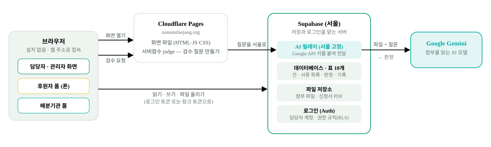
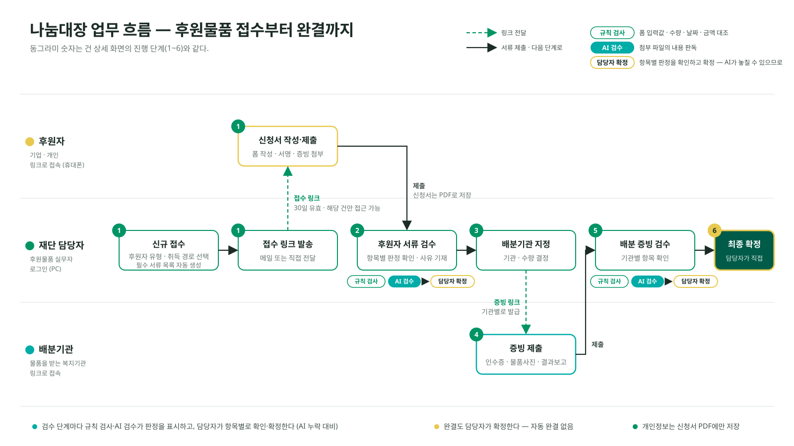
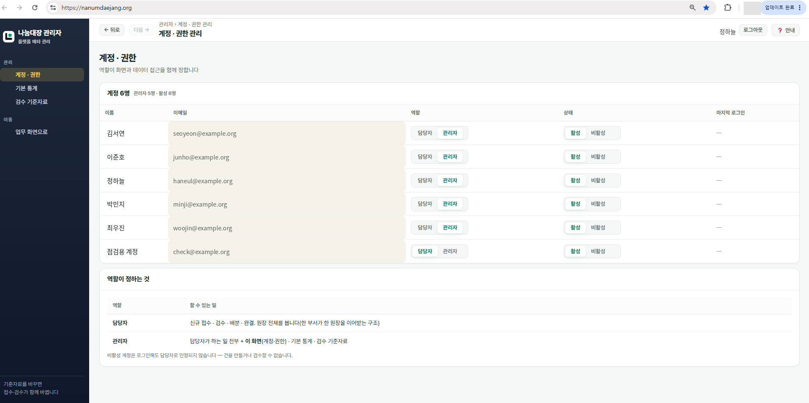
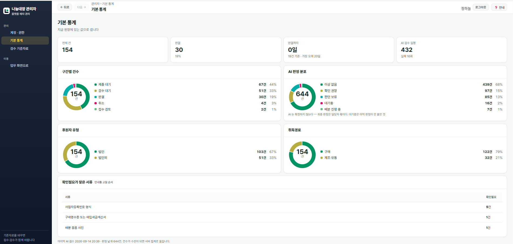
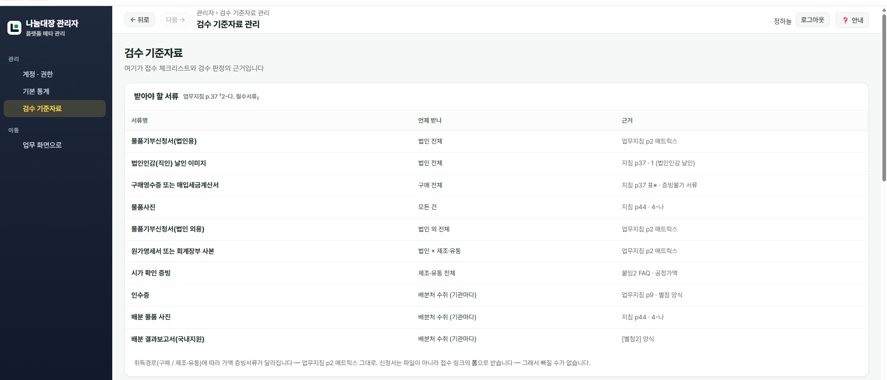
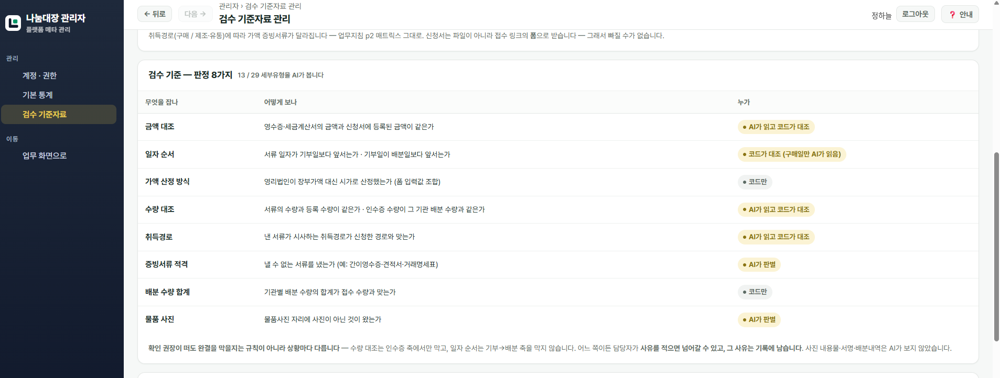
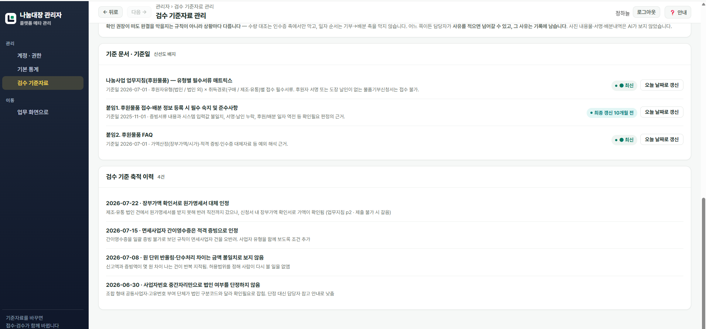

# 나눔대장 관리자 가이드

> 후원물품 접수·배분 관리 플랫폼 「나눔대장」 · 시스템 운영 · 권한 체계 · 데이터 구조 · 인수인계
> **문서 버전 v1.1 · 2026-11-10** · 관련 문서: 사용자 매뉴얼 v0.1 · README
> 인쇄본: [나눔대장_관리자가이드.pdf](나눔대장_관리자가이드.pdf)

## 목차

- [0 문서 개요](#0-문서-개요)
  - [0.1 목적과 독자](#01-목적과-독자)
  - [0.2 문서 구성](#02-문서-구성)
  - [0.3 용어](#03-용어)
  - [0.4 개정 이력](#04-개정-이력)
- [1 시스템 개요](#1-시스템-개요)
  - [1.1 플랫폼 성격](#11-플랫폼-성격)
  - [1.2 구성 요소](#12-구성-요소)
  - [1.3 업무 진행 단계](#13-업무-진행-단계)
  - [1.4 이용자 구분](#14-이용자-구분)
  - [1.5 이용 환경과 접근 링크](#15-이용-환경과-접근-링크)
  - [1.6 검수 방식 — 규칙 검사와 AI 검수](#16-검수-방식--규칙-검사와-ai-검수)
- [2 관리자 기능](#2-관리자-기능)
  - [2.1 접근 조건](#21-접근-조건)
  - [2.2 계정 · 권한](#22-계정--권한)
  - [2.3 기본 통계](#23-기본-통계)
  - [2.4 검수 기준자료](#24-검수-기준자료)
  - [2.5 관리자 계정에만 나타나는 것](#25-관리자-계정에만-나타나는-것)
  - [2.6 데모 모드](#26-데모-모드)
- [3 계정 및 권한 체계](#3-계정-및-권한-체계)
  - [3.1 권한 모델](#31-권한-모델)
  - [3.2 역할 정의](#32-역할-정의)
  - [3.3 데이터베이스 수준의 권한 강제](#33-데이터베이스-수준의-권한-강제)
  - [3.4 계정 운영 정책](#34-계정-운영-정책)
  - [3.5 계정 생애주기](#35-계정-생애주기)
  - [3.6 제약사항 및 유의사항](#36-제약사항-및-유의사항)
- [4 데이터 구조](#4-데이터-구조)
  - [4.1 테이블 목록](#41-테이블-목록)
  - [4.2 주요 항목](#42-주요-항목)
  - [4.3 개인정보 보호 설계 및 암호화 대상](#43-개인정보-보호-설계-및-암호화-대상)
  - [4.4 국외 이전과 처리 위탁](#44-국외-이전과-처리-위탁)
  - [4.5 스키마 형상 관리](#45-스키마-형상-관리)
- [5 설치 및 환경 설정](#5-설치-및-환경-설정)
  - [5.1 사전 준비](#51-사전-준비)
  - [5.2 설치 절차](#52-설치-절차)
  - [5.3 환경 설정값](#53-환경-설정값)
  - [5.4 보안 정보 관리](#54-보안-정보-관리)
- [6 운영 및 유지보수](#6-운영-및-유지보수)
  - [6.1 운영 비용](#61-운영-비용)
  - [6.2 정기 점검](#62-정기-점검)
  - [6.3 장애 대응](#63-장애-대응)
  - [6.4 배포와 화면 갱신](#64-배포와-화면-갱신)
  - [6.5 점검 도구](#65-점검-도구)
  - [6.6 감사 기록 열람](#66-감사-기록-열람)
  - [6.7 취소 처리](#67-취소-처리)
  - [6.8 데이터 보존 및 파기](#68-데이터-보존-및-파기)
- [7 인수인계](#7-인수인계)
  - [7.1 인계 항목](#71-인계-항목)
  - [7.2 인계자 체크리스트](#72-인계자-체크리스트)
  - [7.3 인수자 확인 항목](#73-인수자-확인-항목)
- [8 문의 및 지원](#8-문의-및-지원)
- [부록 A 검수 판정 규칙](#부록-a-검수-판정-규칙)
- [부록 B 유형별 필수 서류](#부록-b-유형별-필수-서류)

## 0 문서 개요

### 0.1 목적과 독자

본 문서는 후원물품 접수·배분 관리 플랫폼「나눔대장」의 운영 환경과 권한 체계, 데이터 구조를 정리하여, **운영기관의 시스템 관리자와 향후 유지보수 주체**가 시스템을 인수하고 관리하는 데 필요한 기술적 근거를 제공하기 위해 작성되었습니다.

나눔대장은 **운영기관이 자체 환경에 직접 설치하여 사용하는 구조**입니다. 따라서 본 문서는 특정 기관 전용 운영 안내가 아니라, **어느 기관이 도입하더라도 동일하게 적용되는 관리 기준**을 기술합니다. 본문에 제시된 화면은 사회복지법인 어린이재단 구축 사례이며, 화면에 표시된 서류명·근거 조항은 기관의 업무지침에 따라 달라집니다.

### 0.2 문서 구성

| 장 | 내용 | 주 독자 |
|----|----|----|
| 1\. 시스템 개요 | 플랫폼의 성격과 구성 요소, 이용자 구분 | 도입 검토자 |
| 2\. 관리자 기능 | 관리자 화면 세 가지의 조작 방법 | 관리자 |
| 3\. 계정 및 권한 | 권한 모델, 역할, 계정 운영 정책 | 관리자 |
| 4\. 데이터 구조 | 테이블 구성, 개인정보 보호 설계 | 유지보수 담당자 |
| 5\. 설치 및 환경 설정 | 신규 구축 절차와 환경 설정값 | 구축 담당자 |
| 6\. 운영 및 유지보수 | 정기 점검, 장애 대응, 데이터 파기 | 관리자 · 유지보수 |
| 7\. 인수인계 | 인계 항목과 확인 절차 | 인계자 · 인수자 |
| 8\. 문의 및 지원 | 연락 창구와 담당자 안내 사항 | 관리자 |

#### 문서 체계

나눔대장의 문서는 독자에 따라 세 가지로 나뉩니다. 본 문서를 읽기 전에 어느 문서를 보아야 하는지 확인하십시오.

<table>
<colgroup>
<col style="width: 33%" />
<col style="width: 33%" />
<col style="width: 33%" />
</colgroup>
<thead>
<tr>
<th>문서</th>
<th>다루는 범위</th>
<th>독자</th>
</tr>
</thead>
<tbody>
<tr>
<td><strong>사용자 매뉴얼</strong></td>
<td>접수부터 완결까지 여섯 단계의 <strong>화면 조작</strong>. 후원자·배분기관에게 보낼 안내 문구 포함</td>
<td>담당자</td>
</tr>
<tr>
<td><strong>관리자 매뉴얼</strong> 
**이 문서**</td>
<td>계정·권한 · 통계 · 기준자료 · <strong>운영</strong> · 데이터 구조 · 설치 · 인수인계</td>
<td>관리자 · 유지보수 주체</td>
</tr>
<tr>
<td><strong>README</strong></td>
<td>솔루션 소개 · 저장소 구조 · <strong>설치 요약</strong>(<code>app/README.md</code>) · 개발 환경 구성</td>
<td>개발·유지보수 · 도입 검토자</td>
</tr>
</tbody>
</table>

> **설치 절차는 두 문서에 모두 있습니다**
>
> 중복이 아니라 **상세도를 달리한 의도적 이중 게재**입니다. README는 `app/README.md`「새 환경에 세울 때」로 안내하며, 그곳의 명령 위주 **요약**(7단계)으로 빠르게 따라 할 수 있게 하고, 본 문서 5장은 **상세**(9단계)로 각 단계의 근거와 유의사항을 함께 기술합니다. 두 문서 중 하나만 읽어도 구축이 가능하도록 작성했습니다.

### 0.3 용어

| 용어 | 정의 |
|----|----|
| **운영기관** | 나눔대장을 설치하여 후원물품 업무에 사용하는 기관. 한 설치 환경에 하나의 운영기관이 대응한다. |
| **접수 건** | 후원물품 접수 단위. 접수번호로 식별하며 검수·배분·완결의 대상이 된다. |
| **체크리스트** | 해당 건에서 받아야 할 서류 목록. 후원자 유형과 취득경로에 따라 자동으로 구성된다. |
| **검수** | 제출된 서류와 시스템 등록값을 대조하여 판정을 산출하는 절차. |
| **판정** | 검수 결과. 「이상 없음 · 확인 권장 · 판단 보류」 중 하나로 산출되며, 확정은 담당자가 한다. |
| **배분처** | 접수된 물품을 전달받는 기관. 한 건에 복수의 배분처를 지정할 수 있다. |
| **기준자료** | 체크리스트 구성과 검수 판정의 근거가 되는 문서 집합. 기관의 업무지침·붙임자료를 가리킨다. |

### 0.4 개정 이력

| 버전 | 변경일 | 변경 내용 | 작성자 |
|----|----|----|----|
| v1.0 | 2026-09-15 | 최초 작성 — 관리자 기능, 권한 체계, 데이터 구조, 설치 및 인수인계 절차 | 운영 담당 |
| v1.1 | 2026-11-10 | 오픈소스 공개 전 전문가 검토 반영 — 설치 순서·환경변수, 접근 범위·링크 보호의 한계, AI 국외 전송 범위, 보관·파기, 운영 비용 상한 | 운영 담당 |

## 1 시스템 개요

### 1.1 플랫폼 성격

나눔대장은 후원물품의 접수부터 배분 증빙 수취까지를 하나의 원장으로 관리하는 업무 시스템입니다. 설계상 다음 세 가지 성격을 갖습니다.

| 성격 | 내용 | 관리자에게 주는 의미 |
|----|----|----|
| **단일 기관 설치형** | 한 설치 환경에 운영기관이 하나. 여러 기관이 한 환경을 공유하지 않는다. | 데이터 주권과 개인정보 책임이 기관 단위로 분리된다 |
| **기준자료 교체형** | 필수서류 구성과 판정 근거가 기관의 기준자료에서 나온다. | 기준자료를 바꾸면 접수·검수가 함께 바뀐다 |
| **판정 보조형** | 시스템은 대조 결과를 제시하고, 확정은 담당자가 한다. | 시스템 판정을 승인으로 오해하지 않도록 안내해야 한다 |

### 1.2 구성 요소

| 구성 요소 | 역할 | 비고 |
|----|----|----|
| 화면(웹) | 담당자·후원자·배분기관·관리자 화면 | **Cloudflare Pages** · 외부 라이브러리·빌드 도구 없음 |
| 데이터베이스 | 원장·체크리스트·판정·감사 기록 | **Supabase** (PostgreSQL 17) |
| 파일 저장소 | 제출 서류 원본, 생성된 신청서·인수증 PDF | Supabase Storage · 접근 정책으로 보호 |
| 인증 | 담당자 로그인 | Supabase Auth · 이메일·비밀번호 · **셀프 가입 차단 필수** — 켜 두면 공개 키를 아는 누구나 가입해 전체 원장과 신청서 PDF(주민등록번호 포함)를 봄(담당자 접근 정책은 로그인 여부만 확인) · 5.2 참고 |
| 서버 함수 | AI 판독 요청 중계(첫 구간) | **Cloudflare Pages Functions**(`/judge`) · AI 키를 화면에 노출하지 않기 위함 · 받은 요청을 아래 서울 릴레이로 넘김 |
| AI 릴레이 | AI 판독 요청을 **서울 리전에서 대신 보냄** | Supabase Edge Function · 리전 고정 |
| AI 판독 | 제출 서류에서 서류 종류·금액·수량·일자를 읽음 | Google Gemini · 호출 한도 있음 |

*<strong>플랫폼 구조.</strong> 브라우저는 설치 없이 웹 주소로 접속합니다. 저장·로그인은 서울 리전의 Supabase가, 첨부 판독은 Google Gemini가 맡으며, <strong>AI 요청은 서울 고정 릴레이를 한 번 거칩니다</strong>(아래 참조). API 키는 서버에만 있고 브라우저로 내려가지 않습니다.*

> **AI 요청이 릴레이를 거치는 이유**
>
> AI 판독 요청은 화면에서 직접 나가지 않고 **서버를 두 번 거칩니다.** 화면 호스팅의 서버 함수는 실행 지역을 지정할 수 없는데, AI 서비스가 일부 지역에서 온 요청을 거부하기 때문입니다. 그래서 **서울 리전에 고정된 릴레이**를 한 번 더 두었습니다.
>
> 이 구조의 부수 효과로 **AI 키가 서버 두 곳에만 존재**하며 브라우저로 내려가지 않습니다. 릴레이를 걷어내면 키가 노출되거나 특정 지역에서 검수가 실패하므로 구조를 임의로 단순화하지 마십시오.

### 1.3 업무 진행 단계

접수 건 하나는 다음 **여섯 단계**를 거쳐 완결됩니다. 건 상세 화면의 진행바 여섯 칸이 이 단계에 대응하며, 사용자매뉴얼도 같은 순서로 구성되어 있습니다.

| 단계 | 수행 주체 | 내용 |
|----|----|----|
| 1 · 접수 | 담당자 | 후원자 유형·취득경로 지정 → 접수 링크 발급 |
| 2 · 후원자 제출 | 후원자 | 링크로 신청서 작성 · 서명 또는 직인 · 증빙 첨부 |
| 3 · 검수 | 담당자 | AI 판독 + 담당자 확인 (수취 확정) |
| 4 · 배분결정 | 담당자 | 배분기관·수량 지정 → 증빙 제출 링크 발급 |
| 5 · 배분 증빙 | 배분기관 | 인수증 작성 · 배분 물품 사진 제출 |
| 6 · 완결 | 담당자 | 배분처 서류 검수 → 완결 처리 · 서류 일괄 내려받기 |

*<strong>업무 흐름.</strong> 가로줄은 이용자별 작업 구간, 점선은 링크 전달, 실선은 서류 제출과 다음 단계 이동입니다. 동그라미 숫자는 건 상세 화면의 진행 단계와 같습니다. 두 검수 단계에서 <strong>규칙 검사와 AI 검수가 판정을 표시하고, 담당자가 항목별로 확인·확정</strong>합니다.*

> **단계는 앞 단계가 끝나야 열립니다**
>
> **배분결정(4단계)은 후원자 서류 검수(3단계)가 끝나야** 열립니다. 그 전에는 안내만 표시됩니다. **완결(6단계)은 후원자·배분처 서류가 모두 수취 확정되고 확인필요가 없을 때** 열립니다. 덜 들어온 건은 완결 버튼이 잠깁니다.

> **운영 원칙**
>
> **“올라온 것”과 “받은 것”은 다릅니다.** 후원자가 파일을 올린 것만으로는 수취가 완료되지 않으며, 담당자가 확인해야 수취 완료입니다. **AI 판정은 참고값이며 확정은 항상 담당자가 합니다.**

### 1.4 이용자 구분

| 이용자 | 접근 방법 | 주요 행위 |
|----|----|----|
| **담당자** | 계정 로그인 | 접수 생성·링크 발급·검수·배분결정·완결 처리 |
| **관리자** | 계정 로그인 (관리자 역할) | 담당자 업무 전부 + 계정·통계·기준자료 관리 |
| **후원자** | 접수 링크 (로그인 없음) | 신청서 작성·서류 제출 |
| **배분기관** | 증빙 제출 링크 (로그인 없음) | 인수증 작성·배분 증빙 제출 |

### 1.5 이용 환경과 접근 링크

#### 이용 환경

| 구분 | 내용 |
|----|----|
| 권장 브라우저 | 크롬. 스마트폰에서도 동작한다 |
| 설치 | 이용자 측에 설치할 것이 없다. 주소를 열면 된다 |
| 후원자·배분기관 | 로그인이 필요 없다. 링크로만 들어온다 |
| 첨부 파일 형식 | **PDF · PNG · JPG · JPEG · WEBP**만 허용. 한글·워드 문서는 PDF로 저장해 올린다 |
| 첨부 파일 크기 | 파일 하나당 **최대 10MB**. 형식·크기를 벗어나면 제출 단계에서 차단된다 |
| 여러 장 첨부 | 한 서류 칸에 **여러 장을 올릴 수 있다**(예: 영수증 3장) |

#### 접근 링크 규칙

후원자와 배분기관은 담당자가 발급한 링크로만 접근합니다. 링크에는 다음 보호가 적용됩니다. 단, 본인확인·5회 잠금·1회성은 **화면에서의 보호**입니다(아래 주의 참고).

| 보호 | 내용 |
|----|----|
| 본인확인 | 화면에서 링크를 열 때 **연락처 뒷 4자리**를 입력해야 신청서가 보인다. 값은 담당자가 정한다. **화면에서의 보호이며, 데이터베이스는 이 값을 확인하지 않는다** |
| 유효기간 | **30일**. 만료 시 담당자가 재발급한다 |
| **5회 잠금** | 화면에서 본인확인을 **5회 틀리면 입력이 잠긴다.** 화면 안에서만 세는 값이라 새로고침하면 다시 시도할 수 있다. 확실히 막으려면 담당자가 재발급한다 |
| 1회성 | 제출이 완료되면 그 링크로는 **신청서 화면이 다시 열리지 않는다.** 화면에서의 차단이며, 데이터베이스에서는 만료·무효화 전까지 링크가 살아 있다 |
| 취소 연동 | 접수를 취소하면 해당 링크가 즉시 무효가 된다 |
| **재발급 두 가지** | 건 상세에서 재발급하면 **같은 접수번호로 새 링크**가 나간다. 신규 접수 화면의 재발급은 **새 접수를 만든다** — 두 가지를 구분해 안내한다 |
| 기관별 분리 | 여러 기관에 나눠 배분하면 **기관마다 링크가 따로** 나가며, 각 기관은 자기 몫만 본다 |

> ⚠️ **링크 주소가 곧 열쇠입니다 — 본인확인 4자리는 화면에서의 보호입니다**
>
> 데이터베이스는 링크 주소(토큰)와 만료·무효 여부만 확인합니다. 그래서 **만료되거나 무효화되기 전까지는 주소를 가진 사람이 4자리 없이도, 제출한 뒤에도** 그 건의 정보를 읽고 일부 값(상태·수량, 수취 상태 등)을 바꿀 수 있습니다. 신청서 PDF 파일은 로그인한 담당자만 열 수 있어 링크로는 열리지 않습니다.
>
> - 링크를 **단체 대화방에 올리지 않는다.** 받을 사람 한 명에게만 보낸다.
> - 유출이 의심되면 담당자가 **링크를 무효화·재발급**한다(재발급하면 이전 링크는 쓸 수 없다).
> - **완결 전에** 담당자가 수량·수취 상태를 원본 서류와 대조한다.

> ⚠️ **본인확인 값은 링크와 함께 전달해야 합니다**
>
> 링크만 보내면 후원자가 폼을 열 수 없습니다. 담당자가 정한 **네 자리 값을 링크와 함께** 알려 주도록 안내하십시오. 연락처를 입력하면 그 뒷 네 자리가 기본값으로 들어가며, 담당자가 직접 바꿀 수도 있습니다.

> **주소는 발급 시 한 번만 표시됩니다**
>
> 링크 주소는 발급 시점에만 화면에 표시되며 이후 다시 조회할 수 없습니다. 원문을 저장하지 않기 때문입니다(4.3 참조). 주소를 잃어버린 경우 재발급하십시오.

### 1.6 검수 방식 — 규칙 검사와 AI 검수

제출물은 성격이 둘로 나뉘고, 검사 주체도 그에 따라 갈립니다. **이 구분을 알아야 판정 결과를 바르게 읽을 수 있습니다.**

<table>
<colgroup>
<col style="width: 25%" />
<col style="width: 25%" />
<col style="width: 25%" />
<col style="width: 25%" />
</colgroup>
<thead>
<tr>
<th>구분</th>
<th>대상</th>
<th>검사 주체</th>
<th>무엇을 보는가</th>
</tr>
</thead>
<tbody>
<tr>
<td><strong>규칙 검사</strong></td>
<td>화면 폼 입력값 
(물품기부신청서)</td>
<td>규칙</td>
<td>필수 항목 누락·형식 · 개인정보 동의 여부 · 사업자번호로 법인·영리 여부 판별 · 날짜 순서 · 수량 합계 · 금액 대조</td>
</tr>
<tr>
<td><strong>AI 검수</strong></td>
<td>첨부 파일 
(영수증·사진·명세서)</td>
<td>AI + 규칙</td>
<td>제출물이 적격 서류인지(견적서·거래명세표 등) · 사진에 내용물이 보이는지 · 파일에 적힌 금액·수량·구매일 · 서류가 시사하는 취득경로</td>
</tr>
</tbody>
</table>

신청서는 폼으로 받으므로 **필수 항목 누락은 제출 단계에서 규칙이 막습니다.** 반면 첨부 파일이 해당 서류가 맞는지, 파일에 적힌 값이 신청서 값과 같은지는 **파일 내용을 읽어야 알 수 있어** AI가 맡습니다. 읽은 값을 신청서 값과 대조하는 일은 다시 규칙이 수행합니다.

> ⚠️ **파일이 올라온 것과 그 서류를 받은 것은 다릅니다**
>
> 파일이 올라온 **사실**은 규칙이 확인하고, 그 파일이 **맞는 서류인지**는 AI가 판정합니다. 두 판정은 화면에 표시될 뿐이며, **AI가 놓칠 수 있으므로 담당자가 항목마다 확인하고 확정합니다.** 완결도 담당자가 확정합니다.

> **AI 판정임을 화면이 밝힙니다**
>
> 검수 결과 상단에 AI 고지가 표시되고, 항목마다 **AI가 읽은 값과 등록 값이 나란히** 놓입니다. 원본 파일은 언제든 열어 확인할 수 있습니다. 담당자에게 이 점을 교육하십시오 — 판정을 승인으로 오해하면 확인 절차가 형식화됩니다.

## 2 관리자 기능

관리자 화면은 **계정·권한**, **기본 통계**, **검수 기준자료** 세 가지로 구성됩니다.

### 2.1 접근 조건

관리자 화면은 다음 세 조건이 모두 충족될 때에만 표시됩니다. 하나라도 어긋나면 화면으로 이동하는 경로 자체가 나타나지 않습니다.

| 구분 | 조건                               |
|------|------------------------------------|
| 인증 | 담당자 계정으로 로그인되어 있을 것 |
| 역할 | 계정의 역할이 **관리자**일 것      |
| 상태 | 계정의 상태가 **활성**일 것        |

조건이 충족되면 업무 화면에 관리 항목이 표시되고, 이를 선택하면 화면 전체가 **관리자 화면군**으로 전환됩니다. 전환 후에는 업무 메뉴가 표시되지 않으며, 「업무 화면으로」를 통해 되돌아갑니다.

> **데모 모드는 예외입니다**
>
> 데이터베이스에 연결되지 않은 **데모 모드에서는 위 조건과 무관하게 관리자 화면이 열립니다**(2.6 참조). 교육·검토 목적이며 그 상태에서는 어떤 변경도 저장되지 않습니다.

> ⚠️ **반영 시점**
>
> 역할 변경은 해당 이용자의 화면에 즉시 반영되지 않습니다. 역할은 애플리케이션이 시작될 때 조회되므로, **이용자가 페이지를 새로 열거나 재로그인해야** 변경된 권한이 적용됩니다.

### 2.2 계정 · 권한

등록된 담당자 계정을 조회하고 역할과 상태를 변경하는 화면입니다. 상단에 전체 계정 수, 관리자 수, 활성 계정 수가 함께 표시됩니다.

*<strong>계정 · 권한 화면</strong>(구축 사례). 좌측이 관리자 화면군의 메뉴 구성입니다. 계정 성명·이메일과 로그인 표시는 <strong>예시 값으로 대체</strong>하였습니다.*

> ⚠️ **이 화면을 외부에 제공할 때**
>
> 계정 표에는 **담당자 전원의 성명과 이메일 주소**가 표시됩니다. 본 문서의 그림은 예시 값으로 대체한 것입니다. 보고·심사·공개 자료에 실제 화면을 그대로 캡처하여 넣지 마십시오 — 한 번 배포된 개인정보는 회수할 수 없습니다.

| 항목 | 내용 | 화면에서 변경 |
|----|----|----|
| 이름 | 담당자 성명. 본인 계정에는 별도 표시 | 불가 |
| 이메일 | 로그인 식별자 | 불가 |
| 역할 | 담당자 / 관리자 | **가능** |
| 상태 | 활성 / 비활성 | **가능** |
| 마지막 로그인 | 최근 로그인 일자 | 자동 기록 |

계정 표의 구성

#### 최종 관리자 보호

활성 관리자가 **한 명인 경우** 해당 계정의 역할·상태 변경이 차단되며, 차단 사유가 화면에 함께 표시됩니다. 다른 계정을 관리자로 지정한 뒤에 변경할 수 있습니다.

> **차단 사유**
>
> 활성 관리자가 존재하지 않게 되면 계정 관리 화면에 접근할 수 있는 이용자가 없어지며, 이 상태는 **화면을 통해 복구할 수 없습니다.** 데이터베이스에 직접 접속하여 조치해야 하므로, 화면과 데이터베이스 양쪽에서 이중으로 차단합니다.

### 2.3 기본 통계

조회 시점의 원장을 직접 집계하여 표시합니다. 별도로 저장된 집계값이 아닙니다.

*<strong>기본 통계 화면</strong>(구축 사례). 도넛 차트 오른쪽에 건수와 비율이 문자로 함께 표기되어, 색상 구분이 어려운 환경에서도 판독할 수 있습니다.*

| 구역 | 표시 항목 |
|----|----|
| 지표 카드 | 전체 건수 · 완결 건수와 비율 · 완결까지 소요 일수 · **검수 실행 횟수와 실패 횟수** |
| 분포 | 구간별 건수 · 판정 분포 · 후원자 유형 · 취득경로 |
| 서류 순위 | 확인필요 판정이 자주 발생하는 서류 |

> **활용**
>
> **검수 실행 실패 횟수**는 정기 점검 항목입니다. 실패가 증가하는 경우 대부분 AI의 호출 한도에 기인합니다(6.3 참조). **확인필요가 잦은 서류**는 후원자 안내 문구를 개선할 우선순위로 활용합니다.
>
> 본 화면은 조회 시마다 원장 전체를 집계하므로, 접수 건수가 수천 건 규모에 도달하면 서버 집계 방식으로 전환해야 합니다.

### 2.4 검수 기준자료

체크리스트 구성과 검수 판정의 근거를 관리하는 화면으로, **업무에 가장 직접적인 영향을 미칩니다.** 네 개 영역으로 구성됩니다.

#### ① 받아야 할 서류

서류별로 **적용 조건**(후원자 유형·취득경로·단계)과 **근거 조항**을 함께 표시합니다. 이 목록은 별도로 관리하는 문서가 아니라 시스템이 실제로 사용하는 구성을 그대로 표시하므로, 화면과 실제 체크리스트가 불일치할 수 없습니다.

*<strong>검수 기준자료 — 받아야 할 서류</strong>(구축 사례). 서류명·적용 조건·근거 조항의 3열 구성입니다.*

#### ② 검수 기준

검수가 대조하는 항목과 **각 항목의 판정 주체**를 표시합니다. 판정 주체는 「AI가 값을 읽고 규칙이 대조」, 「규칙만으로 판정」, 「모델이 판별」로 구분됩니다. 상세 목록은 [부록 A](#부록-a-검수-판정-규칙)에 있습니다.

*<strong>검수 기준자료 — 검수 기준</strong>(구축 사례). 카드 머리에 AI가 담당하는 세부유형의 비율이 표시됩니다.*

> **판정 범위의 명시**
>
> 화면은 전체 세부유형 중 AI가 담당하는 범위를 **수치로 표시**하며, AI가 확인하지 않는 항목(사진 내용물·서명·배분내역)을 별도로 명시합니다. 이는 시스템이 모든 항목을 검증한다는 오해를 방지하기 위한 설계이며, **임의로 삭제하지 마십시오.**

> ⚠️ **판정과 완결의 관계 — 두 층을 구분할 것**
>
> 완결 차단에는 성격이 다른 두 가지가 있습니다. 혼동하면 담당자에게 잘못 안내하게 됩니다.
>
> **① 서류 수취 상태** — 「확인필요」가 하나라도 남아 있으면 완결이 잠깁니다(과완결 방지). 이는 예외 없이 적용됩니다.
>
> **② 대조 판정** — 「확인 권장」 판정이 곧 완결 차단을 의미하지는 않습니다. 차단 여부는 대조 항목에 따라 다릅니다.
>
> 어느 경우든 담당자가 **사유를 기재하여 해소**하면 진행할 수 있으며, 기재한 사유는 감사 기록에 보존됩니다.

#### ③ 기준 문서 · 기준일

검수의 근거가 되는 기준 문서와 각 문서의 기준일을 표시하고, 경과 기간에 따라 **신선도 표시**를 부여합니다. 문서를 실제로 개정한 경우 「오늘 날짜로 갱신」으로 기준일을 갱신합니다.

#### ④ 검수 기준 축적 이력

기준을 변경한 사유를 일자와 함께 기록합니다. 기준 변경 시 반드시 해당 이력에 변경 사유를 남깁니다.

*<strong>검수 기준자료 — 기준 문서와 축적 이력</strong>(구축 사례). 두 번째 문서에 경과 기간 표시가 부여되어 있습니다.*

> ⚠️ **관리자 전담 점검 항목**
>
> 기준 문서의 경과 기간 표시는 **관리자 화면에만 나타납니다.** 담당자 업무 화면에는 표시되지 않으므로, 기준 문서의 최신성 점검은 관리자의 고유 책임입니다.
>
> 「오늘 날짜로 갱신」은 **기준일만 변경합니다.** 원본 문서의 개정 여부를 확인하지 않은 상태에서 실행하면 확인하지 않은 사실이 확인한 것으로 기록됩니다.

> **축적 이력의 의의**
>
> 판정 규칙만으로는 **그 기준을 채택한 사유**를 알 수 없습니다. 축적 이력은 그 사유가 기록되는 유일한 위치이며, 담당자 교체 시 판단 기준이 개인에게만 남는 문제를 방지하기 위한 장치입니다.

### 2.5 관리자 계정에만 나타나는 것

관리자 화면 세 가지 외에도, **관리자로 로그인한 브라우저에서만 나타나는 요소**가 있습니다. 담당자 계정이나 로그아웃 상태에서는 표시되지 않으므로, 관리자가 알고 있어야 합니다.

| 요소 | 나타나는 위치 | 용도 |
|----|----|----|
| **시연용 입력 채우기** | 후원자 신청서 화면 · 배분기관 증빙 제출 화면 | 발표·교육 시 예시 데이터와 예시 서류를 한 번에 채운다 |
| 기준 문서 신선도 표시 | 검수 기준자료 | 기준 문서의 개정 필요 여부 확인 (2.4 참조) |

> ⚠️ **시연용 입력 채우기 — 반드시 알아 둘 것**
>
> 이 버튼은 **관리자 로그인 세션이 남아 있는 브라우저에서만** 그려집니다. 담당자 계정, 로그인하지 않은 상태, 다른 브라우저에서는 나타나지 않습니다.
>
> 관리자가 후원자용 링크를 자기 브라우저에서 열면 이 버튼이 보입니다. **실제 후원자에게는 보이지 않으므로 화면이 다르다고 오해하지 마십시오.** 반대로 담당자 계정에서 이 버튼이 보인다면 권한 설정이 잘못된 것입니다.
>
> 이 기능으로 만든 건은 **실제 원장에 기록**됩니다. 교육·시연에 사용한 건은 식별할 수 있도록 표시하고, 필요하면 6.8에 따라 정리하십시오.

### 2.6 데모 모드

화면은 데이터베이스 연결 여부에 따라 두 가지 상태로 동작합니다.

| 상태 | 조건 | 동작 |
|----|----|----|
| **실서비스** | 설정 파일에 연결 정보가 있음 | 실제 원장에 읽고 쓴다. 로그인이 필요하다 |
| **데모** | 설정 파일이 없거나 연결 정보가 비어 있음 | 예시 데이터로 뜬다. **로그인 없이 열리고, 어떤 변경도 저장되지 않는다** |

#### 데모임을 알리는 표시

데모 여부는 화면마다 다르게 표시됩니다. **담당자 업무 화면에는 별도 표시가 없으므로** 실서비스와 혼동하지 않도록 주의하십시오.

| 화면 | 표시 |
|----|----|
| 후원자 · 배분기관 화면 | 상단에 데모 배지 |
| 관리자 — 계정·권한 | 상단 배너 “데모 계정입니다” · 토글마다 **“데모에서는 바꿀 수 없습니다”** |
| 담당자 업무 화면 | **표시 없음** — 예시 데이터라는 점을 사용자가 알고 있어야 한다 |

> **교육과 도입 검토에 활용**
>
> 데모 모드에서는 **관리자 화면 세 가지까지 모두 열어 볼 수 있습니다.** 계정 표에 담당자·관리자·퇴사자 예시가 들어 있어 역할과 상태의 차이를 그대로 보여 줄 수 있고, **변경은 차단**되어 있어 실수할 여지가 없습니다.
>
> 검수 기준자료 화면은 데모에서도 **실제와 같은 내용**을 표시합니다. 기준은 설정이 아니라 시스템 정본에서 나오기 때문입니다.
>
> 실서비스에서도 신규 접수 화면의 **\[미리보기 열기\]**로 후원자가 보게 될 화면을 담당자가 미리 확인할 수 있습니다. **보기만 하고 저장되지 않으므로** 교육 자료로 쓰기 좋습니다.
>
> 반대로 **실서비스인데 데이터가 보이지 않는 경우** 설정 파일의 연결 정보를 먼저 확인하십시오.

## 3 계정 및 권한 체계

### 3.1 권한 모델

권한 설계의 전제는 **데이터베이스에 개인정보를 저장하지 않는다**는 것입니다(4.3 참조). 그 위에 세 계층의 접근 권한이 적용됩니다.

<table>
<caption>접근 주체별 권한</caption>
<colgroup>
<col style="width: 25%" />
<col style="width: 25%" />
<col style="width: 25%" />
<col style="width: 25%" />
</colgroup>
<thead>
<tr>
<th>주체</th>
<th>식별 방법</th>
<th>허용 범위</th>
<th>차단 범위</th>
</tr>
</thead>
<tbody>
<tr>
<td><strong>담당자</strong></td>
<td>계정 인증</td>
<td>전 테이블 조회·생성·수정, 파일 조회·등록·삭제, 감사 기록 생성, 파기 실행</td>
<td>감사 기록 수정·삭제, 계정 정보 수정</td>
</tr>
<tr>
<td><strong>후원자 · 
배분기관</strong></td>
<td>링크 토큰</td>
<td><strong>해당 건과 그 하위 자료에 한하여</strong> 조회, 서류·제출본 등록 및 수정, 지정 경로 파일 등록</td>
<td>타 건 조회(결과 없음), 삭제, 검수 실행, 파일 목록 조회</td>
</tr>
<tr>
<td><strong>미인증 
접근</strong></td>
<td>공개 키만 보유</td>
<td><strong>파일 올리기만 가능</strong> — 지정 경로(<code>attachments/</code>·<code>forms/</code>)에 공개 키만으로 파일 등록 가능(파일당 10MB, PDF·이미지 형식만). 그 밖에는 없음</td>
<td>전 테이블 조회(결과 없음), 파일 읽기·목록 조회, 삭제</td>
</tr>
</tbody>
</table>

> **미인증 접근에 파일 올리기가 열려 있는 이유와 주의점**
>
> 후원자·배분기관은 로그인 없이 링크로 서류를 올리므로, 파일 저장소의 올리기 정책은 **올리는 경로만 확인하고 링크 토큰은 확인하지 않습니다.** 그래서 공개 키만 가진 사람도 지정 경로에 파일을 올릴 수 있습니다. 남의 파일을 읽거나 목록을 보는 것은 막혀 있지만, **쓸모없는 파일로 저장소 용량을 채울 수는 있습니다.** 크기(10MB)·형식(PDF·이미지) 제한은 접근 정책이 아니라 저장소(버킷) 설정으로 걸려 있으므로 버킷 설정을 바꾸지 마십시오. 저장소 용량은 정기 점검(6.2)에서 확인합니다.

> **담당자 권한을 넓게 설정한 근거**
>
> 담당자는 원장 전체를 조회·수정할 수 있습니다. 후원물품 업무는 **한 부서가 하나의 원장을 이어받는 구조**이므로, 담당자별로 건을 분리하면 업무 인수인계가 불가능해집니다. 권한을 좁힌 대상은 **계정 정보 수정** 한 가지입니다.
>
> 목록 화면에 **「내가 접수한 건만」 필터**가 있으나 이는 **보기 편의**일 뿐 권한 제한이 아닙니다. 필터를 꺼면 모든 건이 보입니다.

### 3.2 역할 정의

| 역할 | 허용 업무 |
|----|----|
| **담당자** | 접수 생성 · 링크 발급 · 검수 · 배분결정 · 완결 처리. 원장 전체 조회 |
| **관리자** | 담당자 업무 전부 + 계정·권한 관리 · 기본 통계 조회 · 검수 기준자료 관리 |

역할에 **상태**가 함께 적용됩니다. 비활성 상태의 계정은 로그인은 가능하나 담당자로 인정되지 않아 건 생성과 검수를 수행할 수 없습니다.

### 3.3 데이터베이스 수준의 권한 강제

화면에서 기능을 숨기는 것만으로는 권한이 보장되지 않으므로, 동일한 규칙을 데이터베이스에도 적용합니다.

| 항목                  | 기능                                       |
|-----------------------|--------------------------------------------|
| 관리자 판별 함수      | 요청 주체가 활성 관리자인지 판정           |
| 계정 테이블 쓰기 정책 | 관리자만 역할·상태를 변경할 수 있도록 제한 |
| 최종 관리자 보호 장치 | 활성 관리자를 0명으로 만드는 변경을 거부   |

> **이중 적용의 근거**
>
> 화면에서만 기능을 숨기는 구성은 **은폐를 보호로 오인하게 만듭니다.** 권한 관련 기능은 화면과 데이터베이스 양쪽에 동일한 규칙을 적용하는 것을 원칙으로 합니다.

### 3.4 계정 운영 정책

운영 기준은 **시스템이 강제하는 것**과 **운영기관이 정하는 권고**로 구분됩니다. 권고 항목은 시스템이 차단하지 않으므로 운영기관의 내부 규정으로 정해 두는 것이 바람직합니다.

| 계정 종별 | 용도 | 운영 기준 | 구분 |
|----|----|----|----|
| **데이터베이스 소유자** | 인프라 복구, 요금제 변경, 환경 삭제 등 소유자 전용 작업 | 운영기관이 직접 보유하고 일상 업무에 사용하지 않는다. **2인 이상**이 접근 가능하도록 유지할 것을 권고한다. | **권고** |
| **관리자** | 계정·기준자료 관리 및 담당자 업무 | 최종 1인의 역할·상태 변경은 **시스템이 차단**한다. 그와 별개로 상시 **2인 이상** 활성 상태 유지를 권고한다. | **강제** **권고** |
| **담당자** | 접수·검수·배분 업무 | 업무 담당자 1인당 1계정으로 운영하고 계정 공유를 하지 않을 것을 권고한다. | **권고** |
| **외부 열람** | 심사·감사 등 한시적 열람 | 필요 기간에만 발급하고, 종료 시 Authentication에서 로그인 계정을 삭제하거나 비밀번호를 바꾼다(화면의 비활성 처리만으로는 로그인이 막히지 않음). | **필수** |

계정 종별 운영 기준

> **권고의 근거**
>
> 시스템은 활성 관리자가 **0명이 되는 것만** 차단합니다. 1명인 상태는 허용되지만, 그 계정에 접근할 수 없게 되면(퇴직·장기 부재·비밀번호 분실) 화면을 통한 복구가 불가능해집니다. 2인 이상 유지를 권고하는 이유입니다.

### 3.5 계정 생애주기

#### 발급

1.  **인증 서비스에서 계정 생성** — 이메일과 임시 비밀번호로 생성합니다. **셀프 가입은 차단**되어 있으므로 관리자가 직접 생성해야 합니다.
2.  **담당자 정보에 연결** — 생성된 계정의 식별자를 담당자 정보에 동일하게 연결합니다. 연결하지 않으면 로그인은 가능하나 **작업 수행자가 기록되지 않습니다.**
3.  **최초 로그인 확인** — 본인이 로그인하여 담당자 화면이 정상 표시되는지 확인합니다.
4.  **역할 지정** — 관리자 권한이 필요한 경우 계정·권한 화면에서 역할을 변경합니다. 변경은 해당 이용자의 재접속 후 적용됩니다.

#### 비밀번호 분실 대응

본 시스템에는 **이용자가 스스로 비밀번호를 재설정하는 기능이 없습니다.** 로그인 화면에 「비밀번호 찾기」가 없으므로, 담당자가 비밀번호를 잊으면 **관리자가 인증 서비스 콘솔에서 재설정**해야 합니다.

1.  **본인 확인** — 요청자가 해당 계정의 담당자인지 확인합니다. 메신저·전화 등 로그인과 다른 경로로 확인하십시오.
2.  **콘솔에서 재설정** — 인증 서비스의 이용자 관리에서 임시 비밀번호를 발급합니다.
3.  **개별 전달** — 임시 비밀번호는 개별 전달하고, 첫 로그인 후 변경하도록 안내합니다(5.4 참조).

> **로그인 유지**
>
> 로그인 상태는 일정 시간이 지나면 만료되며 이용 중에는 자동으로 갱신됩니다. **공용 PC에서는 작업 후 반드시 로그아웃**하도록 담당자에게 안내하십시오.

#### 회수

퇴직·전보 등으로 권한을 회수하는 경우 **계정을 삭제하지 않고 비활성 처리**합니다. 해당 계정이 생성한 건과 검수 기록이 계정을 참조하므로, 삭제 시 수행자 이력이 함께 소실됩니다.

> ⚠️ 화면에서 **비활성으로 바꾸는 것만으로는 로그인과 직접 호출이 막히지 않습니다**(아래 제약 1). 퇴사자나 외부에 공유했던 계정(심사·감사용, 여러 사람이 함께 쓴 계정 등)은 담당자 목록에서 비활성으로 두는 것과 별개로, 데이터베이스 관리 화면의 **Authentication에서 해당 로그인 계정을 삭제하거나 비밀번호를 바꿔야** 합니다. 담당자 목록의 기록(수행자 이력)은 그대로 남습니다.

회수 대상이 관리자인 경우 **다른 계정을 관리자로 지정한 뒤** 변경해야 합니다.

### 3.6 제약사항 및 유의사항

> ⚠️ **제약 1 — 비활성 처리의 적용 범위**
>
> 비활성 처리는 **화면 수준에서 적용**됩니다. 데이터베이스 수준까지 차단하려면 전체 접근 정책의 재작성이 필요하여 현재 적용되어 있지 않습니다. 따라서 **보안상 즉시 차단이 필요한 경우에는 비활성 처리만으로 종료하지 말고 인증 서비스에서 비밀번호를 재설정**하십시오.

> ⚠️ **제약 2 — 역할 조회 실패 시 동작**
>
> 역할 정보 조회 결과가 비어 있을 경우 **직전 판정을 유지**합니다. 일시적 통신 장애로 정상 담당자의 권한이 해제되는 것을 방지하기 위한 설계입니다. 비활성 처리는 조회 결과가 정상 반환되므로 정상적으로 적용됩니다.

## 4 데이터 구조

### 4.1 테이블 목록

| NO | 테이블명 | 한글명 | 구분 | 주요 보관 항목 |
|----|----|----|----|----|
| 1 | `staff` | 담당자 | 마스터 | 성명·식별자·역할·상태·최종 로그인 |
| 2 | `donation` | 접수 건 | 마스터 | 접수번호·상태·후원자 유형·품목·수량·가액·기부일 |
| 3 | `distribution` | 배분처 | 일반 | 기관명·배분 수량·배분일·증빙 상태 |
| 4 | `access_link` | 접근 링크 | 일반 | 토큰 해시·만료·사용 시각·발급자 |
| 5 | `checklist_item` | 체크리스트 항목 | 일반 | 서류 구분·단계·수취 상태·확인자 |
| 6 | `attachment` | 첨부 파일 | 일반 | 파일명·저장 키·등록 주체·최신본 여부 |
| 7 | `form_submission` | 폼 제출본 | 일반 | 대조용 값·생성 PDF 키·서명 여부 |
| 8 | `audit_log` | 감사 기록 | 로그 | 수행자·행위·대상·변경 전후 값 |
| 9 | `inspection` | 검수 실행 | 로그 | 기준 버전·모델·실행자·상태 |
| 10 | `inspection_finding` | 검수 판정 | 로그 | 규칙·판정·사유·읽은 값·등록값·근거 파일 |

업무 흐름 순 · 총 10개

### 4.2 주요 항목

#### 검수 판정의 근거 3항목

`inspection_finding`에는 판정 결과와 함께 다음 세 항목이 보존됩니다. 사후에 판정 근거를 재확인할 수 있는 유일한 자료입니다.

| 항목      | 내용                      |
|-----------|---------------------------|
| 읽은 값   | 제출 서류에서 판독한 값   |
| 등록값    | 시스템에 등록되어 있던 값 |
| 근거 파일 | 판정의 대상이 된 파일명   |

#### 수량 항목의 3단 구성

서류에 기재되는 수량 단위(박스·포·묶음 등)와 배분 합계 대조에 필요한 낱개 수량이 다르므로, 수량을 세 항목으로 분리하여 보관합니다.

| 항목              | 내용                                  | 예시  |
|-------------------|---------------------------------------|-------|
| `qty_as_received` | 서류 기재 수량                        | 400   |
| `qty_unit`        | 서류 기재 단위                        | 박스  |
| `pack_size`       | 1단위당 낱개 수 (담당자 입력)         | 12    |
| `qty`             | **낱개 총수량** — 배분 합계 대조 기준 | 4,800 |

세 항목이 모두 입력된 경우 `qty = qty_as_received × pack_size` 성립 여부를 데이터베이스가 검증합니다.

### 4.3 개인정보 보호 설계 및 암호화 대상

본 시스템의 개인정보 처리 원칙은 **데이터베이스에 개인정보를 저장하지 않는 것**입니다.

| 정보 | 보관 위치 | 보호 방식 |
|----|----|----|
| 성명 · 주민등록번호 · 연락처 · 주소 · 서명 | **신청서 PDF 파일** | DB에는 파일 키만 보관 |
| 법인 상호 · 사업자등록번호 | 데이터베이스 | 개인정보에 해당하지 않음 |
| 법인 외 후원자 성명 | 데이터베이스 | **마스킹 처리** · 제약조건으로 실명 저장 차단 |
| 배분기관 연락처 · 링크 수신 연락처 | 데이터베이스 | Supabase 기본 저장 암호화(디스크 수준)로 보관 — 칸 단위 별도 암호화는 하지 않음 · 목적 달성 시 즉시 삭제 |
| 접근 링크 토큰 | 데이터베이스 | **단방향 해시** · 원문 미보관 |
| 본인확인 값 | 데이터베이스 | **단방향 해시** · 원문 미보관 |

정보 종별 보관 위치 및 보호 방식

> **신청서 PDF는 브라우저에서 생성됩니다**
>
> 후원자가 폼을 제출하면 **그 브라우저에서 신청서 PDF가 만들어져** 파일 저장소로 올라갑니다. 성명·주민등록번호·서명은 이 경로로만 이동하며 데이터베이스를 거치지 않습니다.

> ⚠️ **첨부 파일명**
>
> 첨부 파일은 **원본 파일명이 그대로 보관**되며, 파일명에 개인정보가 포함될 수 있습니다(예: 성명이 포함된 파일명). 파일 목록을 외부에 제공할 때 유의하십시오.

### 4.4 국외 이전과 처리 위탁

AI 판독은 해외 서비스를 이용하므로 **개인정보의 국외 이전이 발생**합니다. 이는 위탁과 별개의 법적 요건이며, 운영기관이 반드시 확인해야 할 사항입니다.

#### 동의와 고지는 다릅니다

| 구분 | 성격 | 화면 처리 | 근거 |
|----|----|----|----|
| **국외 이전** | **동의 대상** | 별도 체크박스 — 수집·이용 동의와 **분리** | 개인정보 보호법 제28조의8 |
| **처리 위탁** | 공개(고지) 대상 | 체크박스 없이 안내만 표시 | 기관 개인정보 처리방침에 반영 |
| 법인 후원자 고지 | 확인 | “동의”가 아닌 “확인” | 법인은 정보주체가 아니어서 동의 주체가 될 수 없음 |

> ⚠️ **한 체크박스로 묶지 마십시오**
>
> 위탁은 공개 대상이지만 **국외 이전은 위탁이라도 별도 동의가 필요**합니다. 하나로 묶으면 정보주체가 무엇에 동의했는지 특정되지 않아 동의의 유효성이 흔들립니다.

#### 무엇을 보내고 무엇을 보내지 않는가

| 구분 | 내용 |
|----|----|
| **전송함** | 신청서를 뺀 **첨부 서류 전부의 이미지** — 구매영수증·세금계산서, 시가 확인 증빙, 원가명세서, 물품사진, **배분 물품 사진, 배분 결과보고서** (담당자가 대신 등록한 파일 포함) |
| 가림 처리 | **하지 않음** — 서류에 적힌 이름·연락처, 사진 속 얼굴이 **그대로 전송**됨 |
| **전송 안 함** | **신청서** — 성명·주민등록번호·연락처·주소·서명이 담긴 문서. 법인인감이 날인된 신청서도 전송하지 않음 |
| 전송 시점 | **담당자가 AI 검수를 실행할 때만**([검수 실행]·[다시 판정]). 후원자·배분기관이 제출하는 순간에는 전송하지 않음 |
| 전송 경로 | Cloudflare 함수 → Supabase 서울 릴레이 → Google Gemini API(Google LLC, 미국) |
| 전송 후 | 모델 학습·제품 개선에 사용되지 않으며, 위반 탐지 목적으로 **제한된 기간 기록 후 삭제**. 이 시스템에는 판독 결과만 저장 |

> ⚠️ **거부 경로를 없애지 마십시오**
>
> 동의를 거부하면 온라인 접수를 이용할 수 없으나, **서면 신청서로 접수할 수 있는 경로가 반드시 유지**되어야 합니다. 거부하면 기부 자체가 불가능한 구조는 사실상 강제 동의가 되어 동의의 유효성이 성립하지 않습니다.

> **처리 국가를 하나로 확정하지 않습니다**
>
> 이용 중인 서비스들은 처리 국가를 미리 지정하지 않으므로, 특정 국가 하나를 적으면 사실과 달라집니다. 화면은 **“각 사가 지정하는 국가에서 처리될 수 있다”**는 가변성 자체를 고지하는 형식을 씁니다.

#### 만 14세 미만 기부자

법인 외 후원자에게는 신청서에 **만 14세 미만 여부**를 묻는 항목이 있습니다. 해당하면 **법정대리인의 이름·휴대전화·아동과의 관계**를 추가로 받아 신청서 PDF에 표로 붙입니다.

> ⚠️ **이 정보도 개인정보입니다**
>
> 법정대리인 정보는 아동 본인이 아닌 **제3자의 개인정보**이며, 다른 개인정보와 같이 **신청서 PDF 안에만** 저장됩니다. 파기 시 함께 지워지며, 별도로 추출해 보관하지 마십시오.

#### 운영기관이 해야 할 일

- 위탁 현황(AI 판독 · 저장·보관 · 화면 제공 및 요청 전달)을 **기관 개인정보 처리방침에 반영**
- 서면 접수 대체 경로와 그 **문의 창구를 실제로 운영**
- 이용 서비스나 처리 범위가 바뀌면 **고지 문구와 처리방침을 함께 갱신**
- 만 14세 미만 기부자의 **법정대리인 동의 절차**가 기관 지침과 맞는지 확인
- 법인 후원자 서류에 담당자 성명·연락처가 섞여 오는 경우가 있으므로 **검수 목적 외 이용·별도 저장 금지**를 담당자에게 교육

> ⚠️ **법인 고지는 면책 장치가 아닙니다**
>
> 법인 후원자의 “확인”은 운영기관을 면책하지 않습니다. 수집한 이상 처리자는 운영기관입니다. 권한 없는 정보가 유입되었을 때 **소명을 요구할 근거**일 뿐입니다.

### 4.5 스키마 형상 관리

스키마 관련 산출물은 세 가지이며 용도가 각각 다릅니다.

| 산출물 | 용도 | 사용 시점 |
|----|----|----|
| 스키마 정의 파일 | 구조 이해. 항목별 설계 의도가 주석으로 기술됨 | 구조 파악 시 · 신규 설치 첫 단계 |
| 2단계 추가 파일 | AI 검수 결과를 담는 표 추가 | 신규 설치 시 정의 파일 다음 |
| 변경 패치 | 변경 이력. 일자별 변경 내용과 사유 | 신규 설치 시 파일명 순서로 전부 · 기존 환경 변경 시 |

> ⚠️ **유의 — 정의 파일과 실제 형상의 차이**
>
> 스키마 **정의 파일은 변경 패치를 반영하지 않습니다.** 따라서 정의 파일만으로 현재 형상을 판단하면 실제 데이터베이스와 불일치할 수 있으며, 실제로 제약조건이 일치하지 않는 항목이 존재합니다.
>
> **현재 형상은 정의 파일 → 2단계 추가 파일 → 변경 패치(파일명 순서)를 모두 적용한 결과**입니다. 구조의 설계 의도는 정의 파일에서 확인하되, 실제 제약조건은 해당 항목을 마지막으로 바꾼 변경 패치에서 확인하십시오.

> **변경 원칙**
>
> 구조 변경은 **항상 변경 패치로 기록**합니다. 데이터베이스 화면에서만 바꾸고 패치를 남기지 않으면 새 환경에서 재현할 수 없습니다. 어떤 변경이 적용되었는지 불확실한 경우 조회 전용 점검 도구로 운영 데이터베이스와 대조할 수 있습니다.

## 5 설치 및 환경 설정

본 장은 운영기관이 **새 환경을 구축**하는 절차를 기술합니다. 명령 위주의 요약본은 `app/README.md`「새 환경에 세울 때」에 있으며, 본 장은 각 단계의 근거와 유의사항을 함께 다룹니다.

### 5.1 사전 준비

| 구분 | 준비 사항 |
|----|----|
| Supabase 계정 | 데이터베이스·인증·파일 저장소·서버 함수를 모두 제공. 무료 등급으로도 구축 가능 |
| Cloudflare Pages 계정 | 화면 배포. 무료 등급으로 가능 |
| AI 키 | **유료 등급 필수.** 무료 등급이면 ① 호출 한도로 검수가 중단되고, ② 동의문의 "모델 학습·제품 개선에 쓰지 않음" 문구가 사실과 달라질 수 있음(Google Gemini API 약관상 무료 등급에 보낸 내용은 제품 개선에 쓰일 수 있음 — 운영 전 최신 약관 확인 필요) |
| 도메인 | 운영 도메인 및 인증서 |
| 기준자료 | 기관의 업무지침·붙임자료 (필수서류 구성의 근거) |

### 5.2 설치 절차

1.  **Supabase 프로젝트 생성** — 리전 **서울(ap-northeast-2)** · PostgreSQL 17 로 생성합니다.
2.  **스키마 적용** — SQL Editor 에서 아래 파일을 **이 순서대로 한 번씩** 실행합니다. 순서를 바꾸거나 빠뜨리면 관리자 권한 강제·배분 취소·판독값 저장 같은 기능이 빠진 채로 만들어집니다.
    1. `schema.sql` (스키마 정의 파일)
    2. `stage2-inspection.sql` (2단계 추가 파일)
    3. `patch-*.sql` 전부 — **파일명(날짜) 순서대로**: `patch-20260828-contact` → `patch-20260828-unit` → `patch-20260828-vat` → `patch-20260831-dockey` → `patch-20260831-donation-date` → `patch-20260831-verdict-enum` → `patch-20260901-finding-resolution` → `patch-20260901-rls-minimal` → `patch-20260902-checklist-resolution` → `patch-20260902-donation-state` → `patch-20260902-inspection-status-error` → `patch-20260904-purge` → `patch-20260906-donor-name-mask` → `patch-20260907-finding-rule-e8` → `patch-20260907-rls-close-anon-delete` → `patch-20260907-rls-stage2` → `patch-20260907-sent-channel-mail` → `patch-20260908-rls-link-scope` → `patch-20260910-admin-accounts` → `patch-20260910-admin-rls` → `patch-20260911-caseno-guard` → `patch-20260911-dist-cancel` → `patch-20260911-dist-lock` → `patch-20260911-finding-facts` (모두 `.sql`)
3.  **파일 저장소(버킷) 생성** — SQL 로는 만들어지지 않으므로 Supabase 대시보드 **Storage → New bucket** 에서 만듭니다. 이름 `nanumdaejang-docs` · **비공개**(Public 끔) · 파일 크기 한도 **10MB** · 허용 형식 **PDF · PNG · JPG · WEBP**(`application/pdf`, `image/png`, `image/jpeg`, `image/webp`). 이름이 다르면 코드와 접근 정책이 맞지 않아 서류 저장이 실패합니다.
4.  **신규 가입 차단** — Authentication → Email 에서 **셀프 가입 차단**, 자동 확인 활성화. URL Configuration 의 사이트 주소를 운영 도메인으로 지정합니다.
    > ⚠️ **신규 가입 차단 필수**(Supabase → Authentication 설정에서 새 사용자 가입 허용을 끔). 켜 두면 공개 키를 아는 누구나 가입해 **전체 원장과 신청서 PDF(주민등록번호 포함)를 볼 수 있습니다** — 담당자 접근 정책은 로그인 여부만 확인하기 때문입니다.
5.  **최초 관리자 계정 생성 및 연결** — 최초 관리자 계정을 생성하고 담당자 정보에 동일 식별자로 연결합니다. 3.4의 권고에 따라 **2인 이상 생성**하는 것이 바람직합니다.
6.  **로컬 설정 파일 작성** — `config.example.js` 를 `config.local.js` 로 복사해 프로젝트 주소와 공개 키를 기재합니다. 본 파일은 형상관리 대상에서 제외됩니다.
7.  **Cloudflare Pages 연결** — 저장소를 연결하고 환경변수(5.3 표)를 등록한 뒤 빌드 설정을 아래와 같이 지정합니다.

    | 항목 | 값 |
    |----|----|
    | 루트 디렉터리(Root directory) | `app` |
    | 빌드 명령(Build command) | `npm install && bash prepublish.sh` |
    | 빌드 출력 폴더 | 루트 디렉터리 그대로(`app` 폴더를 내보냄) |

    > ⚠️ **빌드 명령을 빠뜨리면 데이터베이스 설계 파일(`schema.sql` · `patch-*.sql`)과 검사 스크립트(`*.mjs`)가 사이트 주소로 그대로 공개됩니다.** `prepublish.sh` 가 배포본에서만 이 파일들을 지우고, 화면 파일 11개가 남았는지 확인한 뒤 캐시 버전을 붙입니다(6.4). 이 설정은 Cloudflare 대시보드에만 저장되고 저장소를 따라오지 않으므로, **프로젝트를 새로 만들거나 옮길 때마다 다시 입력**해야 합니다.
8.  **Edge Function 배포** — AI 릴레이 함수(`gemini-relay`)를 **서울 리전 고정**으로 배포하고 비밀값(5.3 표)을 설정합니다.
9.  **설치 확인** — 검수를 1건 실행하여 판정이 생성되고 **데이터베이스에 저장되는지** 확인합니다. 이어서 로그인과 목록 조회를 확인하고, 검사 도구를 실행해 전 항목 통과를 확인합니다.

> ⚠️ **유의**
>
> **데이터가 존재하는 환경에 `schema.sql` 을 실행하지 마십시오.** 첫머리에서 표를 지우고 다시 만듭니다. 위 순서는 빈 프로젝트 신규 구축 전용이며, 기존 환경의 변경은 새 변경 패치로 수행합니다.
>
> **`seed-*.sql` 은 검사용 더미 데이터입니다.** 실서비스 환경에서는 실행하지 마십시오.

### 5.3 환경 설정값

| 설정 항목 | 설정 위치 | 미설정 시 증상 |
|----|----|----|
| AI 키 · 모델명 | 호스팅 환경변수 · AI 릴레이 비밀값 · 로컬 환경파일 | 검수 미동작 |
| 데이터베이스 주소 · 공개 키 | 로컬 설정 파일 · 호스팅 환경변수 | 예시 데이터로만 동작 |
| 데이터베이스 관리 콘솔 접근 | 조직 구성원 초대 | 스키마 조회 불가 |
| 점검용 계정 | 로컬 파일 또는 환경변수 | 연동 점검 도구 실행 불가 |

설정 위치별 항목 · 모두 형상관리 대상에서 제외

**호스팅(Cloudflare Pages) 환경변수** — 프로젝트 → Settings → Environment variables 에 등록합니다. 값은 이 문서에 적지 않습니다.

| 이름 | 필요 여부 | 설명 |
|----|----|----|
| `SUPABASE_URL` | 필수 | Supabase 프로젝트 주소. 화면에 접속 설정을 내려주고(`/config.js`), AI 릴레이 주소를 만드는 데 씁니다. 없으면 화면이 **예시 데이터로만** 동작합니다 |
| `SUPABASE_ANON_KEY` | 필수 | Supabase **공개 키**(publishable key). 브라우저에 그대로 내려가는 값이며, 릴레이 호출 확인에도 씁니다. 위 주소와 함께 있어야 AI 검수가 서울 릴레이를 거칩니다 |
| `GEMINI_MODEL` | 선택 | AI 판독에 쓸 모델 이름. 비우면 `gemini-3.5-flash` |
| `GEMINI_API_KEY` | 예비 | 릴레이를 쓸 수 없을 때(위 두 값이 없을 때)만 구글을 직접 부르는 AI 키입니다. 넣는다면 **릴레이와 같은 유료 키**를 넣습니다. 위 두 값도 이 키도 없으면 검수가 동작하지 않습니다 |
| `GEMINI_RELAY_REGION` | 선택 | 릴레이 실행 지역. 비우면 서울(`ap-northeast-2`) |

**AI 릴레이(Supabase Edge Function) 비밀값** — Supabase → Edge Functions → Secrets 에 등록합니다.

| 이름 | 필요 여부 | 설명 |
|----|----|----|
| `GEMINI_API_KEY` | 필수 | AI 키(**유료 등급 필수** — 무료 등급이면 동의문의 "모델 학습·제품 개선에 쓰지 않음" 문구가 사실과 달라질 수 있음, 5.1). 릴레이가 구글을 부를 때 붙입니다. 없으면 검수가 동작하지 않습니다 |
| `RELAY_KEYS` | 권장 | 릴레이 호출을 허용할 공개 키(여러 개면 쉼표로 구분). 호스팅의 `SUPABASE_ANON_KEY` 와 같은 값을 넣습니다. 맞지 않으면 릴레이가 호출을 거부합니다 |
| `GEMINI_MODEL` | 선택 | 현재 릴레이 코드는 이 값을 읽지 않습니다(모델은 호스팅의 `GEMINI_MODEL` 이 정합니다). 넣어도 무방합니다 |

`SUPABASE_ANON_KEY` · `SUPABASE_PUBLISHABLE_KEYS` · `SB_REGION` 처럼 Supabase 가 스스로 넣어 주는 값은 따로 등록하지 않습니다.

### 5.4 보안 정보 관리

| 구분 | 기준 |
|----|----|
| 전달 방법 | 담당자 간 **개별 전달**. 형상관리 저장소·문서·단체 대화 채널에 기재하지 않는다 |
| 관리 콘솔 접근 | 비밀번호 공유가 아닌 **조직 구성원 초대** 방식으로 부여한다 |
| 공개 저장소 | 저장소를 공개하는 경우 **이력에서도 제거되지 않으므로** 사전에 보안 정보 포함 여부를 점검한다 |
| 교체 주기 | 담당자 교체·외부 열람 종료 시 즉시 교체한다 |

## 6 운영 및 유지보수

### 6.1 운영 비용

운영에 드는 비용은 **AI 판독 호출량**에서 거의 전부 발생합니다. 나머지 구성 요소는 이 규모의 업무에서 무료 등급으로 운용할 수 있습니다.

| 구성 요소 | 과금 방식 | 비고 |
|----|----|----|
| 데이터베이스 · 파일 저장소 · 인증 | 사용량 기반 | 무료 등급으로 구축 가능. 저활동 정지에 유의(6.3) |
| 화면 호스팅 | 사용량 기반 | 무료 등급으로 가능 |
| **AI 판독** | **호출당 과금** | **유료 등급 필수** — 무료 등급은 분당 5회 제한으로 검수가 중단되고, 동의문의 "모델 학습·제품 개선에 쓰지 않음" 문구가 사실과 달라질 수 있다(Google 약관상 무료 등급에 보낸 내용은 제품 개선에 쓰일 수 있음 — 5.1) |

> **호출량이 정해지는 방식**
>
> AI 호출은 **건당이 아니라 첨부 파일당** 발생하며(한 건 판독에 대략 10~20초), 같은 파일은 다시 부르지 않습니다. 파일이 바뀌거나 새 첨부가 들어오면 그 파일만 다시 읽습니다. 따라서 **첨부가 많은 건일수록 호출이 늘고**, 재검수를 반복해도 파일이 그대로면 추가 비용이 발생하지 않습니다.
>
> 기본 통계의 **검수 실행 횟수**가 사용량 추이를 보는 지표입니다(2.3). 접수 건수가 크게 늘면 AI 서비스 콘솔에서 실제 사용량과 요금을 함께 확인하십시오.

> ⚠️ **AI 검수는 로그인 없이 호출할 수 있는 구조입니다 — 예산 상한이 필수입니다**
>
> **발생 조건** — AI 검수 주소(`/judge`)는 로그인 여부를 확인하지 않습니다. 그 뒤의 서울 릴레이(Supabase 함수 `gemini-relay`)도 **공개 키**만 확인하는데, 이 공개 키는 화면 설정 파일(`/config.js`)로 **모든 방문자에게 내려갑니다**. 그래서 외부인이 이 주소들을 직접 호출하면, 기관의 Gemini 키로 임의의 모델과 내용을 실행할 수 있습니다.
>
> **영향** — 개인정보가 바로 새는 경로는 아니지만, **AI 요금이 늘어나거나 호출 한도가 바닥나 검수가 멈출 수 있습니다.**
>
> **운영 전 반드시 걸어 둘 것**
>
> | 어디서 | 무엇을 |
> |----|----|
> | Google (Gemini 키가 속한 결제 계정·프로젝트) | **예산 알림**을 설정하고, API **사용량 상한**(할당량)을 업무량에 맞게 낮춰 둔다 |
> | Cloudflare (화면 호스팅) | `/judge` 주소에 **요청 횟수 제한**(Rate Limiting) 규칙을 건다 |
>
> 리전 확인용 점검 함수(`where-am-i`)도 같은 공개 키로 호출되므로 **점검할 때만 배포하고 운영에서는 내려 둡니다.**

### 6.2 정기 점검

| 주기 | 점검 항목 | 확인 위치 |
|----|----|----|
| 주 1회 | 검수 실행 실패 횟수 추이 | 기본 통계 |
| 주 1회 | 확인필요가 잦은 서류 — 안내 문구 개선 대상 식별 | 기본 통계 |
| 월 1회 | 기준 문서 경과 기간 표시 — 개정 여부 확인 | 검수 기준자료 |
| 월 1회 | AI 키 등급이 **유료**인지 — 무료로 바뀌면 동의문의 학습·제품 개선 미사용 문구가 사실과 달라짐(5.1) | Google AI Studio → API 키 목록의 요금제(Plan) 표시 |
| 월 1회 | 활성 관리자 수(권고 2인 이상), 퇴직자 계정 잔존 여부 | 계정 · 권한 |
| 월 1회 | 파일 저장소(Storage) 용량 — 갑자기 늘었거나 접수 건과 맞지 않는 파일이 쌓였는지 확인(3.1 미인증 접근 참조) | Supabase 대시보드 → Storage · Usage |
| 분기 1회 | 파기 대상 조회 및 파기 실행 | 6.8 참조 |

### 6.3 장애 대응

| 증상 | 원인 | 조치 |
|----|----|----|
| 검수 실행 실패 증가 | AI 호출 한도 초과 | AI 키 등급을 확인한다. 오류 응답에 초과한 한도 종류가 포함된다 |
| 서비스 응답 없음 | 무료 등급의 저활동 일시 중지 | Supabase 무료 등급은 **일정 기간 접속이 없으면 프로젝트가 일시 중지**된다. 이를 막는 자동 접속 장치는 **저장소에 포함되어 있지 않으므로**, 외부 예약 작업(정기 접속)을 따로 마련하거나 유료 요금제를 사용해야 한다. 중지된 경우 **소유자 계정**으로 대시보드에서 복구를 실행한다 |
| 접수 링크 만료 | 유효기간(30일) 경과 | 담당자가 재발급한다 |
| 권한 변경 미반영 | 역할 조회 시점 | 해당 이용자에게 재접속을 안내한다 |
| 화면에 판정이 표시되나 미저장 | 저장 시 제약조건 위반 | 개발자 도구 콘솔에서 오류를 확인하고 4.5에 따라 형상을 점검한다 |

### 6.4 배포와 화면 갱신

화면 파일은 저장소에 반영하면 자동으로 배포됩니다. 빌드 명령(5.2 7단계)은 저장소 전용 파일을 지우고 캐시 버전을 붙이는 일만 하며 설치할 의존성이 없어, 배포 시간이 짧습니다.

> ⚠️ **고쳤는데 옛 화면이 보이는 경우**
>
> HTML은 재배포 즉시 갱신되지만 **스크립트 파일은 브라우저와 CDN에 캐시**되어 옛 것이 남을 수 있습니다. 배포 스크립트가 파일 주소에 **배포 시각을 자동으로 덧붙여** 이 문제를 막습니다.
>
> 그래도 옛 화면이 보이면 **강력 새로고침**(Ctrl+Shift+R)으로 확인하십시오. 여러 이용자가 동시에 같은 증상을 겪는다면 배포가 실제로 반영되었는지 먼저 점검합니다.

### 6.5 점검 도구

| 도구 | 확인 내용 | 사용 시점 |
|----|----|----|
| 전체 검사 | 화면·규칙·판정 로직 전반의 자동 검사 **59종**. 실제 데이터베이스 연동 검사를 포함한다 | 구축 직후 · 코드 변경 후 · 인수인계 시 |
| 패치 적용 점검 | 어떤 스키마 변경이 실제 데이터베이스에 적용되어 있는지 **조회만** 수행 | 형상이 불확실할 때 · 인수인계 시 |

두 도구 모두 조회 위주이며 원장을 변경하지 않습니다. 실행 방법은 `app/README.md`「검증」을 참조하십시오.

> **검사가 규칙 문서화를 강제합니다**
>
> 판정 규칙을 새로 추가하고 **관리자 화면의 설명을 함께 쓰지 않으면 검사가 실패**합니다. 규칙만 늘고 설명이 빠지는 것을 막기 위한 장치이므로, 검사 실패 시 설명 누락 여부를 먼저 확인하십시오.

### 6.6 감사 기록 열람

다음 행위가 기록에 남습니다. 감사·문의 대응의 근거 자료입니다.

| 기록 대상 | 남는 내용 |
|----|----|
| 건 생성 · 수취 확정 · 완결 처리 | 수행자 · 시각 · 변경 전후 값 |
| **신청서·인수증 PDF 열람** | 누가 언제 열었는지 — **기록이 남아야만 열립니다** |
| 사유 해소 | 기재한 사유 원문 |
| 파기 실행 | 대상과 시각 |

> **감사 기록은 고치거나 지울 수 없습니다**
>
> 담당자·관리자 모두 감사 기록의 수정·삭제 권한이 없습니다. 이는 정책으로 차단되어 있으며 보관 주기는 영구입니다.

### 6.7 취소 처리

| 대상 | 가능 시점 | 효과 |
|----|----|----|
| 접수 취소 | 완결 전 | 발급된 접수 링크가 **즉시 무효**가 되어 제출이 차단된다 |
| 배분 수정 · 배분 취소 | **증빙 수취 확정 전** | 배분처와 수량을 고치거나 배분 자체를 취소한다. **취소는 사유와 함께 기록된다** |
| 수취 취소 | 완결 전 | 확정한 서류 수취를 되돌린다. **파일은 그대로 두고 상태만** 되돌아간다 |
| **완결 처리 취소** | 완결 후 | 잘못 누른 완결을 되돌린다. **완결 시각도 함께 지워지고** 배분처 서류 검수 단계로 돌아간다. 보완 후 다시 완결할 수 있다 |

#### 담당자 대리 등록

우편·이메일·방문으로 **직접 받은 서류**는 담당자가 대신 올려 수취 처리할 수 있습니다. 증빙 파일이 없으면 처리되지 않습니다.

> **감사 관점**
>
> 이 경로로 올린 서류는 **후원자가 링크로 제출한 것과 구분**되어 “담당자 확정”으로 기록됩니다. 누가 제출했고 누가 확정했는지가 갈라져 남으므로, **대리 등록을 일상 경로로 쓰지 않도록** 안내하십시오. 링크 제출이 원칙입니다.

> ⚠️ **되돌릴 수 없는 경계**
>
> **증빙이 수취 확정된 배분은 수정·취소할 수 없습니다.** 배분처나 수량을 고쳐야 한다면 수취를 먼저 취소해야 합니다.
>
> **접수 취소는 완결 전에만** 가능합니다. 완결된 건을 손봐야 한다면 먼저 완결 처리를 취소하십시오.

### 6.8 데이터 보존 및 파기

#### 보관 기간

접수 건의 보관 기간은 **기부일자로부터 1년**입니다. 기부일자는 신청서의 후원일자 칸이며, 비어 있으면 입고일, 그것도 없으면 등록일을 씁니다. 이 날짜에 1년을 더한 **파기 예정일이 자동 계산되어 건마다 기록**됩니다(`app/patch-20260904-purge.sql`).

> **파기 자체는 자동으로 실행되지 않습니다**
>
> 자동으로 정해지는 것은 파기 예정일뿐입니다. 예정일이 지난 건은 **담당자(관리자)가 아래 파기 절차를 직접 실행해야** 지워집니다. 6.2 정기 점검에 따라 **분기마다** 실행하십시오.

> **이 파기는 “보존 의무 종료”가 아닙니다**
>
> 기관의 개인정보 처리방침이 기부 관련 정보를 더 긴 기간 보존하도록 정하고 있다면, **본 시스템에서의 파기는 기관의 주 시스템으로 이관한 뒤 사본을 지우는 것**입니다. 법정 보존 의무와 충돌하지 않습니다.
>
> 구축 사례의 설명은 이렇습니다 — *“기관의 보유 기간은 동의문대로 물품기부신청일로부터 5년, 나눔대장 사본은 기부일자로부터 1년. 1년 뒤 나눔대장에서는 지우고, 그 뒤로는 기관 후원관리시스템에서 보관한다.”* 두 기간은 기산점이 다릅니다(5년은 신청일, 나눔대장 파기는 기부일자).
>
> **도입 기관은 자기 처리방침의 보존 기간과 기산점을 확인하여 이 기간을 조정해야 합니다.** 기산점을 기관 처리방침과 같게 맞추면 설명이 한 줄로 정리됩니다.

#### 파기 절차

| 구분           | 기준                                              |
|----------------|---------------------------------------------------|
| 파기 대상 확인 | 전용 조회 수단으로 대상을 먼저 확인한 후 실행한다 |
| 파기 순서      | 파일을 먼저 삭제하고 데이터베이스 기록을 삭제한다 |
| 백업           | 운영 기본값은 **별도 백업 없음**. 단, `app/backup-live.mjs` 로 수동 백업을 받을 수 있으며, 받은 파일(신청서 PDF 원본 포함)은 원본과 같은 수준으로 관리하고 **파기한 건이 백업에 남지 않게** 함께 지운다 |
| 기록           | 파기 사실은 감사 기록에 보존된다                  |
| 감사 기록      | 수정·삭제가 정책으로 차단된다. 보관 주기는 영구   |

#### 완결 건 서류 반출

완결 처리된 건은 제출 서류를 **한 번에 내려받을 수 있습니다**(ZIP). 기관의 기존 시스템으로 이관하거나 감사 자료로 제출할 때 사용합니다. **완결 전에는 잠겨 있습니다.**

| 구분      | 내용                                                |
|-----------|-----------------------------------------------------|
| 담기는 것 | 신청서 PDF · 인수증 PDF · 첨부 서류 · **대조 판정** |
| 기록      | **내려받은 사실이 기록에 남습니다**(6.6)            |

> ⚠️ **반출 시 유의**
>
> 내려받은 파일에는 **신청서 PDF가 포함되며, 그 안에 성명·주민등록번호·연락처·주소·서명이 들어 있습니다.** 반출한 파일의 보관과 파기는 기관의 개인정보 처리 기준에 따르십시오. 반출 자체는 시스템의 파기 절차와 무관합니다.

> ⚠️ **파기는 복구되지 않습니다**
>
> 파기 절차에는 되돌리기 기능이 없고, 운영 기본값으로는 백업도 두지 않습니다(수동 백업을 받았다면 그 파일에서만 남아 있습니다). 실행 전 반드시 대상을 확인하십시오.

## 7 인수인계

### 7.1 인계 항목

| 구분      | 인계 항목                                                   |
|-----------|-------------------------------------------------------------|
| 권한      | 관리자 역할, 데이터베이스 관리 콘솔 접근권, **소유자 계정** |
| 보안 정보 | AI 키·모델명, 데이터베이스 주소·공개 키                     |
| 자산      | 도메인, 호스팅 계정                                         |
| 산출물    | 스키마 정의 파일·변경 패치 이력, 본 문서 및 사용자매뉴얼   |
| 업무 기준 | 기준 문서 원본, 검수 기준 축적 이력                         |

### 7.2 인계자 체크리스트

- 인수자를 관리자로 지정하고, **인계자가 권한을 내려놓기 전에** 인수자의 계정·권한 화면 접근을 확인
- 데이터베이스 관리 콘솔에 인수자를 조직 구성원으로 초대 (비밀번호 공유 금지)
- 보안 정보 4종을 개별 전달
- **소유자 계정 보유자를 명시** — 서비스 정지 복구는 소유자만 수행 가능
- 도메인·호스팅 계정 소유권 이전
- 데이터베이스 화면에서만 바꾸고 변경 패치로 남기지 않은 구조 변경이 없는지 확인
- 외부 열람 계정 비활성 처리 및 비밀번호 교체

### 7.3 인수자 확인 항목

- 관리자 화면 3종이 모두 정상 표시되는가
- 검수를 1건 실행하여 판정이 생성되고 **데이터베이스에 저장**되는가
- 점검 도구가 정상 통과하는가
- 파기 절차를 **폐기 예정 건으로** 1회 실행하여 확인 (복구 불가하므로 실제 건으로 시행 금지)
- 활성 관리자가 **2인 이상**인가 (3.4 권고)
- 기준 문서의 경과 기간 표시를 확인하고 개정 필요 여부를 판단했는가

> ⚠️ **인계 시 유의**
>
> 활성 관리자가 1인만 남은 상태로 인계를 종료하지 않을 것을 **권고**합니다. 시스템은 이 상태를 차단하지 않으나, 해당 계정에 접근할 수 없게 되면 화면을 통한 복구가 불가능하며 데이터베이스 직접 조작이 필요합니다.

## 8 문의 및 지원

사용자매뉴얼은 담당자에게 **“시스템 문의는 관리자에게”**라고 안내하고 본 문서의 연락처를 가리킵니다. 아래 네 가지 창구를 **역할 단위로** 지정하고, 실제 담당자와 연락처는 기관 내부 공지로 전달하십시오.

| 창구 | 담당 역할 | 대응 범위 | 누가 연락하나 |
|----|----|----|----|
| **시스템 관리자** | 후원물품 업무 **주관 부서**의 시스템 관리 담당 | 계정 발급·권한 변경·비밀번호 재설정 · 기준자료 변경 · 장애 1차 확인 | 담당자 |
| **업무 문의** | 후원물품 업무 **실무 총괄** | 서류 판단 기준 해석 · 예외 처리 · 판정에 대한 최종 판단 | 담당자 |
| **서면 접수 창구** | 후원물품 **접수 담당** | 국외 이전 동의를 거부한 후원자의 서면 신청서 접수(4.4) | **후원자** |
| 인프라 소유자 | 데이터베이스·호스팅 **계정 소유자**(3.4) | 서비스 정지 복구 · 요금제 변경 등 소유자 전용 작업 | 시스템 관리자 |

창구 네 가지 · 담당 부서는 운영기관이 지정

> **역할로 적고, 연락처는 따로 공지합니다**
>
> 본 문서에는 **역할만** 적습니다. 담당자 성명과 연락처는 사람이 바뀔 때마다 달라지므로, 기관 내부 공지나 업무 안내에 두고 그쪽을 갱신하십시오. 매뉴얼에 개인 연락처를 적으면 담당자 교체 때마다 문서를 다시 배포해야 하고, 문서가 외부로 나갈 때 개인정보가 함께 나갑니다.

> ⚠️ **서면 접수 창구는 후원자가 직접 연락하는 곳입니다**
>
> 다른 셋과 달리 이 창구는 **외부에 공개**되어야 합니다. 국외 이전 동의를 거부한 후원자가 접수할 수 있는 유일한 경로이며, 창구가 실제로 운영되지 않으면 동의의 유효성이 성립하지 않습니다(4.4 참조). 동의 화면의 안내 문구에 이 창구를 적어 두십시오.

> ⚠️ **공석으로 두지 마십시오**
>
> 네 창구 모두 **지정된 사람이 실제로 있어야** 합니다. 특히 시스템 관리자가 공석이면 비밀번호 재설정과 계정 발급이 멈춥니다.

#### 담당자에게 안내할 것

| 상황 | 안내 |
|----|----|
| 비밀번호를 잊음 | 관리자에게 요청 — 스스로 재설정하는 기능이 없음(3.5) |
| “AI 검수가 잠시 안 됩니다” 표시 | 잠시 뒤 다시 실행. 계속되면 관리자에게(6.3) |
| 화면이 이상함 | 강력 새로고침(Ctrl+Shift+R) 후에도 같으면 관리자에게(6.4) |
| 내려받은 서류 파일 관리 | **개인 PC·메신저에 남기지 않는다.** 열람 기록이 남으며 업무 외 열람은 금지(6.6) |
| 배분 사진에 아동 얼굴 | 그대로 수취하지 말고 **다시 받는다.** 받은 채로 두어야 하면 **AI 검수 실행 전에** 그 사진을 검수 대상에서 빼거나 얼굴을 가린 파일로 바꾼다 — 검수를 실행하면 사진이 가림 없이 Google(미국)로 간다 |

## 부록 A 검수 판정 규칙

검수가 대조하는 항목과 판정 주체입니다. 관리자 화면 「검수 기준자료 — 검수 기준」에 동일한 내용이 표시됩니다.

| 규칙 | 대조 항목 | 대조 내용 | 판정 주체 |
|----|----|----|----|
| E1 | 금액 대조 | 영수증·세금계산서의 금액과 신청서 등록 금액의 일치 여부. **매입세액공제 여부에 따라 합계금액과 맞출지 공급가액과 맞출지가 갈린다** | **AI 판독 + 규칙 대조** |
| E2 | 일자 순서 | 서류 일자와 기부일, 기부일과 배분일의 선후 관계 | **규칙 대조 (구매일만 AI 판독)** |
| E3 | 가액 산정 방식 | 영리법인의 장부가액 기준 적용 여부 | **규칙만** |
| E4 | 수량 대조 | 서류 수량과 등록 수량, 인수증 수량과 배분 수량의 일치 여부 | **AI 판독 + 규칙 대조** |
| E5 | 취득경로 | 제출 서류가 시사하는 취득경로와 신청 경로의 일치 여부 | **AI 판독 + 규칙 대조** |
| E6 | 증빙서류 적격 | 증빙으로 사용할 수 없는 서류의 제출 여부 | **AI 판별** |
| E7 | 배분 수량 합계 | 배분처별 수량 합계와 접수 수량의 일치 여부 | **규칙만** |
| E8 | 물품 사진 | 사진 항목에 사진이 아닌 자료가 제출되었는지 여부 | **AI 판별** |

#### 판정값

| 판정 | 의미 | 담당자 조치 |
|----|----|----|
| **이상 없음** | 대조한 값이 일치함 | 수취 확정 |
| **확인 권장** | **오류 판정이 아니라 “사람이 한 번 보라”는 표시.** 맞는 서류도 값이 다르게 적혀 있으면 뜬다 | 원본 확인 후 수취 확정 또는 사유 해소 |
| **판단 보류** | 대조할 근거가 없거나 값을 읽지 못함 | 원본을 직접 확인 |

> **금액 대조의 기준은 매입세액공제 여부가 정합니다**
>
> 신청서에 **매입세액공제 여부** 항목이 있고, 이 값이 대조 기준을 정합니다 — 공제를 받으면 부가세를 뺀 **공급가액**과, 받지 않으면 **합계금액**과 맞춥니다.
>
> 매입세액공제는 **부가가치세 과세사업자만** 받을 수 있어, 이 항목은 **법인과 개인사업자(기부금영수증을 사업자등록번호로 받는 경우)에게만** 묻습니다. 그 밖의 일반 개인 후원자는 애초에 공제 대상이 아니므로 **“받지 않음”으로 보고 합계금액과 맞춥니다.**
>
> 항목을 물었는데 후원자가 **[모름]** 을 고른 경우에만, 어느 쪽과 맞는지를 사유에 적고 “확인 권장”으로 남깁니다.

> **인수증 수량이 배분 수량과 달라도 제출은 막지 않습니다**
>
> 배분기관이 인수증에 **실제 받은 수량**을 적을 때, 배분 수량과 다르면 화면이 미리 알려 주지만 **제출을 차단하지는 않습니다.** 파손·분실 등 정당한 사유가 있을 수 있기 때문입니다. 차이는 담당자 화면에 수량 대조 판정으로 표시되고, **사유는 담당자가 기재**합니다.

> **판정은 확정이 아닙니다**
>
> 시스템은 서류를 승인하거나 수취를 확정하지 않으며, **확정은 담당자가 수행**합니다. 판정 결과에는 읽은 값·등록값·근거 파일이 함께 보존됩니다(4.2 참조).

#### 사유 해소

확인 권장 판정이 떴으나 원본 확인 결과 문제가 없는 경우, 담당자가 **사유를 기재하여 해소**할 수 있습니다.

> **해소는 '정상'이 아닙니다**
>
> 사유로 해소한 항목은 이상 없음으로 바뀌는 것이 아니라 **「사유 해소 — 담당자 · 시각 · 사유」** 상태로 남아 감사 이력이 됩니다. 나중에 왜 넘어갔는지를 되짚을 수 있는 기록입니다.

후원자에게 서류를 다시 받은 경우에는 사유 해소 대신 **새 파일로 수취 등록**하며, 필요 시 수취를 취소하여 되돌릴 수 있습니다.

> **관리자 관점**
>
> 사유 해소는 **판정을 무시하는 기능이 아니라 판단 근거를 남기는 기능**입니다. 사유 없이 넘어간 건과 사유를 적고 넘어간 건은 감사 시 다르게 취급되므로, 담당자 교육 시 이 점을 함께 안내하십시오.

## 부록 B 유형별 필수 서류

담당자가 신규 접수에서 **후원자 유형**과 **취득 경로**를 선택하면 필수 서류 목록이 자동으로 정해집니다. 아래는 구축 사례의 구성이며, **운영기관의 기준자료에 따라 달라집니다**(2.4 참조).

<table>
<caption>굵은 글씨 = 화면 폼으로 입력(규칙 검사) · 나머지 = 파일 첨부(AI 검수)</caption>
<colgroup>
<col style="width: 33%" />
<col style="width: 33%" />
<col style="width: 33%" />
</colgroup>
<thead>
<tr>
<th>후원자 유형</th>
<th>구매한 물품</th>
<th>직접 만들거나 유통하는 물품</th>
</tr>
</thead>
<tbody>
<tr>
<td><strong>법인</strong> 
**기업 · 단체**</td>
<td><strong>물품기부신청서(법인용)</strong> 
법인인감(직인) 날인 이미지 
구매영수증 또는 매입세금계산서 
물품사진</td>
<td><strong>물품기부신청서(법인용)</strong> — 장부가액 확인서 포함 
법인인감(직인) 날인 이미지 
원가명세서 또는 회계장부 사본 
**대체** 제출 불가 시 신청서의 장부가액 확인서로 갈음 
시가 확인 증빙 (판매처 캡처·단가표 등) 
물품사진</td>
</tr>
<tr>
<td><strong>법인 외</strong> 
**개인 · 개인사업자**</td>
<td><strong>물품기부신청서(법인 외용)</strong> — 전자서명 · 개인정보 동의 포함 
구매영수증 또는 매입세금계산서 
물품사진</td>
<td><strong>물품기부신청서(법인 외용)</strong> — 전자서명 · 개인정보 동의 포함 
시가 확인 증빙 
물품사진</td>
</tr>
</tbody>
</table>

#### 배분기관이 제출하는 것

| 서류 | 비고 |
|----|----|
| 인수증 | 화면 폼으로 작성 — 품목(자동)·수량(낱개)·포장 단위(선택)·받은 날짜·담당자명·기관명·담당자 서명. **재판매·교환 금지 다짐 문구가 함께 찍힌다.** 종이 인수증을 스캔해 올리는 방식이 아니다 |
| 배분 물품 사진 | 실제 인수한 물품. **아동 얼굴이 담긴 사진은 AI 검수 실행 전에 담당자가 걸러 낸다**(검수 대상에서 빼거나 얼굴을 가린 파일로 바꾼다) — 검수를 실행하면 첨부 사진이 가림 없이 Google(미국)로 전송된다. 배분기관 화면에도 같은 안내가 표시된다 |
| 배분 결과보고서 | **선택 항목.** 없으면 나중에 담당자가 대리 등록할 수 있다(6.7). 제출되면 후원자 접수 서류와 같은 방식으로 검수한다 |

> **기타 첨부**
>
> 정해진 서류 칸 외에 **「기타 첨부」 선택 칸**이 있습니다. 필수 목록에 없는 자료를 후원자가 덧붙일 때 씁니다. 필수가 아니므로 비어 있어도 제출됩니다.

> **신청서가 빠질 수 없는 이유**
>
> 물품기부신청서는 파일 첨부가 아니라 **접수 링크의 화면 폼**으로 받습니다. 그래서 목록에서 누락될 수가 없고, 필수 항목 미입력은 제출 단계에서 차단됩니다(1.6 참조).

**나눔대장 관리자 매뉴얼** · v1.0 · 2026-09-15

본 문서에 수록된 화면은 사회복지법인 어린이재단 구축 사례이며, **계정 성명·이메일과 로그인 표시는 예시 값으로 대체**하였습니다. 화면에 표시되는 서류명·근거 조항은 운영기관의 기준자료에 따라 달라집니다.

관련 문서 — **나눔대장 사용자 매뉴얼** v0.1(접수부터 완결까지 화면 조작) · **README**(저장소 구조·개발 환경)
