# 나눔대장 이용자 가이드

> 후원물품 서류를 받고, 검수하고, 기록합니다 · **담당자용 사용자 매뉴얼 · 2026. 9.**
> 인쇄본: [나눔대장_이용자가이드.pdf](나눔대장_이용자가이드.pdf) · 관리자 기능(계정·권한·검수 기준자료 등)은 [관리자 가이드](나눔대장_관리자가이드.md)에 있습니다.

이 문서는 기관 담당자가 나눔대장으로 후원물품 한 건을 처리하는 방법을 화면 순서대로 안내합니다. 후원자·배분기관에게 보낼 안내 문구와 유의사항을 함께 실었습니다.

| 이용자 | 하는 일 |
|---|---|
| **담당자** | 로그인 · 접수 링크 · 검수 · 배분 · 완결 |
| **후원자** | 링크로 신청서 작성 · 서명 · 증빙 첨부 |
| **배분기관** | 링크로 인수증 작성 · 배분 사진 |

한 건은 **① 접수 → ② 후원자 제출 → ③ 검수 → ④ 배분결정 → ⑤ 배분 증빙 → ⑥ 완결**의 여섯 단계를 거칩니다. 이 순서대로 안내합니다.

## 목차

- [1. 한눈에 보기](#1-한눈에-보기) — 업무 흐름도 · 전체 흐름 · 역할 · 화면 지도 · 시작 전 준비
- [2. 로그인 · 홈](#2-로그인--홈) — 담당자 로그인 · 홈 대시보드
- [3. 신규 접수](#3-신규-접수) — 접수 유형 지정 → 필요 서류 자동 전개 → 접수 링크 발급
- [4. 후원자 안내](#4-후원자-안내) — 안내 문구 · 후원자 화면 · 유의사항
- [5. 후원건 목록 · 건 상세](#5-후원건-목록--건-상세) — 진행 단계 6칸 · 수취 요약
- [6. 검수 실행 · AI 판정 읽기](#6-검수-실행--ai-판정-읽기) — 이상 없음 · 확인 권장 · 판단 보류 · 사유 해소
- [7. 배분기관 지정 · 배분처 링크](#7-배분기관-지정--배분처-링크) — 배분결정 · 증빙 제출 링크 발급
- [8. 배분기관 안내](#8-배분기관-안내) — 안내 문구 · 인수증 화면 · 유의사항
- [9. 배분처 서류 검수 · 완결](#9-배분처-서류-검수--완결) — 수량 대조 · 완결 처리 · 서류 일괄 받기(ZIP) · 수취 등록
- [10. 자주 있는 상황 · 유의사항](#10-자주-있는-상황--유의사항) — 취소 · 재발급 · 수취 취소 · 완결 취소 · 파일 형식 · 개인정보

> 화면 그림의 동그라미 번호는 그림 아래 설명의 번호와 같습니다.

---

## 1. 한눈에 보기

### 1.1 업무 흐름도

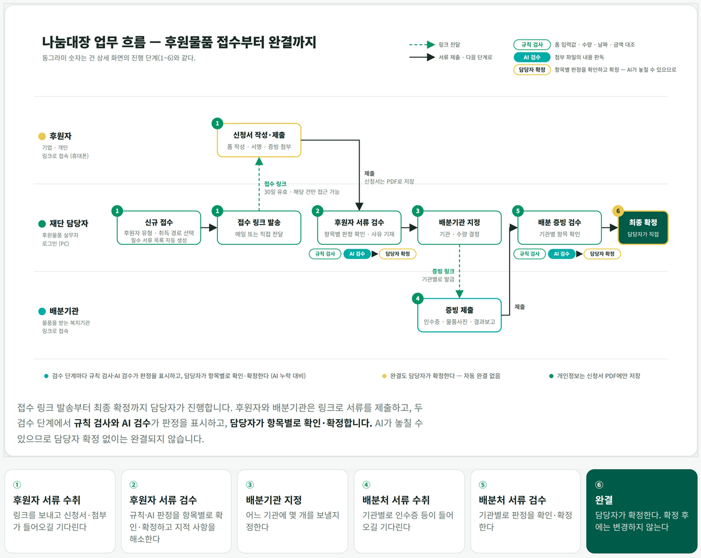

**흐름도 읽는 법** — 가로줄 = 역할별 작업 구간

1. **세 줄 = 세 역할주체** — 후원자(위) · 재단 담당자(가운데) · 배분기관(아래). 담당자만 로그인하고, 후원자·배분기관은 링크로 응답합니다.
2. **점선 = 링크 전달** — 접수 링크(30일 유효)와 증빙 링크(기관별 발급). 담당자가 보내고 상대가 자기 기기에서 엽니다.
3. **실선 = 서류 제출 · 다음 단계** — 후원자 제출 → 검수, 배분기관 제출 → 배분 증빙 검수. 신청서는 제출 즉시 PDF로 저장됩니다.
4. **검수 두 번 = 규칙 검사 + AI 검수 → 담당자 확정** — ② 후원자 서류와 ⑤ 배분처 서류에서 각각 진행합니다. 폼 값·수량·날짜는 규칙이, 첨부 내용은 AI가 판정하고, 확정은 항상 담당자가 합니다.
5. **⑥ 최종 확정도 담당자** — 자동 완결은 없습니다. 담당자 확인을 거쳐 확정합니다. 개인정보는 신청서 PDF에만 저장됩니다.

### 1.2 후원물품 한 건의 흐름 — 접수부터 완결까지 여섯 단계

| 단계 | 누가 | 무엇을 |
|---|---|---|
| 1 접수 | 담당자 | 유형·경로 지정 → 접수 링크 발급 |
| 2 후원자 제출 | 후원자 | 링크로 신청서 작성 · 전자서명 · 증빙 첨부 |
| 3 검수 | 담당자 | AI 판독 + 담당자 확인 (수취 확정) |
| 4 배분결정 | 담당자 | 배분기관·수량 지정 → 증빙 제출 링크 |
| 5 배분 증빙 | 배분기관 | 인수증 작성 · 배분 물품 사진 |
| 6 완결 | 담당자 | 배분처 서류 검수 → 완결 · ZIP |

**담당자 (재단 직원)**
- **로그인** — 이메일·비밀번호. 담당자 화면은 로그인한 사람만 봅니다.
- **하는 일** — 접수 링크 발급 · 검수(AI 판정 확인) · 배분결정 · 배분처 링크 발급 · 완결 · 서류 ZIP 다운로드
- **원칙** — AI 판정은 참고값이며, 담당자의 확인 및 확정이 있어야만 최종 완결할 수 있습니다.

**후원자 (기업·개인)**
- **로그인 없음** — 담당자가 생성하여 발송한 링크로 후원 관련 정보를 제출합니다.
- **본인확인** — 후원자 연락처 뒷 4자리(담당자가 생성)
- **하는 일** — 물품기부신청서 작성(화면 폼) · 전자서명(법인은 직인 이미지로 날인) · 구매영수증·물품사진 등 첨부 · 제출
- **참고** — 제출 후에는 그 링크로 신청서 화면이 다시 열리지 않습니다(화면에서의 차단 · 아래 1.4 ② 주의 참고).

**배분기관 (지역아동센터 등)**
- **로그인 없음** — 배분결정 이후 담당자가 생성하여 발송한 링크로 증빙 관련 서류를 제출합니다.
- **본인확인** — 기관 연락처 뒷 4자리(담당자가 생성)
- **하는 일** — 인수증 작성(화면 폼 · 담당자 서명으로 날인) · 배분 물품 사진 첨부 · 결과보고서(필요 시)
- **참고** — 하나의 후원물품을 여러 기관에 배분 결정하는 경우, 담당자는 기관별로 링크를 생성하여 전달합니다.

### 1.3 화면 지도 — 왼쪽 메뉴 3개 + 상세 진행바 6칸

| 메뉴 · 화면 | 구성 | 무엇을 하나 |
|---|---|---|
| 홈 | 홈 대시보드 | 접수·검수 건수 요약 · [신규 접수]·[검수] 카드 |
| 신규 접수 | 접수 유형 → 필요 서류 → 발송 | 후원자 유형×취득경로를 고르면 필요 서류가 자동으로 정해지며, 접수 링크를 발급하여 후원자에게 전달 |
| 후원건·검수 | 후원건 목록 | 구간(후원 접수·검수 / 배분 검수 / 완결)별 건수 · 검색 · [내가 접수한 건만] 확인 가능 |
| 후원건·검수 › 건 상세 | 진행바 6칸(탭) | ① 후원자 서류 수취 → ② 후원자 서류 검수 → ③ 배분기관 지정 → ④ 배분처 서류 수취 → ⑤ 배분처 서류 검수 → ⑥ 완결 |
| 후원건·검수 › 수취 등록 | 담당자가 직접 받은 서류 업로드 | 우편·이메일 수취 서류 등 담당자 직접 업로드가 필요한 경우 사용 |
| 관리자 | 계정·권한 / 기본 통계 / 검수 기준자료 | 별도 [관리자 가이드](나눔대장_관리자가이드.md) 참조 |
| (링크) 후원자 화면 | 본인확인 → 물품기부신청서 → 제출 완료 | 후원자가 작성하여 제출(담당자 화면 아님) |
| (링크) 배분기관 화면 | 본인확인 → 배분 증빙 제출 → 제출 완료 | 배분기관이 작성하여 제출(담당자 화면 아님) |

### 1.4 시작 전 준비사항

**① 접속**
- **주소** — https://nanumdaejang.org
- **브라우저** — 크롬(Chrome) 권장
- **기기** — 담당자는 PC 사용 권장, 후원자·배분기관은 PC·모바일 모두 사용 가능
- **계정** — 담당자 계정은 관리자가 발급(셀프 가입 없음)

**② 링크 규칙 (후원자 · 배분기관)**
- **본인확인** — 링크를 열고 담당자가 사전에 설정한 4자리 비밀번호를 입력하면 폼 접속 가능
- **유효기간** — 발급 후 30일(만료 시 담당자 재발급 필요)
- **제출 후 화면 닫힘** — 중복 제출·재열람 방지를 위한 조치로, 제출 후에는 같은 링크로 신청서 화면이 다시 열리지 않음
- **취소** — 오발송한 링크는 [접수 취소]로 무효화 가능하며, 접수 취소 처리한 링크는 열리지 않음
- **⚠️ 주의 — 링크 주소가 곧 열쇠** — 본인확인 4자리·5회 잠금·제출 후 화면 닫힘은 **화면에서의 보호**입니다. 데이터베이스는 링크 주소와 만료·무효 여부만 확인하므로, 만료·무효화 전까지는 주소를 가진 사람이 4자리 없이도 그 건의 정보를 읽고 일부 값을 바꿀 수 있습니다(신청서 PDF 파일은 로그인 전용이라 열리지 않음). 그래서 ① 링크를 단체 대화방에 올리지 않고, ② 유출이 의심되면 링크를 무효화·재발급하며, ③ 완결 전에 수량·수취 상태를 원본 서류와 대조합니다.

**③ 첨부 파일**
- **업로드 가능 파일형식** — PDF · PNG · JPG · JPEG · WEBP
- **크기** — 파일당 10MB 이하

**④ AI 판정 참고사항**
- **무엇을 보나** — 금액 · 일자 · 수량 · 취득경로. 서류에 적힌 값과 신청서 값을 대조
- **무엇을 안 보나** — 사진 내용의 적정성, 서명·직인, 배분 내역
- **판정 3가지** — 이상 없음 / 확인 권장 / 판단 보류 (3가지 모두 자동 확정 아님). '확인 권장' 시, 담당자가 원본을 보고 사유를 적거나 서류를 재수취

**⑤ 개인정보**
- **DB에 개인정보 없음** — 이름·주민번호·연락처·주소·서명은 신청서 PDF 안에만 존재
- **법인외(개인) 후원자명** — 화면·원장에 마스킹하여 노출(예: 김나눔 → 김○눔)
- **보관기간** — 기부일 기준 1년([관리자 가이드](나눔대장_관리자가이드.md) 참고)
- **열람 기록** — 신청서 PDF를 열면 누가·언제 열었는지 기록 저장

---

## 2. 로그인 · 홈

### 2.1 로그인

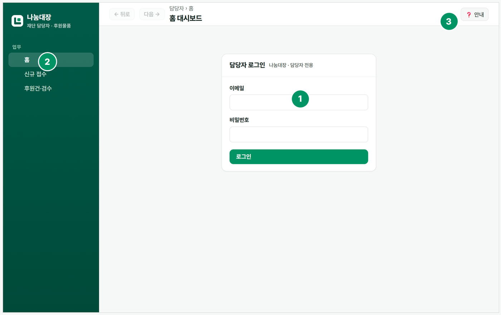

*담당자 로그인 화면 (nanumdaejang.org)*

1. **이메일 · 비밀번호** — 관리자가 발급한 담당자 계정을 입력하고 [로그인]을 누릅니다.
2. **로그인이 필요한 화면** — 담당자 화면(홈·신규 접수·후원건·검수)은 로그인한 사람만 볼 수 있습니다.
3. **로그인 상태** — 오른쪽 상단에 이름과 [로그아웃]이 보이면 로그인된 것입니다. 공용 PC에서는 작업 후 반드시 로그아웃하세요.

> ※ 비밀번호를 잊으면 관리자에게 재설정을 요청합니다. 셀프 가입·비밀번호 찾기 화면은 없습니다.

### 2.2 홈 대시보드

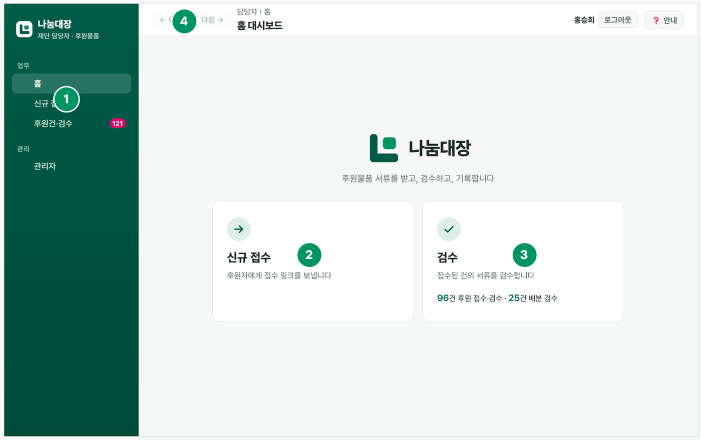

*로그인 직후 화면*

1. **왼쪽 메뉴** — 홈 · 신규 접수 · 후원건·검수 세 가지가 담당자 업무의 전부입니다. 빨간 숫자는 아래 ※ 참고.
2. **[신규 접수]** — 후원자에게 접수 링크를 보내는 화면으로 이동합니다.
3. **[검수]** — 접수된 건의 목록으로 이동합니다. 후원 접수·검수 건수와 배분 검수 건수가 표시됩니다.
4. **뒤로 · 다음 · 안내** — 화면 이동 이력으로 되돌아갑니다(Alt+←/→). [? 안내]로 언제든지 안내사항을 확인할 수 있습니다.

> **※ 왼쪽 메뉴 '후원건·검수' 옆의 숫자 마크**
> 아직 처리가 끝나지 않은 건의 수입니다.
> 완결된 건과 취소된 건은 세지 않습니다.
> 처리할 건이 없으면 숫자가 표시되지 않습니다.
> 예) 전체 3건 중 1건이 완결이면 → 2

---

## 3. 신규 접수

### 3.1 접수 유형과 필요 서류

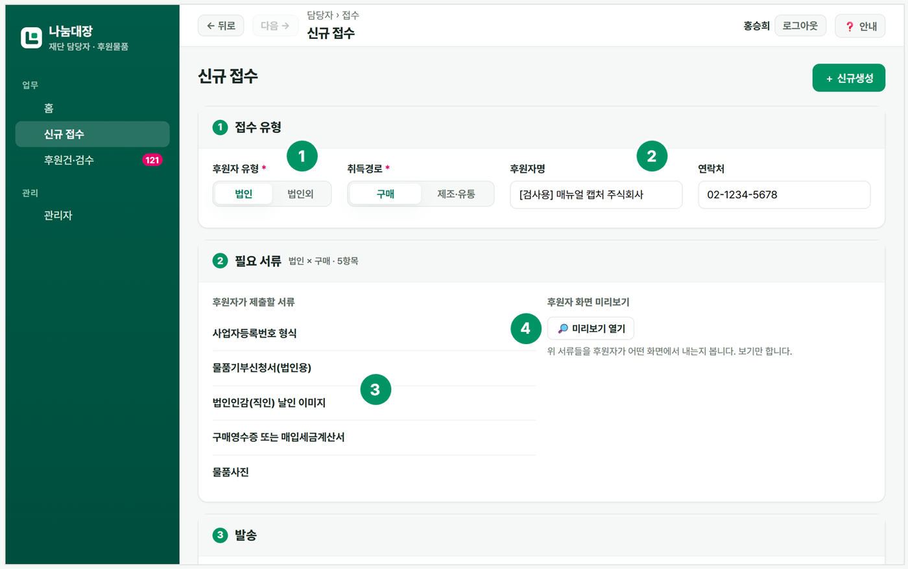

*신규 접수 화면 (위쪽)*

1. **후원자 유형 · 취득경로** — 법인/법인외 × 구매/제조·유통 네 조합 중 하나를 선택합니다. 이 선택이 필요 서류를 정합니다.
2. **후원자명 · 연락처** — 후원자에게 확인한 이름(상호)과 연락처를 입력합니다. 연락처 입력 시 본인확인 값(연락처 뒷 4자리)이 자동으로 채워집니다.
3. **필요 서류 (자동 설정)** — 업무지침 매트릭스([관리자 가이드](나눔대장_관리자가이드.md) 참고)에 따라 후원자가 제출해야 하는 서류 목록이 자동으로 펼쳐집니다.
4. **[미리보기 열기]** — 후원자 화면을 미리 확인할 수 있습니다. 보기만 가능하며, 입력 · 저장하지 않습니다.

> 💡 **유의** · 후원자 유형·취득경로에 따라 필요 서류가 달라지므로, 오기입 시 서류를 다시 제출해야 하는 번거로움이 발생할 수 있습니다. 반드시 접수 유형을 확인하세요.

### 3.2 접수 링크 발급과 전달

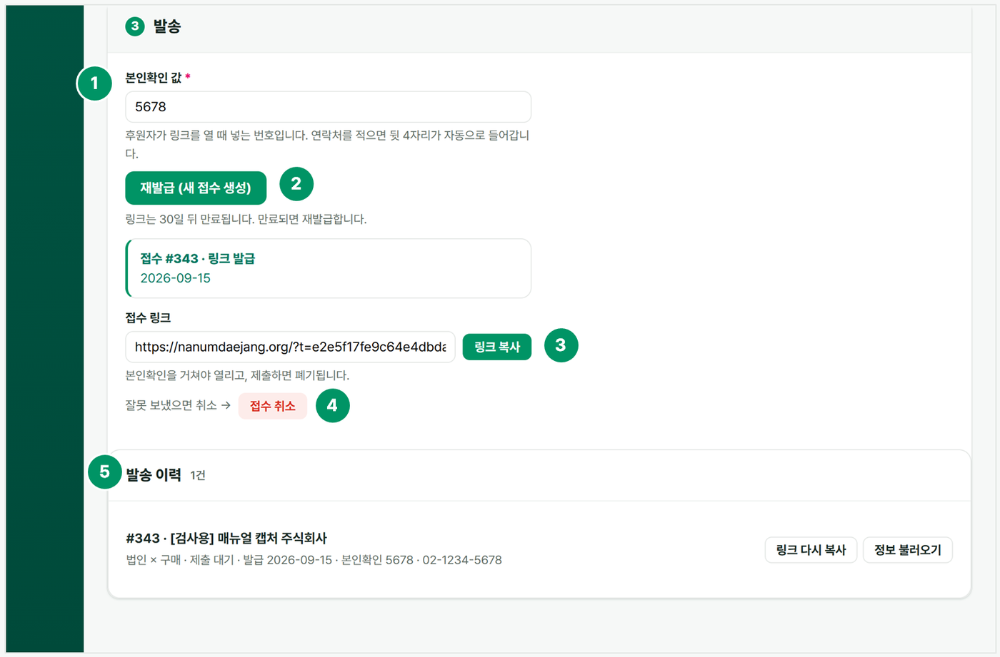

*신규 접수 화면 (아래쪽)*

1. **본인확인 값** — 후원자가 링크를 열 때 넣는 4자리. 연락처 뒷 4자리가 기본이고 직접 바꿔도 됩니다. 링크와 함께 후원자에게 알려 줍니다.
2. **[접수 생성 + 링크 발급]** — 누르면 접수번호가 생기고 링크가 만들어집니다. 같은 후원자에게 다시 보내려면 [재발급].
3. **접수 링크 · [링크 복사]** — 복사해서 카카오톡·문자·이메일 등 쓰던 채널로 보냅니다. (안내 문구는 [4.1](#41-링크와-함께-보내는-안내-문구) 참고)
4. **[접수 취소]** — 잘못 보냈으면 즉시 취소. 취소 처리한 링크는 열리지 않으므로, 후원자는 취소 처리한 링크를 사용할 수 없습니다.
5. **발송 이력** — 이 화면에서 발급한 건 목록. [링크 다시 복사] · [정보 불러오기]로 이어서 작업할 수 있습니다.

> 💡 **유의** · 반드시 본인확인 값을 링크와 함께 전달합니다 · 링크는 30일 뒤 만료됩니다 · [접수 취소] 처리한 링크로는 제출할 수 없습니다

---

## 4. 후원자 안내

### 4.1 링크와 함께 보내는 안내 문구

**📩 카카오톡 · 문자 · 이메일 공통 문구**

```text
[기관명] 후원물품 접수 안내

○○○ 후원자님, 후원해 주셔서 감사합니다.
아래 링크에서 물품기부신청서를 작성해 주세요. (PC·모바일 모두 가능)

▶ 접수 링크: (담당자 생성 링크 삽입)
▶ 본인확인 번호: (담당자 생성 본인확인 번호 4자리 삽입)

준비해 주실 것
 · 구매영수증 또는 매입세금계산서 (사진·PDF)
 · 물품 사진
 · (법인) 법인인감(직인) 날인 이미지
 · (개인·기부금영수증 발급 시) 주민등록번호

링크는 30일간 유효하며, 제출하신 이후에는 다시 열리지 않습니다.
문의: 담당자 ○○○ (02-000-0000)
```

**보내기 전에 확인**
- **유형·경로가 맞나** — 법인/법인외, 구매/제조·유통이 틀리면 필요 서류가 달라지므로, 후원자가 다시 제출해야 합니다. 반드시 올바른 유형을 선택하여 안내해 주세요.
- **본인확인 값** — 화면에서는 본인확인 값 4자리를 입력해야 입력 폼이 열립니다. 링크 주소 자체가 열쇠이므로 링크는 받을 사람 한 명에게만 보냅니다(단체 대화방 금지).
- **연락처** — 후원자가 문의할 수 있는 담당자 연락처를 함께 안내합니다.

> 💡 **유의** · 본인확인 값 4자리를 5번 틀리면 화면이 잠깁니다(화면 안에서만 세는 잠금) — 후원자가 잠겼다고 하면, 담당자가 [접수 링크 재발급]으로 새 링크를 안내합니다 (접수번호는 유지됨)

**후원자가 자주 묻는 것**

| 질문 | 안내 |
|---|---|
| "링크가 안 열려요" | 기기 환경으로 추정되는 경우 크롬에서 열도록 안내합니다(사용자의 기기 환경에 따라 다를 수 있음). 30일이 지나면 링크가 만료되며, 만료 후에는 사용할 수 없으므로 새 링크를 재발급하여 전달합니다. |
| "본인확인이 안 돼요" | 담당자 생성 값(신규 접수 화면 아래쪽 ①)을 확인하여 다시 안내합니다. |
| "한글 파일이 안 올라가요" | 지원 파일 형식을 안내합니다. 한글이나 워드의 경우 PDF로 저장해서 올리도록 안내합니다(10MB 이하). |
| "제출했는데 수정하고 싶어요" | 제출 완료본은 수정할 수 없습니다. 담당자가 링크 [재발급]으로 접수 링크를 재전달하거나, 별도 파일을 전달받아 업로드합니다. |

### 4.2 후원자 화면(참고) — 본인확인

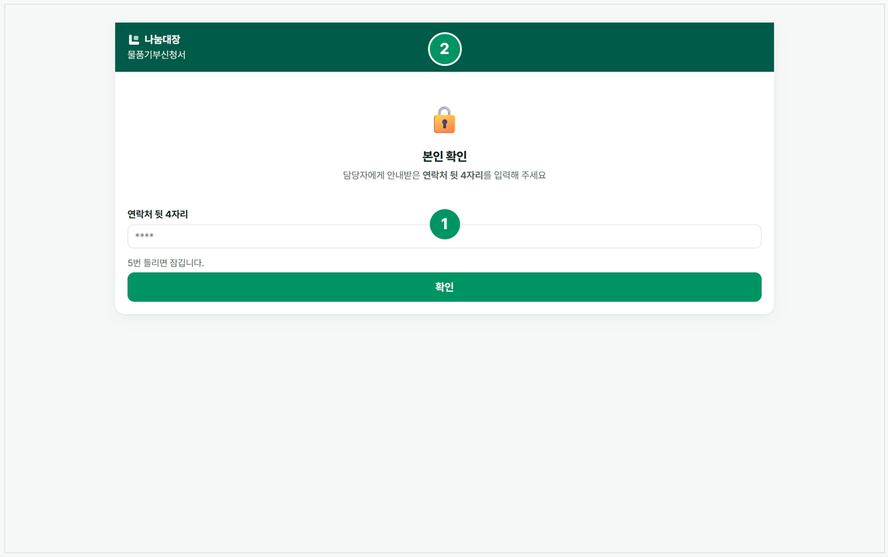

*후원자가 링크를 열었을 때*

1. **본인확인** — 담당자가 생성한 본인확인 값 4자리를 넣어야 신청서가 열립니다.
2. **후원자 화면** — 담당자 화면이 아니라 후원자가 자신의 기기(PC·모바일)에서 보는 화면입니다. 담당자는 [미리보기 열기]를 통해 후원자가 받아볼 화면을 확인할 수 있습니다. ([3.1](#31-접수-유형과-필요-서류) 참고)

### 4.3 후원자 화면(참고) — 물품기부신청서

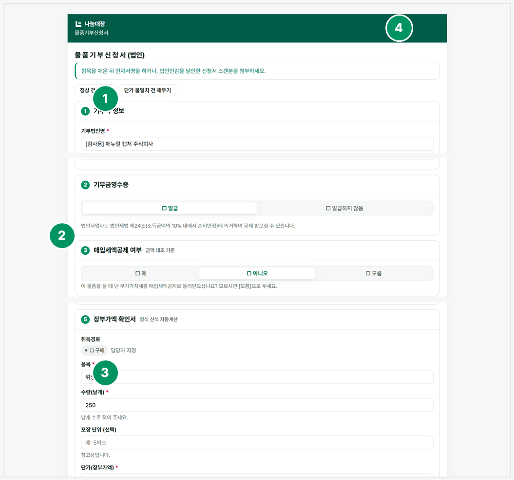

*후원자 신청서 (위쪽)*

1. **기부자 정보** — 법인명(개인은 이름) · 사업자등록번호(개인은 주민번호, 영수증 발급 시 필요) · 후원일자 · 주소 · 연락처.
2. **기부금영수증 · 매입세액공제** — 기부금영수증 발급 여부, 법인·개인사업자의 경우 매입세액공제 여부를 선택합니다.
3. **장부가액 확인서** — 품목 · 수량(낱개) · 단가 → 기부가액이 자동 계산됩니다. 계산과 다르게 적으면 비고에 사유가 필요합니다.
4. **이 화면이 곧 신청서** — 제출한 내용이 곧 신청서가 되므로, 별도 신청서 수취가 필요하지 않습니다. 후원자가 제출을 완료하면 신청서 PDF가 자동으로 생성되어 나눔대장에 저장됩니다.

> 💡 **유의** · 물품가액은 추후 AI 검수 시 AI가 총금액을 합계와 맞출지, 공급가액과 맞출지 정하는 값이 됩니다. 후원자 서류 제출 완료 후, 물품가액이 올바르게 입력되었는지 반드시 확인해 주세요.

### 4.4 후원자 화면(참고) — 첨부 · 직인 · 제출

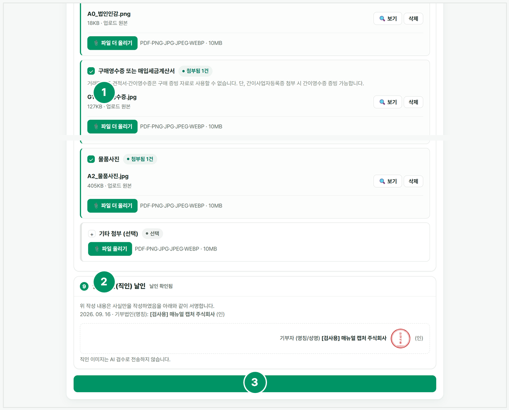

*후원자 신청서 (아래쪽)*

1. **증빙 파일 첨부** — 신규 접수에서 정해진 서류에 따라 입력 칸이 나옵니다. 칸이 하나라도 비면 제출할 수 없습니다. 오른쪽에 위치한 [보기]로 업로드한 파일을 확인할 수 있습니다.
2. **법인인감(직인) 날인** — 법인은 전자서명 대신 직인 이미지(PNG·JPG) 파일을 올립니다. 전자서명/이미지는 신청서 PDF 파일의 (인) 자리에 찍힙니다.
3. **제출하기** — 필수 항목이 다 차면 활성화됩니다. 제출하면 그 링크로는 화면이 다시 열리지 않고 담당자 화면에 "제출됨"으로 나타납니다.

> ※ 후원자가 제출했음에도 목록에서 확인되지 않으면 왼쪽 메뉴를 다시 누르거나 새로고침(Ctrl+Shift+R)을 실행해 보세요.

---

## 5. 후원건 목록 · 건 상세

### 5.1 후원건 목록

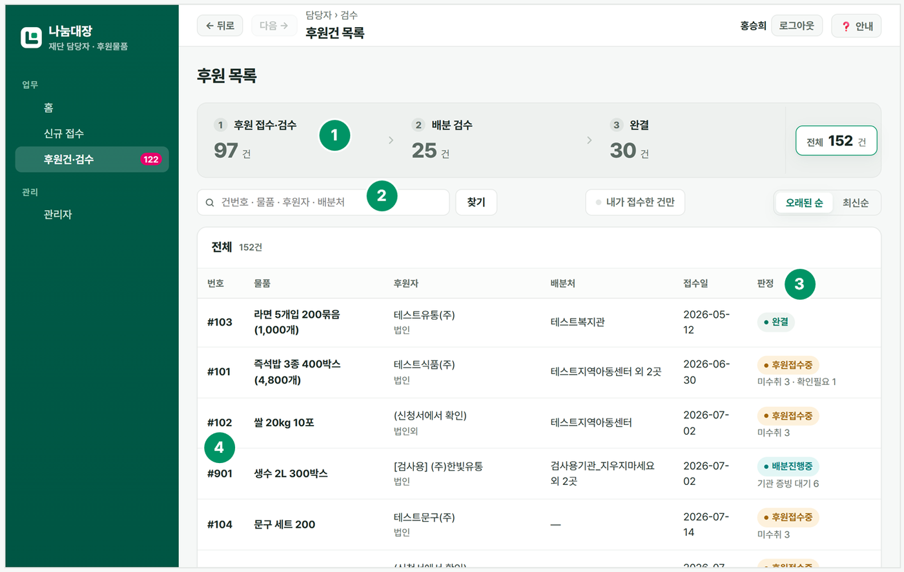

*후원건·검수 › 후원건 목록*

1. **구간별 건수** — ① 후원 접수·검수 ② 배분 검수 ③ 완결 — 지금 어느 단계에 몇 건이 있는지. 누르면 그 구간만 봅니다.
2. **검색 · 내가 접수한 건만** — 건번호·물품·후원자·배분처로 검색할 수 있습니다. [내가 접수한 건만]은 화면 필터입니다.
3. **판정 열** — 지금 상태와 해야 할 일이 한 줄로 보입니다. (예: 미수취 2 · 확인필요 1)
4. **행을 누르면 건 상세** — 접수번호를 눌러 건 상세로 들어갑니다.

### 5.2 건 상세 — 진행바 6칸이 곧 단계

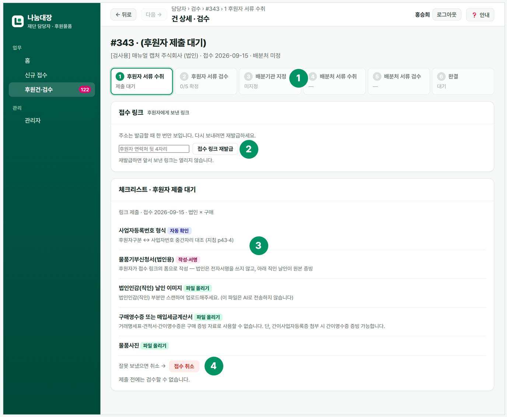

*후원건·검수 › 건 상세 (① 후원자 서류 수취 · 제출 대기)*

1. **진행바 6칸 = 탭** — ① 후원자 서류 수취 → ② 검수 → ③ 배분기관 지정 → ④ 배분처 서류 수취 → ⑤ 배분처 서류 검수 → ⑥ 완결. 다른 단계 칸을 누르면 그 단계 화면으로 이동합니다.
2. **접수 링크 · 재발급** — 후원자가 아직 내지 않은 건(제출 대기)에는 접수 링크 카드가 보입니다. 주소는 발급할 때 한 번만 보이므로, 링크를 잃었으면 뒷 4자리를 확인하고 [접수 링크 재발급]으로 처리합니다. 접수번호는 그대로 유지됩니다.
3. **체크리스트 · 후원자 제출 대기** — 유형×경로로 정해진 서류 목록을 미리 봅니다. 후원자가 제출하기 전에는 검수할 수 없습니다.
4. **[접수 취소]** — 잘못 보냈으면 여기서 취소합니다. 후원자가 자료를 제출한 뒤에는 이 자리에 수취 요약(받을·들어온·확정)과 서류별 행이 나타납니다 → [6.1](#61-검수-실행--ai-판정-읽기) 참고.

---

## 6. 검수 실행 · AI 판정 읽기

### 6.1 검수 실행 — AI 판정 읽기

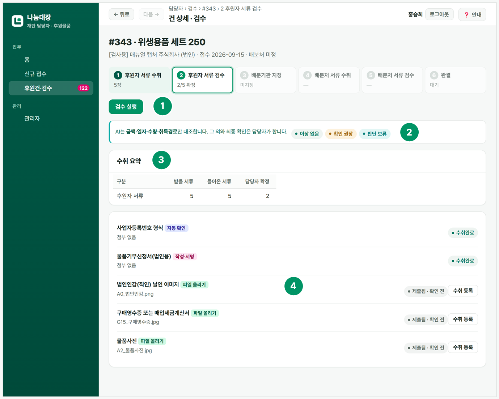

*건 상세 ② 후원자 서류 검수 (검수 실행 전)*

1. **[검수 실행]** — 후원자 서류가 들어오면 누릅니다. AI가 영수증 등에서 금액·일자·수량을 읽어 신청서 값과 대조합니다(약 10초 소요).
2. **AI 범위 안내** — AI는 금액·일자·수량·취득경로만 대조합니다. 그 외 내용과 최종 확인은 담당자 몫입니다.
3. **수취 요약** — 받을 서류 · 들어온 서류 · 담당자 확정으로 구분합니다. "들어온 서류"와 "담당자 확정" 건수가 다르면 담당자 확인이 남은 것입니다.
4. **서류별 행** — 제출됨 · 확인 전 = 후원자가 냈지만 담당자가 아직 보지 않은 것입니다. 검수 실행 후 [원본 보고 처리]로 하나씩 확정합니다. [수취 등록]은 담당자가 직접 서류 업로드 시에 사용합니다.

> ※ 검수 실행 뒤에는 이 버튼이 [다시 검수]로 바뀌고 결과 화면([6.2](#62-확인-권장-처리--원본-보고-사유-해소) 참고)이 열립니다.

### 6.2 확인 권장 처리 — 원본 보고 사유 해소

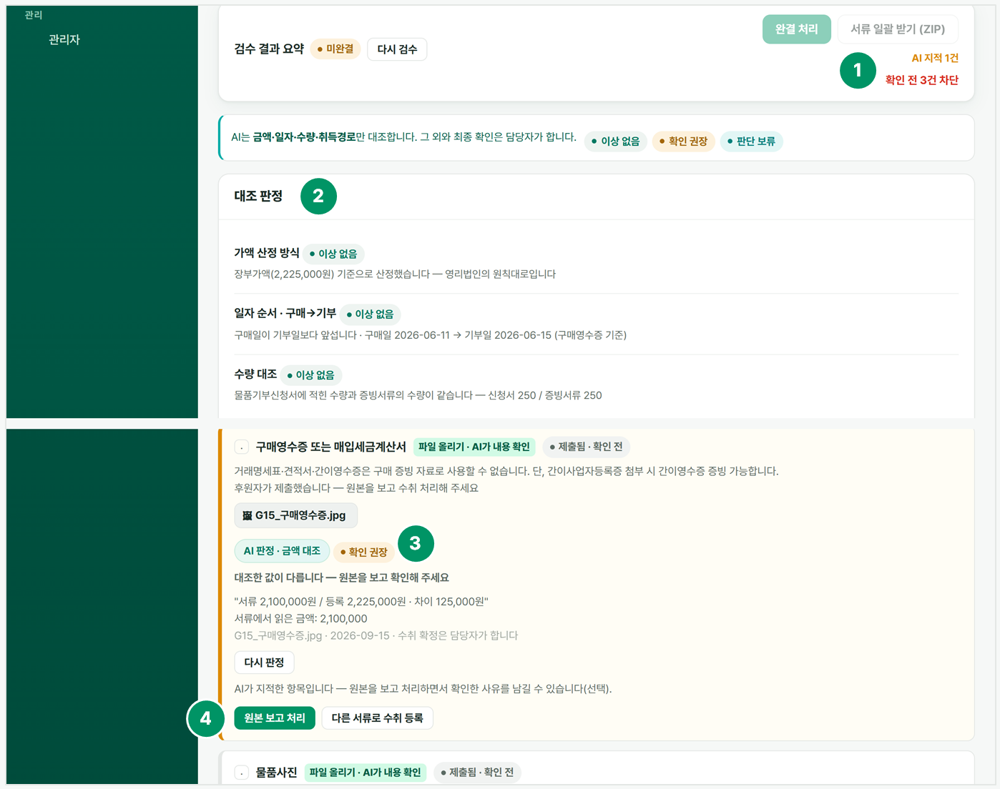

*건 상세 ② (검수 실행 뒤 · AI가 지적한 서류)*

1. **검수 결과 요약** — "AI 지적 1건 · 확인 전 3건 차단"처럼 완결을 막는 요인을 한 줄로 요약하여 보여 줍니다. 확인필요가 0이 될 때까지 [완결 처리]는 잠깁니다.
2. **대조 판정** — 규칙별 한 줄: 가액 산정 방식 · 일자 순서 · 수량 대조. 초록=이상 없음, 주황=확인 권장, 회색=판단 보류.
3. **AI 판정 카드 (확인 권장)** — AI가 읽은 값과 등록값이 나란히 보입니다(예: 서류 2,100,000원 / 등록 2,225,000원 · 차이 125,000원). AI는 오류를 단정하지 않고, "원본을 보고 확인해 주세요" 안내 문구로 담당자에게 확인을 요청합니다.
4. **[원본 보고 처리] → 사유 해소** — 원본 창에서 서류를 보고, 문제가 없으면 사유(선택)를 기재합니다. 사유는 "사유해소"로 기록에 남습니다. 다시 받은 서류는 [다른 서류로 수취 등록]으로 직접 등록할 수 있으며, AI를 다시 돌리려면 [다시 판정]을 누릅니다.

> 💡 **유의** · "확인 권장"은 오류 판정이 아닙니다 · 하나라도 남으면 ⑥ 완결이 잠깁니다. 잘못 확정했으면 [수취 취소].

---

## 7. 배분기관 지정 · 배분처 링크

### 7.1 배분기관 지정

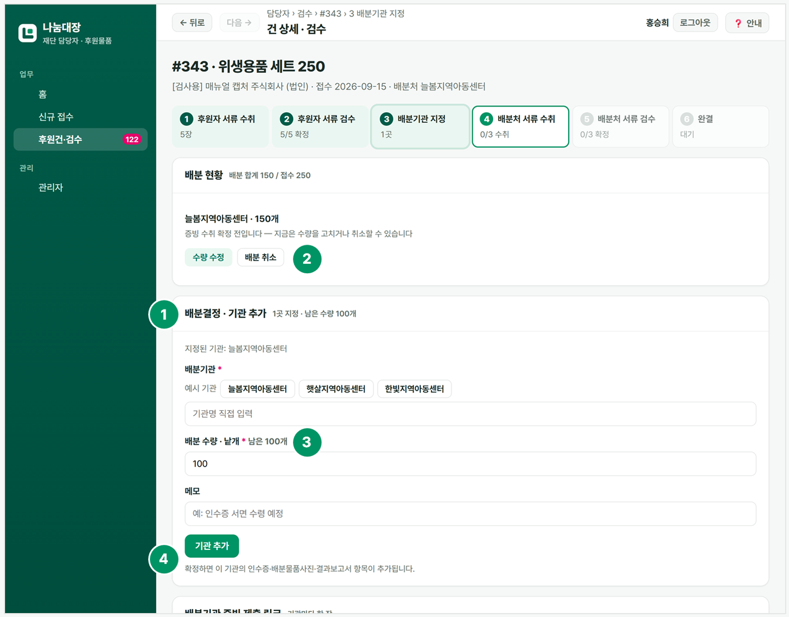

*건 상세 ③ 배분기관 지정 (확정 뒤 · 기관 추가 가능)*

1. **배분기관 · 수량 · 날짜 → 확정** — 후원자 서류 검수(②)가 끝나면 열립니다. 기관명과 배분 수량을 기입하고 [배분결정 확정]. 여러 기관이면 [기관 추가]를 반복하며 남은 수량을 배분합니다.
2. **배분 현황 — [수량 수정] · [배분 취소]** — 확정한 기관은 현황 카드로 보입니다. 배분처 증빙을 수취 확정하기 전까지는 수량을 고치거나 배분을 취소할 수 있습니다(취소는 사유와 함께 남음).
3. **남은 수량** — 접수 수량 대비 배분 합계와 남은 수량이 표시됩니다(예: 250 중 150 지정 · 남은 100). 남은 수량이 있으면 완결 화면에 "배분 진행 중"으로 표시됩니다.
4. **확정하면 자동으로** — 그 기관의 인수증·배분 물품 사진·결과보고서 항목이 추가되고 ④ 배분처 서류 수취로 넘어갑니다.

> 💡 **유의** · [수량 수정], [배분 취소]는 담당자가 배분처 증빙을 수취 확정하기 이전까지만 가능합니다. 배분 결정 내용 변경은 반드시 배분처 증빙서류 접수 이전에 진행해 주세요.

### 7.2 배분처 증빙 제출 링크 발급

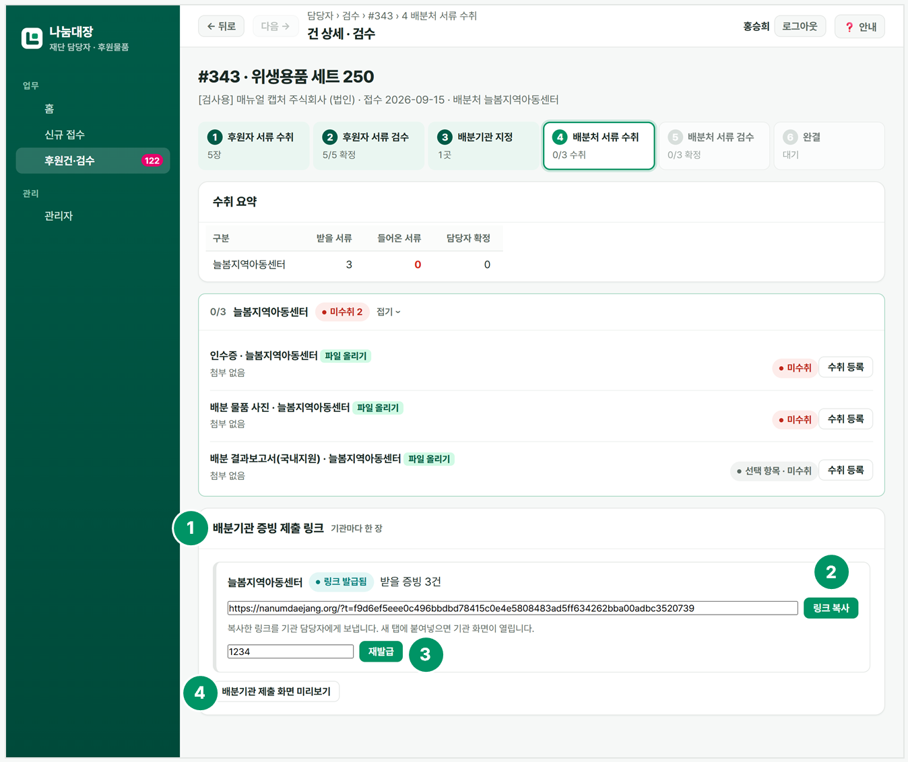

*건 상세 ④ 배분처 서류 수취 (링크 발급 뒤)*

1. **기관별 링크 카드** — ④ 아래에 배분기관마다 카드가 한 장씩 생성됩니다. 미발급 → 링크 발급됨 → 제출 완료로 바뀌고, 받을 증빙 건수가 표시됩니다.
2. **본인확인 뒷 4자리 → [증빙 제출 링크 발급] → [링크 복사]** — 담당자가 배분기관에 안내할 본인확인 값 4자리를 넣고 발급하면 링크가 생성됩니다. [링크 복사]로 배분기관에 안내합니다. (안내 문구는 [8.1](#81-배분기관에게-보낼-안내-문구) 참고)
3. **[재발급]** — 본인확인 값 4자리를 확인하고 재발급합니다. 링크를 재발급하는 경우 앞서 안내한 링크는 사용할 수 없습니다.
4. **[배분기관 제출 화면 미리보기] · 받을 증빙** — 기관이 어떤 화면에서 무엇을 내는지 미리 확인할 수 있습니다. 서류 목록은 기관이 내기 전에는 "미수취", 제출 시에는 "제출됨 · 확인 전"으로 바뀝니다.

---

## 8. 배분기관 안내

### 8.1 배분기관에게 보낼 안내 문구

**📩 배분기관 안내 문구**

```text
[기관명] 후원물품 배분 증빙 제출 안내

[배분기관명] 담당자님, 안녕하세요.
전달해 드린 후원물품(물품명, ○○개)의 인수 증빙을 아래 링크에서 작성해 주세요.

▶ 제출 링크: (담당자 생성 링크 삽입)
▶ 본인확인 번호: (담당자 생성 본인확인 번호 4자리 삽입)

작성하실 것
 · 인수증 — 제출 폼 화면 입력 후 전자서명
 · 배분 물품 사진 1장 이상 (아동에게 전달된 모습, 얼굴이 나오지 않게)
 · 배분 결과보고서 (필요 시)

실제 받은 수량이 전달 수량과 다른 경우 실제 수량을 기입해 주세요.
링크는 30일간 유효하며, 제출하시면 다시 열리지 않습니다.
문의: 담당자 ○○○ (02-000-0000)
```

**보내기 전에 확인**
- **배분결정이 확정됐나** — 확정 전에는 링크를 생성할 수 없습니다.
- **배분기관이 여럿이면** — 기관마다 링크가 다르게 생성되므로, 반드시 기관별 접수번호와 링크를 확인 후 발송해 주세요.
- **수량** — 기관에 전달한 수량이 카드에 적힌 배분 수량과 같은지 확인 후 전달합니다.

**배분기관이 자주 묻는 것**

| 질문 | 안내 |
|---|---|
| "직인을 찍어야 하나요" | 전자서명으로 충분합니다. 직인은 종이 인수증을 별도로 낼 때에 한하여 필요합니다. |
| "수량이 달라요" | 실제 수량을 적으면 담당자 화면에 차이가 표시됩니다. 사유는 담당자가 기재합니다. |
| "결과보고서가 아직 없어요" | 선택 항목이며, 담당자가 [수취 등록]으로 직접 올릴 수 있습니다. |

### 8.2 배분기관 화면(참고) — 인수증 작성

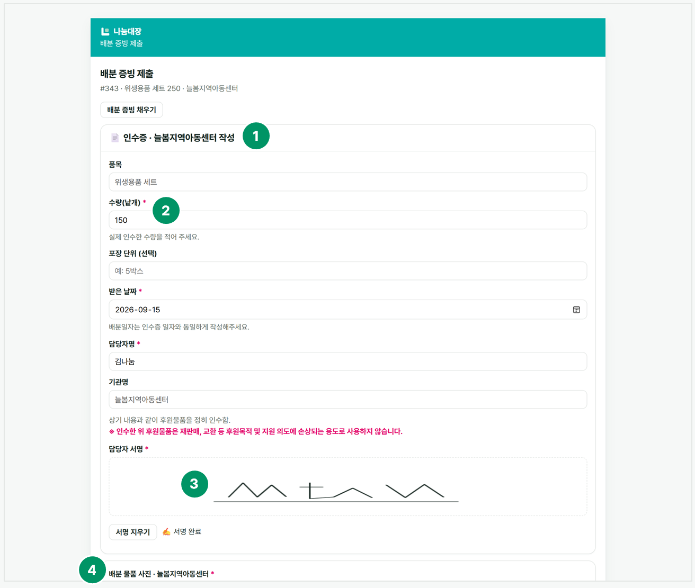

*배분기관이 링크를 열었을 때 (본인확인 뒤)*

1. **인수증 작성 (화면 폼)** — 품목은 자동. 수량(낱개)·받은 날짜·담당자명을 적습니다. 종이 인수증을 스캔해 올리는 방식이 아닙니다.
2. **수량 기재** — 배분 수량과 다르게 기입 시, 화면이 미리 알려 줍니다. 다만, 차이가 있다고 하여 제출 자체를 막지는 않습니다.
3. **담당자 서명** — 기관 담당자가 손으로 서명합니다. 재판매·교환 금지 다짐 문구가 인수증에 함께 찍힙니다.
4. **사진 · 보고서 · 제출** — 배분 물품 사진은 필수, 결과보고서는 선택. 확인 체크 뒤 [제출하기]. 제출하면 그 링크로는 화면이 다시 열리지 않습니다.

---

## 9. 배분처 서류 검수 · 완결

### 9.1 배분처 서류 검수 — 수량 대조

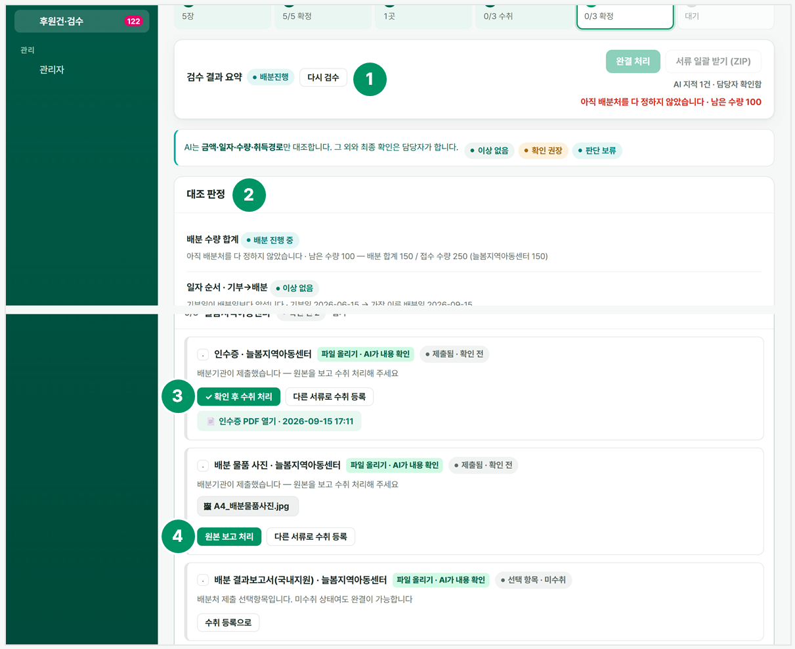

*건 상세 ⑤ 배분처 서류 검수 (검수 실행 뒤)*

1. **[검수 실행] 한 번 더 → 결과 요약** — 기관 증빙이 들어오면 ⑤에 [검수 실행]이 뜹니다. 실행 시 오른쪽에 "AI 지적 N건 · 담당자 확인할 것"과 남은 수량 등 완결을 막는 요인이 요약되어 보입니다.
2. **대조 판정 · 인수증 ↔ 배분** — 배분 수량 합계(남은 수량이 있으면 "배분 진행 중") · 일자 순서 · 인수증 수량이 배분 수량과 같은지 판정합니다. 등록값과 다른 경우, 판정 결과가 요약되어 표기됩니다.
3. **인수증 — [✓ 확인 후 수취 처리]** — 기관이 화면에서 작성한 인수증은 PDF로 만들어집니다. 담당자가 [인수증 PDF 열기]로 확인 후, 수취 처리합니다.
4. **사진·보고서 — [원본 보고 처리]** — 배분 물품 사진은 원본을 보고 확정합니다. 결과보고서는 선택 항목이라 없어도 완결할 수 있고, 나중에 [수취 등록]을 통해 담당자가 업로드할 수 있습니다. 확정한 배분처는 잠깁니다.

> 💡 **유의** · 결과보고서는 선택 항목(없어도 완결 가능) · 확정한 배분처는 잠깁니다(수정·취소 불가)

### 9.2 완결 · 서류 일괄 받기(ZIP)

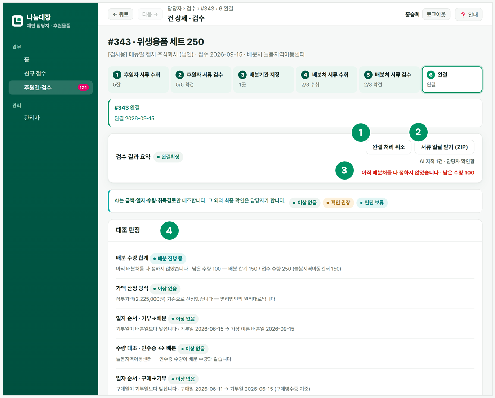

*건 상세 ⑥ 완결 (완결 처리 뒤)*

1. **[완결 처리] → 완결** — 후원자·배분처 서류가 모두 수취 확정이고, '확인필요'가 0이면 열립니다. 누르면 "#(건번호) 완결"로 바뀌고 ⑥이 켜지며, 그 자리는 [완결 처리 취소]가 됩니다.
2. **[서류 일괄 받기 (ZIP)]** — 완결하면 활성화됩니다. 신청서 PDF·인수증 PDF·첨부·대조 판정 내용을 한 파일로 내려받아 서류를 관리할 수 있습니다.
3. **요약 줄 — 처리 이력** — "AI 지적 1건 · 담당자 확인함"처럼 AI 지적을 담당자가 어떻게 처리했는지가 남습니다.
4. **대조 판정 · 수취 요약** — 후원자·배분처 쪽 판정과 요약 등 누가·무엇을·언제 확정했는지의 기록이 전부 남습니다.

> 💡 **유의** · 완결 뒤 빠진 것이 보이면 [완결 처리 취소] → 고친 뒤 다시 완결 · ZIP 내려받기는 기록에 남습니다

### 9.3 수취 등록 — 담당자가 직접 받은 서류

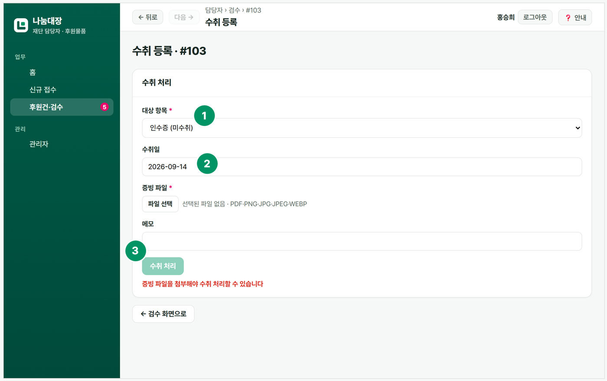

*후원건·검수 › 수취 등록*

1. **대상 항목** — 별도로 수령한 서류를 어느 항목으로 올릴지 고릅니다(미수취 항목만).
2. **수취일 · 증빙 파일 · 메모** — 받은 날짜와 파일(PDF·PNG·JPG·JPEG·WEBP · 용량 제한 10MB)을 기입합니다. 파일이 없으면 처리할 수 없습니다.
3. **[수취 처리]** — 올린 파일로 수취완료로 확정합니다. 잘못 올린 경우, 건 상세에서 [수취 취소].

> ※ 후원자가 링크로 낸 서류가 아니라 담당자가 직접 업로드한 서류이므로 "담당자 확정"으로 바로 처리됩니다.

---

## 10. 자주 있는 상황 · 유의사항

### 10.1 자주 있는 상황 — 무엇을 누르면 되는지

| 상황 | 이렇게 합니다 |
|---|---|
| 후원자에게 링크 재발송 필요 | 건 상세 ① [재발급] → 새 링크 전달. 접수번호 그대로. |
| 생성한 링크에 오류가 있어 수정 필요 · 중복 접수 | 신규 접수 또는 건 상세에서 [접수 취소]. 취소된 링크로는 제출이 안 되고, 목록에 취소 일자가 남습니다. |
| 후원자가 제출한 뒤 제출 내용에 대한 수정을 요청 | 제출본은 고칠 수 없습니다. [재발급]해 다시 받거나, 별도로 전달받은 파일을 [수취 등록]으로 담당자가 직접 올립니다. |
| AI가 '확인 권장'으로 판정했는데 서류 내용이 맞음 | 원본을 보고 사유를 적어 [사유로 해소]. 사유는 기록에 남습니다. |
| AI가 서류를 못 읽음 (판단 보류) | 담당자가 원본을 직접 보고 [수취 등록]으로 확정합니다. 흐린 사진 등 서류 자체의 문제라면 후원자·배분기관으로부터 다시 받습니다. |
| 수취 처리를 잘못 누름 | 완결 전이면 그 항목의 [수취 취소]. 파일은 그대로 두고 상태만 되돌립니다. |
| 배분 수량을 오기입함 | 배분처 증빙을 수취 확정하기 전이면 ③에서 수정·취소. 확정 뒤에는 수정할 수 없습니다. |
| 여러 기관에 나누어 배분하고자 함 | ③에서 기관을 하나씩 [배분결정 확정]. 기관마다 링크가 생성되며 ⑤에서 기관별로 확인할 수 있습니다. |
| 완결 처리 이후에 누락을 발견함 | ⑥ [완결 처리 취소] → 고친 뒤 다시 완결. |
| 후원자가 제출했다고 하는데 담당자 화면에 안 보임 | 왼쪽 메뉴를 다시 누르거나 새로고침(Ctrl+Shift+R). 검수 진행 중에는 자동으로 다시 읽지 않습니다. |

### 10.2 유의사항 — 꼭 지킬 것

**개인정보**
- **신청서 PDF** — 후원자 개인정보의 유일한 사본입니다. 내려받은 파일을 개인 PC·메신저에 남기지 마세요.
- **열람 기록** — PDF를 열면 기록이 남습니다.
- **배분 증빙 사진** — 아동 얼굴이 나온 사진은 다시 수령합니다.
- **공용 PC 작업** — 작업 후 반드시 로그아웃하세요.

**AI 판정**
- **참고값** — 이상 없음이어도, 최종 확정은 담당자가 합니다.
- **판정 범위** — 금액·일자·수량·취득경로만 봅니다. 서명·직인·사진 내용은 보지 않습니다.
- **AI 호출** — 한 번 판정을 완료한 서류는 다시 호출하지 않습니다. 수정사항이 있는 경우에는 새로운 파일로 재판정합니다.

**접수·링크**
- **유형·경로 확인 후 발급** — 필요 서류가 달라집니다. 반드시 확인 후 후원자에게 링크를 안내해 주세요.
- **본인확인 값** — 링크와 함께 반드시 전달해야 합니다. 본인확인 값이 있어야만 접속할 수 있습니다.
- **30일 만료** — 만료 전에 제출을 독려합니다. 만료기간이 지나면 재발급이 필요합니다.

**파일·브라우저**
- **형식** — PDF·PNG·JPG·JPEG·WEBP, 파일당 10MB까지 업로드할 수 있습니다.
- **브라우저** — 크롬 사용을 권장합니다.

---

**나눔대장** — 접수부터 완결까지, 빠진 서류를 먼저 잡아냅니다.
